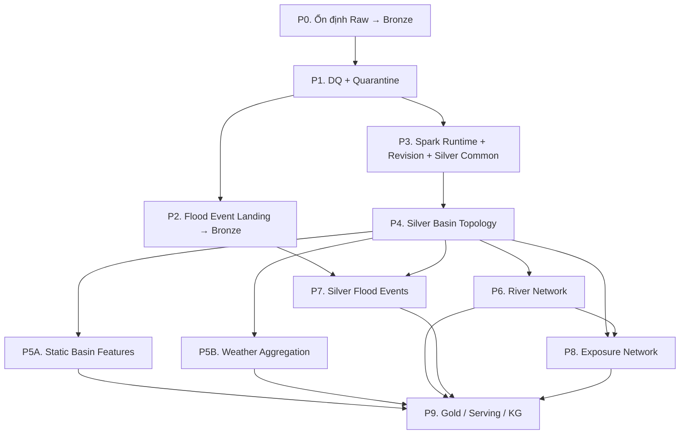

# TODO ưu tiên triển khai FloodLakeKG

**Cập nhật:** 20/10/2026

**Mục tiêu:** sắp xếp các plan hiện có theo dependency thực tế, tránh triển khai Silver rồi phải sửa lại toàn bộ vì DQ, revision hoặc idempotency chưa được chốt.

## Cách sử dụng file này

- Đây là master backlog và thứ tự ưu tiên tổng thể.
- Mỗi checkbox cấp `P` là một milestone có thể nghiệm thu độc lập.
- Các plan tiếng Anh và tiếng Việt cùng tên là hai bản của cùng một kế hoạch, không phải hai task khác nhau.
- Chỉ đánh dấu milestone hoàn thành khi tiêu chí nghiệm thu của milestone đã đạt.
- Các plan file-first L10 cũ không thuộc backlog hiện tại. Kiến trúc hiện hành dùng L12, MinIO, Iceberg và Airflow DAG.
- Refactor package đã hoàn tất: không còn `flashflood_data.static`; AOI, static Landing/Bronze,
  weather, flood event và Silver feature kernel có owner riêng. Đây là baseline cho các milestone dưới.

## Dependency tổng thể

## Trạng thái tổng quan

| Ưu tiên | Milestone | Loại công việc | Trạng thái |
| ---: | --- | --- | --- |
| P0 | Ổn định Raw → Bronze | Audit và sửa khoảng trống | Chưa nghiệm thu |
| P1 | DQ framework + quarantine | Đã tích hợp Landing/Bronze, migration và runbook; chờ rollout audit dữ liệu thật | Sẵn sàng rollout |
| P2 | Flood Event Sources Landing → Bronze | Đã có spec và plan cho news; historical cần plan riêng | Chưa có DAG |
| P3 | Spark runtime + revision contract + Silver common | Shared foundation đã xong; còn revision contract và Airflow submit | Đang triển khai |
| P4 | Silver Basin Topology | Triển khai plan đã có | Chưa triển khai |
| P5A | Silver Static Basin Features | Triển khai plan đã có | Chưa triển khai |
| P5B | Silver Weather Aggregation | Triển khai plan đã có | Chưa triển khai |
| P6 | Silver River Network | Triển khai plan đã có | Chưa triển khai |
| P7 | Silver Flood Events | Triển khai sau P2 và P4 | Chưa triển khai |
| P8 | Silver Exposure Network | Triển khai sau P4 và P6 | Chưa triển khai |
| P9 | Gold, Serving, KG, dashboard | Lập plan sau khi Silver ổn định | Chưa bắt đầu |

---

## P0 — Ổn định và nghiệm thu Raw → Bronze hiện tại

**Lý do làm trước:** incremental loading đã được triển khai ở mức asset/window/object. Cần chứng minh nó hoạt động và sửa các khoảng trống đã biết trước khi thay contract DQ.

- [ ] Chạy hoặc đối soát các backfill static cần thiết.
- [ ] Chạy hoặc đối soát GSMaP NOW, GSMaP Standard, ERA5-Land và IFS đã cấu hình.
- [ ] Kiểm tra `meta.source_objects`, `meta.pipeline_runs`, `meta.lineage_edges`, `meta.quality_results` và snapshot Bronze.
- [ ] Trigger lại static Landing khi không có asset mới; xác nhận không upload lại payload hợp lệ.
- [ ] Trigger lại static Bronze khi không có object mới; xác nhận mapped parse rỗng.
- [ ] Trigger lại weather catch-up; xác nhận không fetch toàn bộ lịch sử.
- [ ] Tạo tình huống thiếu một weather window; xác nhận chỉ window thiếu và bounded overlap được lập kế hoạch.
- [ ] Tạo tình huống thiếu Bronze evidence của một object; xác nhận chỉ object đó được parse lại.
- [ ] Sửa nhận diện `wv0010` trong static SoilGrids Bronze parser và tăng parser version.
- [x] Chốt semantic GSMaP `value_kind`: cấu hình và Bronze đều ghi `rate` (`mm/h`); Raw cũ mang nhãn `preceding_hour_sum` vẫn được nhận diện khi lập kế hoạch và tái sử dụng manifest.
- [ ] Chạy contract/unit test Raw → Bronze.
- [ ] Tạo checkpoint Git trước khi triển khai P1.

**Không xây lại incremental subsystem ở milestone này.** Cơ chế hiện có gồm:

- static reuse asset/tile local đã xác minh;
- HTTP resume khi provider hỗ trợ Range;
- weather planner dùng watermark, inventory, safe end và bounded overlap;
- Bronze discover theo `object_id`, lineage, succeeded run và output còn tồn tại;
- Iceberg writer replace đúng các object của batch, không overwrite toàn bảng.

**Tài liệu:** [raw_to_bronze_workflow.md](raw_to_bronze_workflow.md)

### Tiêu chí nghiệm thu P0

- [ ] Rerun không có dữ liệu mới tạo `0` fetch và `0` parse ngoài overlap có chủ ý.
- [ ] Thiếu một asset/window không kéo theo full backfill.
- [ ] Retry không tạo dòng trùng cho cùng `object_id`.
- [ ] Checksum mismatch chặn object trước khi parse.
- [ ] Các khoảng trống `wv0010` và GSMaP semantic có quyết định/code/test rõ ràng.

---

## P1 — DQ framework và quarantine đa tầng

**Lý do đứng trước Silver:** nếu Silver được xây trước, việc bổ sung fatal/reject/warning sau đó sẽ buộc sửa lại reader, writer, audit và retry của mọi domain pipeline.

- [x] Triển khai model chung cho `block_object`, `reject_rows`, `accept_with_warning` và `pass`.
- [x] Tạo policy loader và policy hash có version.
- [x] Tạo physical contract `quarantine.rejected_objects`.
- [x] Tạo physical contract `quarantine.rejected_rows`.
- [x] Tạo `rejection_id` xác định, không chứa Airflow run ID.
- [x] Xây coordinator xử lý quarantine commit, output commit, Meta audit và repair.
- [x] Áp dụng vào static Bronze.
- [x] Đổi static object batch failure thành outcome theo object khi phù hợp.
- [ ] Áp dụng vào dynamic weather Bronze ở grain raster slice.
- [x] Bảo vệ lifecycle: Raw transient không được expire nếu Bronze/DQ evidence chưa đủ.
- [x] Áp dụng object-level DQ vào Landing.
- [ ] Tạo migration/dry-run cho dữ liệu hiện có mà không gọi provider mặc định.
- [x] Cập nhật contract Silver/Gold để dùng DQ coordinator ngay từ đầu.
- [x] Thêm integration smoke có namespace cô lập và runbook xử lý quarantine/reprocess.

**Plan:** [2026-10-05-layered-data-quality-quarantine.vi.md](superpowers/plans/2026-10-05-layered-data-quality-quarantine.vi.md)

### Tiêu chí nghiệm thu P1

- [ ] Fatal object không ghi dữ liệu vào bảng đích.
- [x] Batch có row lỗi vẫn ghi row hợp lệ và đưa row lỗi vào quarantine.
- [x] Warning vẫn được publish với `quality_status=warning`.
- [ ] Retry cùng input/rule/policy không nhân bản rejection.
- [ ] Operational failure không xóa output tốt trước đó.
- [x] Có đường reprocess quarantine rõ ràng và có checkpoint.

---

## P2 — Các pipeline nguồn Flood Event Landing → Bronze

**Lý do:** flood event đã bị loại khỏi hai static DAG nhưng chưa có pipeline nguồn độc lập. File lịch sử có cấu trúc và bài báo là hai kiểu nguồn khác nhau nên có Landing/Bronze riêng, sau đó cùng hội tụ ở Silver mention.

### P2A. File sự kiện lịch sử có cấu trúc

- [ ] Chốt loại đầu vào: Excel/CSV, point, administrative reference và flood footprint nếu có.
- [ ] Chốt source/asset/object identity.
- [ ] Chốt schema Bronze và quy tắc revision record.
- [ ] Chốt object-level và row-level DQ.
- [ ] Chốt cách tiếp nhận lại 32 record cũ mà không ingest trùng.
- [ ] Viết design/spec.
- [ ] Viết implementation plan chi tiết.
- [ ] Tạo config source/landing/bronze riêng cho flood event.
- [ ] Tạo DAG `flood_event_landing`.
- [ ] Resolve file mới và reuse file/object cũ.
- [ ] Publish Raw payload + manifest và đăng ký `meta.source_objects`.
- [ ] Parse record vào `bronze.historical_event_raw`.
- [ ] Quarantine file corrupt hoặc schema sai hoàn toàn ở object level.
- [ ] Quarantine record lỗi ở row level; vẫn publish record hợp lệ.
- [ ] Ghi run, quality, snapshot và lineage.
- [ ] Thêm migration/adoption cho dữ liệu cũ.
- [ ] Xác nhận thêm một file event mới không làm parse lại toàn bộ lịch sử.

### P2B. Bài báo lũ

- [x] Chốt thiết kế Raw HTTP payload → Bronze full text → Silver mention/event.
- [x] Viết implementation plan Landing riêng.
- [x] Viết implementation plan Raw → Bronze riêng.
- [ ] Triển khai DAG `flood_news_landing` để fetch/reuse/revision và publish Raw payload + manifest.
- [ ] Triển khai DAG `flood_news_to_bronze` để parse full text, metadata, keyword triage và DQ.
- [ ] Xác nhận parser/selector version mới có thể parse lại từ Raw mà không crawl lại.
- [ ] Xác nhận một article revision mới tồn tại song song Raw revision cũ và Bronze chọn được revision bằng policy.

**Thiết kế:** [2026-10-09-flood-news-to-events-design.vi.md](superpowers/specs/2026-10-09-flood-news-to-events-design.vi.md)

**Plan News Landing:** [2026-10-09-flood-news-landing.vi.md](superpowers/plans/2026-10-09-flood-news-landing.vi.md)

**Plan News Raw → Bronze:** [2026-10-09-flood-news-bronze.vi.md](superpowers/plans/2026-10-09-flood-news-bronze.vi.md)

### Tiêu chí nghiệm thu P2

- [ ] Các DAG có thể bổ sung file lịch sử hoặc bài báo mới độc lập với static pipeline.
- [ ] Retry idempotent theo object và source record.
- [ ] 32 record cũ không bị nhân đôi.
- [ ] `bronze.historical_event_raw` và `bronze.news_article_raw` là dependency ổn định cho P7.

---

## P3 — Spark runtime, revision contract và Silver common foundation

**Lý do:** mọi Silver pipeline phải dùng cùng Spark runtime và cùng cách pin snapshot, chọn revision,
tạo stable ID, DQ, commit và repair. Kiến trúc chuẩn nằm tại
[spark_bronze_to_silver_architecture.md](spark_bronze_to_silver_architecture.md).

### P3.0. Hoàn thiện Spark/Sedona runtime

- [x] Chốt compatibility matrix Java 17, Spark 4.1.3, Scala 2.13, Iceberg 1.11.0, Sedona 1.9.1 và GeoTools wrapper 1.9.1-33.5.
- [x] Hoàn thiện Spark image/profile Compose local; image đã build và chạy trên Linux, WSL2 còn cần teammate smoke xác nhận.
- [x] Cấu hình Polaris REST catalog và MinIO S3 endpoint/path-style trong Spark session dùng chung.
- [x] Thêm gateway nội bộ để Airflow gọi `spark-submit`; Spark driver không chạy trong scheduler.
- [ ] Smoke đọc Bronze theo snapshot ID, ghi/đọc/xóa bảng Iceberg thử nghiệm bằng Trino.
- [x] Chốt resource profile local cho driver/executor và không dùng cấu hình cluster lớn mặc định.

### P3.1. Chốt revision contract dùng chung

- [ ] Định nghĩa `revision_group_key` cho static vector, static raster và weather slice.
- [ ] Chuẩn hóa `source_revision`, `provider_issued_at`, `available_at`, `valid_from`, `valid_to` và `supersedes_object_id` khi nguồn hỗ trợ.
- [ ] Định nghĩa `RevisionPolicy` có version theo source/product.
- [ ] Chọn quality-eligible row trước khi rank revision.
- [ ] Ưu tiên explicit provider revision nếu có.
- [ ] Dùng provider-issued/valid time theo policy nguồn.
- [ ] Dùng available/retrieved time và `object_id` làm tie-break tất định.
- [ ] Cấm dùng `MAX(source_version)` dạng chuỗi làm policy chung.
- [ ] Phân biệt source revision với source/product precedence.
- [ ] Bổ sung metadata static để biểu diễn supersession hoặc validity interval.

### P3.2. Triển khai Silver common

- [ ] Canonical hash và stable business ID.
- [x] Input snapshot discovery và snapshot pinning.
- [x] Incremental build identity theo input snapshot + config/policy version.
- [x] Staging manifest trên MinIO theo run/batch, có `_SUCCESS`, checksum và schema hash.
- [x] Shared Spark session, submit contract, snapshot reader, DQ, publish và audit.
- [x] Một publisher chỉ sở hữu một commit cho một bảng; mapped worker chỉ ghi staging.
- [x] Idempotent MERGE, build `skip/repair` và fake-domain crash-repair gate.
- [x] DQ split và projection đúng schema `quarantine.rejected_rows`.
- [x] Ghi pipeline run, quality, snapshot reference theo batch và Bronze → Silver lineage.
- [x] Factory/dependency container dùng chung, không chứa rule nghiệp vụ domain.

**Plan runtime hiện hành:** [2026-10-10-spark-silver-foundation.vi.md](superpowers/plans/2026-10-10-spark-silver-foundation.vi.md)

**Plan common cũ chỉ còn tham chiếu contract:** [2026-09-30-silver-common-foundation.vi.md](superpowers/plans/2026-09-30-silver-common-foundation.vi.md)

### Tiêu chí nghiệm thu P3

- [ ] Hai revision Raw/Bronze của cùng logical slice chỉ tạo một current Silver row theo policy.
- [ ] Có thể tái hiện Silver theo input snapshot/policy version cũ.
- [ ] Rerun cùng input không tạo build hoặc row trùng.
- [ ] Revision mới chỉ làm dirty logical group bị ảnh hưởng.
- [x] Basin topology dùng chung Spark discovery/DQ/publisher/audit contract; các domain tiếp theo tái sử dụng cùng foundation.
- [x] Airflow XCom của Silver basin chỉ chứa plan/result DTO, không chứa DataFrame, GeoDataFrame, raster hoặc full row list.

---

## P4 — Silver Basin Topology

**Lý do:** `silver.dim_basin` và basin version là dependency của static features, weather aggregation, river, event và exposure.

- [x] Chọn revision HydroBASINS và BasinATLAS authoritative đã có trong pinned Bronze snapshot.
- [x] Dùng Spark/Sedona đọc pinned Bronze snapshot, normalize geometry và join allowlist Atlas.
- [x] Normalize bằng Spark/Sedona, không collect row về Python/Shapely driver.
- [x] Dùng HydroBASINS làm nguồn geometry/topology chính.
- [x] Join allowlist BasinATLAS bằng `HYBAS_ID` trong normalization plan.
- [x] Tạo stable `basin_id` và `basin_version`.
- [x] Publish idempotent `silver.dim_basin` bằng Spark MERGE.
- [x] Tạo directed edge theo `NEXT_DOWN` và publish `silver.basin_edge`.
- [x] Kiểm tra duplicate, missing internal target và cycle bằng domain DQ.
- [x] Ghi lineage đến Bronze snapshot và cả HydroBASINS/BasinATLAS object.
- [x] Skip build khi input snapshot, mapping version và policy version không đổi; repair output thiếu.

**Plan:** [2026-09-30-silver-basin-topology.vi.md](superpowers/plans/2026-09-30-silver-basin-topology.vi.md)

### Tiêu chí nghiệm thu P4

- [ ] Đối chiếu production: mỗi basin L12 current có đúng một dòng trong `silver.dim_basin`.
- [x] Integration smoke chứng minh topology không cycle và internal downstream target hợp lệ trên fixture.
- [x] Basin version thay đổi xác định theo build signature của input/config/policy/algorithm.
- [ ] Trigger production và xác nhận các pipeline P5–P8 pin đúng basin snapshot/version.

---

## P5A — Silver Static Basin Features

P5A và P5B có thể triển khai song song sau P4.

- [ ] Aggregate elevation, relief và terrain slope từ DEM.
- [ ] Dùng Spark lập dirty-basin plan, spatial/tabular transform, DQ và Iceberg publish.
- [ ] Python/Rasterio chỉ xử lý raster/hydrology chưa phù hợp với Sedona rồi ghi Parquet staging.
- [ ] Tính flow direction, flow accumulation, outlet và longest flow path.
- [ ] Tính source/outlet elevation, main-channel slope, `tc_hours` và `kb_*`.
- [ ] Aggregate SoilGrids theo depth band.
- [ ] Tính field capacity, wilting point, AWC và uncertainty.
- [ ] Aggregate WorldCover theo basin.
- [ ] Join field BasinATLAS đã duyệt.
- [ ] Publish derived raster/object với lineage riêng, không giả làm Raw source object.
- [ ] Recompute chỉ basin/source group bị dirty khi revision thay đổi.

**Plan:** [2026-09-30-silver-basin-static-features.vi.md](superpowers/plans/2026-09-30-silver-basin-static-features.vi.md)

### Tiêu chí nghiệm thu P5A

- [ ] Có một feature row/current version cho mỗi basin đủ dữ liệu.
- [ ] Field bắt buộc có unit và provenance rõ ràng.
- [ ] Nodata/coverage thấp được DQ xử lý, không tự điền 0.
- [ ] Thay một raster revision không buộc tính lại source không liên quan.

---

## P5B — Silver Weather Aggregation

- [ ] Triển khai dưới dạng Spark/Sedona job; Airflow chỉ submit/monitor và audit.
- [ ] Xây grid–basin intersection weights.
- [ ] Cache weights theo source grid version, basin version và geometry-processing version.
- [ ] Chỉ build tổ hợp weight còn thiếu.
- [ ] Map `cell_indices` sang source grid chính xác.
- [ ] Aggregate mỗi raster slice theo diện tích giao basin.
- [ ] Không coi missing/nodata là 0.
- [ ] Ghi `valid_coverage_fraction`.
- [ ] Chọn revision mới nhất trong cùng product/cycle/window.
- [ ] Giữ NOW, Standard, ERA5-Land và IFS thành observation riêng.
- [ ] Áp dụng source/product precedence ở view hoặc bước consumption riêng.
- [ ] Incremental theo slice/business key, không scan lại toàn timeline.

**Plan:** [2026-09-30-silver-weather-aggregation.vi.md](superpowers/plans/2026-09-30-silver-weather-aggregation.vi.md)

### Tiêu chí nghiệm thu P5B

- [ ] Mỗi basin/window/product/revision có business key xác định.
- [ ] NOW lệch 30 phút không bị Standard xóa.
- [ ] ERA5-Land và IFS giữ provenance riêng.
- [ ] Late/revised slice chỉ cập nhật logical window liên quan.

---

## P6 — Silver River Network

- [ ] Dùng Spark/Sedona cho normalize, spatial join và metric overlay; Python graph job chỉ khi cần.
- [ ] Chọn HydroRIVERS revision authoritative.
- [ ] Chuẩn hóa reach và stable `reach_id`.
- [ ] Xây directed river topology.
- [ ] Liên kết reach với basin version.
- [ ] Tính chiều dài giao basin trong metric CRS.
- [ ] Kiểm tra duplicate, cycle và downstream target.
- [ ] Incremental theo river snapshot, basin version và processing version.

**Plan:** [2026-09-30-silver-river-network.vi.md](superpowers/plans/2026-09-30-silver-river-network.vi.md)

### Tiêu chí nghiệm thu P6

- [ ] River graph có hướng và không cycle ngoài trường hợp policy cho phép rõ ràng.
- [ ] Mỗi reach có stable identity và provenance.
- [ ] River–basin relation dùng đúng basin version.

---

## P7 — Silver Flood Events

**Phụ thuộc:** P2 có `bronze.historical_event_raw` và/hoặc `bronze.news_article_raw`; P3 có Silver common; P4 có `silver.dim_basin`.

- [ ] Chọn revision đầu vào và publish `silver.source_document` có version.
- [ ] Dùng Spark cho revision selection, normalize/consolidate, DQ và event–basin spatial join.
- [ ] Rule/NLP extractor chạy Python và chỉ trả mention evidence qua staging.
- [ ] Trích xuất `silver.flood_event_mention` có evidence span/hash.
- [ ] Cho phép một document sinh nhiều mention và nhiều document cùng dẫn tới một event.
- [ ] Chuẩn hóa stable `flood_event_id`.
- [ ] Tăng `event_revision` khi nội dung chuẩn hóa thay đổi.
- [ ] Duy trì `is_current` và lịch sử revision.
- [ ] Ghi `silver.event_evidence` theo `mention_id`, không theo document chunk.
- [ ] Liên kết event với một hoặc nhiều basin version.
- [ ] Chỉ tính affected area khi có footprint đã xác minh.
- [ ] Point/admin reference chỉ tạo liên kết, không tự sinh affected area.
- [ ] Quarantine event không đạt policy.
- [ ] Ghi lineage từ Raw/Bronze event tới event và event-basin Silver rows.

**Plan hiện hành:** [2026-10-09-flood-event-silver.vi.md](superpowers/plans/2026-10-09-flood-event-silver.vi.md)

Plan ngày 30/09 chỉ còn để tham chiếu lịch sử vì chưa hỗ trợ bài báo, mention/evidence và nhiều tài liệu cho một event.

### Tiêu chí nghiệm thu P7

- [ ] Rerun cùng evidence không tăng revision.
- [ ] Extractor version mới chỉ chạy lại từ `source_document`, không crawl/parse Bronze lại.
- [ ] Nội dung chuẩn hóa đổi mới tăng đúng một revision.
- [ ] Event–basin không trùng và không dùng basin version mơ hồ.
- [ ] Affected area chỉ xuất hiện khi có bằng chứng footprint.

---

## P8 — Silver Exposure Network

**Phụ thuộc:** P4 basin và P6 river network.

- [ ] Chọn OSM/WorldPop revision authoritative.
- [ ] Dùng Spark/Sedona xử lý OSM, spatial relation và population aggregation.
- [ ] Chuẩn hóa facility, road, bridge và hydraulic structure.
- [ ] Aggregate WorldPop theo basin/grid.
- [ ] Xây road graph có version.
- [ ] Liên kết facility/road với basin.
- [ ] Xác định crossing road–river.
- [ ] Phân biệt crossing có bằng chứng bridge/ford với giao hình học `unknown`.
- [ ] Incremental theo source snapshot, basin version và river version.

**Plan:** [2026-09-30-silver-exposure-network.vi.md](superpowers/plans/2026-09-30-silver-exposure-network.vi.md)

### Tiêu chí nghiệm thu P8

- [ ] Facility/road identity ổn định theo OSM snapshot và processing version.
- [ ] Population aggregation không tạo grid registry thứ hai.
- [ ] Crossing classification không suy diễn quá mức bằng geometry.

---

## P9 — Gold, Serving, KG và dashboard

Chỉ lập plan chi tiết sau khi các Silver output cần thiết ổn định.

- [ ] Chốt Gold forcing theo basin/window/scenario.
- [ ] Chốt hydrological state và routing input revision.
- [ ] Chốt flood assessment và impact indicators.
- [ ] Xây `serving.basin_latest` bằng quy tắc latest tất định.
- [ ] Phân biệt `NO_DATA` với mức nguy cơ thấp.
- [ ] Project Silver/Gold sang KG có version.
- [ ] Xây map/dashboard sau khi schema serving ổn định.

### Tiêu chí bắt đầu P9

- [ ] `silver.dim_basin` ổn định.
- [ ] Static feature, weather và river pipeline có DQ/lineage/revision đầy đủ.
- [ ] Ít nhất một end-to-end run có thể tái hiện từ pinned snapshots.

## Thứ tự thực hiện ngắn gọn

1. P0 — audit và checkpoint Raw → Bronze.
2. P1 — DQ framework + quarantine.
3. P2 — Flood Event Landing → Bronze.
4. P3 — Spark runtime + revision contract + Silver common.
5. P4 — Silver Basin Topology.
6. P5A và P5B — Static Features và Weather Aggregation.
7. P6 — River Network.
8. P7 — Silver Flood Events.
9. P8 — Exposure Network.
10. P9 — Gold, Serving, KG và dashboard.

## Gợi ý chia hai người

Sau khi P1 hoàn thành:

| Người 1 | Người 2 |
| --- | --- |
| P2 Flood Event Landing → Bronze | P3 Spark Runtime + Revision + Silver Common |

Sau khi P4 hoàn thành:

| Người 1 | Người 2 |
| --- | --- |
| P5A Static Basin Features | P5B Weather Aggregation |

Tiếp theo:

| Người 1 | Người 2 |
| --- | --- |
| P6 River Network → P8 Exposure | P7 Silver Flood Events và integration test |
