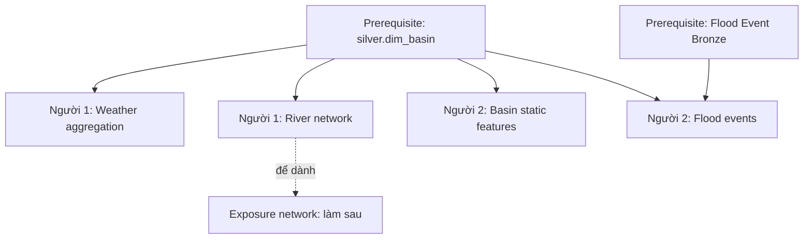

# Phân công triển khai Bronze → Silver cho hai người

> **Cập nhật 17/10/2026:** Phân công này chỉ bao gồm bốn pipeline Silver chuẩn bị triển khai.
> Shared Spark foundation và basin topology không tính vào khối lượng bên dưới. Exposure network,
> Gold, Knowledge Graph và các pipeline khác sẽ được phân công sau.

## 1. Phạm vi và prerequisite

Hai người dùng chung runtime tại `src/flashflood_data/shared/spark/`, gồm snapshot pinning,
build signature, staging, DQ/quarantine, Iceberg publisher và Meta audit. Không pipeline nào được
tạo lại một framework publish hoặc audit riêng.

Các prerequisite ngoài phạm vi phân công:

| Prerequisite | Trạng thái sử dụng |
| --- | --- |
| Shared Spark foundation | Đã có thể dùng để phát triển domain job và chạy smoke. |
| `silver.dim_basin` và `silver.basin_edge` | Cần có trước khi integration test bằng dữ liệu thật và trước khi publish production. |
| Flood-event Landing/Bronze | Cần có trước khi chạy production Silver Flood Events; trong lúc chờ dùng fixture cho unit/integration test cô lập. |

Cả hai người có thể bắt đầu config, model, transform, DQ và fixture ngay. Nếu basin topology chưa
publish, không ghi dữ liệu giả vào bảng Silver production để thay prerequisite.

## 2. Phân công tổng thể

| Người | Pipeline phụ trách | Trọng tâm |
| --- | --- | --- |
| **Người 1** | Weather aggregation; River network | Dữ liệu động theo cửa sổ thời gian, grid–basin weights, geometry sông và directed river graph |
| **Người 2** | Basin static features; Flood events | Raster/hydrology theo basin, SoilGrids/land cover và chuẩn hóa evidence thành event |



Mỗi pipeline có một owner chính. Người còn lại review contract và cách sử dụng shared Spark,
không cùng sửa logic nghiệp vụ trên hai branch khác nhau.

## 3. Người 1

### 3.1 Weather basin aggregation

- Plan: [Tổng hợp thời tiết theo lưu vực](superpowers/plans/2026-09-30-silver-weather-aggregation.vi.md)
- Branch: `feat/silver-weather-aggregation`
- Package: `src/flashflood_data/pipelines/silver_weather/`
- DAG: `airflow/dags/silver_weather_aggregation.py`
- Input chính:
  - `bronze.weather_raster_slice`;
  - `bronze.source_grid`;
  - `silver.dim_basin`.
- Output:
  - `silver.grid_basin_weight`;
  - `silver.basin_weather_value`.

Phạm vi thực hiện:

1. Tạo config/model và version cho source grid, basin geometry và weight algorithm.
2. Pin snapshot Bronze weather, source grid và Silver basin.
3. Dùng Spark/Sedona tính phần diện tích cell giao với từng basin.
4. Cache weight theo `source_grid_version + basin_version + geometry_processing_version`.
5. Ánh xạ đúng `cell_indices` với source grid; không dựa vào vị trí array ngầm định.
6. Aggregate từng raster slice theo trọng số diện tích.
7. Không đổi missing/nodata thành `0`; ghi `valid_coverage_fraction`.
8. Giữ NOW, Standard, ERA5-Land và IFS thành các observation có provenance riêng.
9. Chọn revision trong cùng product/cycle/window; không xóa NOW window lệch 30 phút.
10. Incremental theo logical weather slice và chỉ rebuild window bị dirty.
11. Áp dụng DQ, quarantine, publish, audit và lineage bằng shared Spark.
12. Tạo DAG submit/monitor; XCom chỉ chứa ID, URI, count và status.

Gate bàn giao:

- fixture hai cell/hai basin cho kết quả weighted value đúng;
- nodata làm giảm coverage thay vì trở thành lượng mưa bằng `0`;
- rerun cùng snapshot/config không tạo row hoặc snapshot thừa;
- late/revised slice chỉ cập nhật logical window liên quan.

### 3.2 River network

- Plan: [Mạng sông](superpowers/plans/2026-09-30-silver-river-network.vi.md)
- Branch: `feat/silver-river-network`
- Package: `src/flashflood_data/pipelines/silver_river/`
- DAG: `airflow/dags/silver_river_network.py`
- Input chính:
  - `bronze.river_reach_raw`;
  - `silver.dim_basin`.
- Output:
  - `silver.dim_river_reach`;
  - `silver.river_reach_edge`;
  - `silver.river_basin`.

Phạm vi thực hiện:

1. Chọn HydroRIVERS revision authoritative từ pinned Bronze snapshot.
2. Chuẩn hóa geometry/CRS và tạo stable `reach_id`, `reach_version`.
3. Dùng Spark/Sedona tính intersection và chiều dài reach trong basin bằng metric CRS.
4. Xây directed river topology từ downstream relation của nguồn.
5. Kiểm tra duplicate reach, self-loop, cycle, dangling downstream target và geometry lỗi.
6. Phân biệt reach nội bộ, reach ra ngoài AOI và terminal reach.
7. Liên kết mọi row với đúng `basin_version`.
8. Incremental theo river snapshot, basin version và processing version.
9. Áp dụng DQ/quarantine, single-writer publish, audit và lineage bằng shared Spark.
10. Tạo DAG submit/monitor và truy vấn nghiệm thu bằng Trino.

Gate bàn giao:

- graph có hướng và không có cycle ngoài trường hợp policy cho phép rõ ràng;
- mỗi reach có identity/version xác định và provenance;
- tổng chiều dài intersection không vượt chiều dài reach ngoài tolerance đã cấu hình;
- rerun không tạo edge hoặc relation trùng.

## 4. Người 2

### 4.1 Basin static features

- Plan: [Đặc trưng tĩnh theo lưu vực](superpowers/plans/2026-09-30-silver-basin-static-features.vi.md)
- Branch: `feat/silver-static-features`
- Package: `src/flashflood_data/pipelines/silver_static_features/`
- DAG: `airflow/dags/silver_basin_static_features.py`
- Input chính:
  - các bảng raster/static Bronze;
  - `silver.dim_basin`.
- Output:
  - `silver.basin_static_feature`;
  - `silver.basin_feature_lineage`;
  - `meta.derived_objects`;
  - derived raster/object trên MinIO khi có.

Phạm vi thực hiện:

1. Dùng Spark lập dirty-basin plan, spatial/tabular transform, DQ và Iceberg publish.
2. Aggregate elevation mean/min/max, relief và terrain slope từ DEM.
3. Dùng Python/Rasterio cho flow direction, flow accumulation và hydrology raster chưa phù hợp Sedona.
4. Tính outlet, longest flow path, source/outlet elevation và main-channel slope.
5. Tính `tc_hours`, `kb_fast_hours`, `kb_central_hours` và `kb_slow_hours`.
6. Chuyển đổi SoilGrids theo divisor của từng property và aggregate theo depth band.
7. Tạo feature 0–30 cm và 30–100 cm; tính field capacity, wilting point, AWC và uncertainty.
8. Aggregate WorldCover, population và field BasinATLAS allowlist theo basin.
9. Python specialized worker chỉ ghi Parquet staging; Spark là writer duy nhất của bảng Silver.
10. Đăng ký derived object và lineage riêng, không giả derived raster thành Raw source object.
11. Recompute chỉ basin/source group bị dirty khi một revision thay đổi.
12. Tạo DAG submit/monitor và truy vấn nghiệm thu bằng Trino.

Gate bàn giao:

- fixture hai basin cho kết quả công thức, unit và coverage đúng;
- nodata hoặc coverage thấp đi qua DQ, không tự điền `0`;
- mỗi feature có source/version/lineage rõ ràng;
- rerun cùng input trả `skip` và không nhân derived object.

### 4.2 Flood events

- Plan: [Sự kiện lũ Silver](superpowers/plans/2026-10-09-flood-event-silver.vi.md)
- Branch: `feat/silver-flood-events`
- Package: `src/flashflood_data/pipelines/flood_events/`
- DAG: `airflow/dags/silver_flood_events.py`
- Input chính:
  - `bronze.historical_event_raw`;
  - `bronze.news_article_raw`;
  - `silver.dim_basin`.
- Output chính:
  - `silver.source_document`;
  - `silver.flood_event_mention`;
  - `silver.observed_flood_event`;
  - `silver.event_evidence`;
  - `silver.event_basin`.

Phạm vi thực hiện:

1. Chọn current Bronze revision và tạo versioned `source_document`.
2. Chạy rule/NLP extractor bằng Python, ghi mention evidence qua staging.
3. Lưu evidence span/hash; không tạo document chunk, embedding hoặc Qdrant.
4. Cho phép một document sinh nhiều mention và nhiều document cùng dẫn tới một event.
5. Chuẩn hóa stable `flood_event_id` và tăng `event_revision` khi nội dung chuẩn hóa đổi.
6. Duy trì lịch sử revision và `is_current` xác định.
7. Liên kết event với đúng một hoặc nhiều `basin_version`.
8. Chỉ ghi affected area khi có footprint đã xác minh.
9. Point hoặc administrative reference chỉ tạo quan hệ event–basin, không tự suy ra diện tích.
10. Quarantine mention/event không đạt policy và giữ evidence để reprocess.
11. Ghi lineage từ Bronze document/record đến mention, event và event–basin.
12. Tạo DAG submit/monitor; cho phép chạy test bằng fixture trước khi upstream Bronze sẵn sàng.

Gate bàn giao:

- rerun cùng evidence không tăng revision;
- extractor version mới có thể chạy lại từ `source_document` mà không crawl lại;
- nội dung chuẩn hóa thay đổi tăng đúng một revision;
- event–basin không trùng và không dùng basin version mơ hồ;
- affected area chỉ xuất hiện khi có footprint evidence.

## 5. Trình tự triển khai

### Giai đoạn 1 — Hai pipeline đầu tiên

| Người 1 | Người 2 |
| --- | --- |
| Weather aggregation | Basin static features |

Hai pipeline chỉ giao tiếp qua contract Iceberg và shared Spark. Không import service nội bộ của
pipeline còn lại.

### Giai đoạn 2 — Hai pipeline tiếp theo

| Người 1 | Người 2 |
| --- | --- |
| River network | Flood events |

Flood Events có thể hoàn thành code và test bằng fixture trong khi chờ Landing/Bronze event.
River Network có thể hoàn thành fixture trước khi `silver.dim_basin` được publish, nhưng integration
test dữ liệu thật phải pin đúng basin snapshot.

### Giai đoạn 3 — Review chéo và tích hợp

| Người 1 review | Người 2 review |
| --- | --- |
| Static feature units, staging/derived-object ownership và flood-event revision/evidence semantics | Weather window/coverage/revision và river graph/basin relation |

Sau bốn pipeline, team mới phân công Exposure Network và các pipeline tiếp theo.

## 6. Branch và thứ tự merge

Mỗi pipeline dùng một branch riêng:

```text
feat/silver-weather-aggregation
feat/silver-static-features
feat/silver-river-network
feat/silver-flood-events
```

Weather và Static Features có thể phát triển song song. River và Flood Events bắt đầu sau khi owner
hoàn thành hoặc tạo checkpoint ổn định cho pipeline đầu tiên của mình.

Thứ tự merge khuyến nghị:

1. `feat/silver-weather-aggregation`
2. `feat/silver-static-features`
3. `feat/silver-river-network`
4. `feat/silver-flood-events`

Nếu một pipeline hoàn thành sớm hơn và không phụ thuộc branch đang chờ, có thể đổi thứ tự merge.
Branch merge sau phải rebase lên branch tích hợp mới nhất và chạy lại contract/full test.

Trước khi giao review:

```bash
git fetch origin
git rebase origin/<nhanh-tich-hop>
pytest <cac-test-cua-domain> -q
ruff check src tests airflow spark/jobs
docker compose config --quiet
```

## 7. File dùng chung dễ conflict

```text
src/flashflood_data/storage/iceberg_schemas.py
src/flashflood_data/shared/spark/
config/shared/metadata.yaml
tests/contract/storage/test_meta_bronze_schemas.py
tests/contract/infra/test_silver_dags.py
README.md
docs/pipeline_architecture_and_roadmap.md
docs/schema_contract/data.md
```

Quy tắc:

1. Domain branch được thêm schema, registry và test cần thiết để tự kiểm thử.
2. Không sửa shared Spark chỉ để nhúng rule riêng của domain. Nếu thật sự thiếu primitive chung,
   hai người thống nhất interface trước khi sửa.
3. Không overwrite toàn bộ schema registry hoặc contract test bằng bản từ branch cá nhân.
4. Người merge sau rebase và giữ cả contract đã có lẫn contract mới.
5. Sau khi giải quyết conflict, chạy lại toàn bộ contract test và smoke nếu shared runtime thay đổi.

## 8. Review và bàn giao

Thứ tự đọc một pipeline khi review:

1. plan tiếng Việt;
2. README của package;
3. config model và YAML;
4. data model/schema;
5. transform và rule DQ;
6. Spark/Python job;
7. runtime/factory;
8. DAG;
9. test, registry và documentation.

Mẫu bàn giao:

```text
Pipeline:
Branch/commit:
Input table và pinned snapshot dùng để test:
Output table và snapshot:
Build signature/version:
Số row accepted/rejected/warning:
Test đã chạy:
Lệnh trigger DAG:
Truy vấn Trino để kiểm tra:
Prerequisite hoặc rủi ro còn lại:
```

Một pipeline chỉ được đánh dấu hoàn tất khi:

- output truy vấn được bằng Trino;
- cùng input/config chạy lại không tạo dữ liệu hoặc snapshot thừa;
- input snapshot mới chỉ rebuild logical group bị ảnh hưởng;
- không có nhiều mapped task commit đồng thời vào cùng bảng;
- output snapshot có DQ, input snapshot ref và lineage trong Meta;
- unit, contract, integration test và Ruff đều pass.

## 9. Công việc để sau

Không nằm trong đợt phân công này:

- Exposure network;
- Gold feature/threat/routing;
- Knowledge Graph và PostGIS serving;
- API, dashboard và bản đồ;
- embedding, vector database hoặc Qdrant.

Exposure Network chỉ bắt đầu sau khi River Network ổn định vì nó cần river crossing và network
version. Khi đó team sẽ lập phân công mới dựa trên tiến độ thực tế của bốn pipeline trên.
