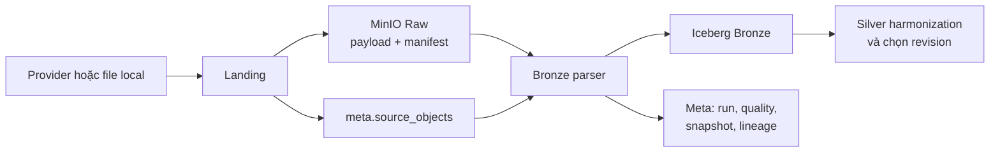
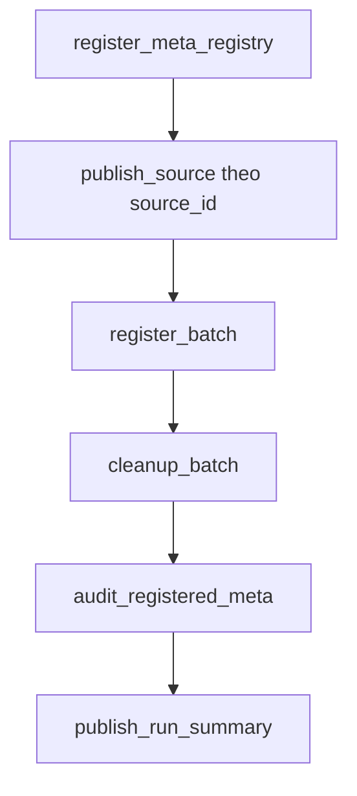
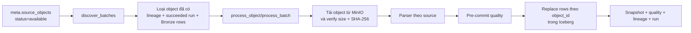
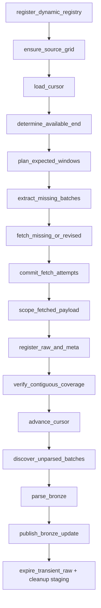

# Workflow Raw → Bronze cho dữ liệu static và dynamic

**Cập nhật:** 09/10/2026

**Phạm vi:** các DAG Landing/Raw → Bronze hiện có trong repository.

**Mục tiêu:** giải thích dữ liệu đi qua hệ thống như thế nào, từng nguồn được parse ra sao, checksum được dùng ở đâu, cách xử lý revision ở Silver và giới hạn của incremental loading.

Schema vật lý của các bảng được mô tả tại [schema_contract/data.md](schema_contract/data.md). Tài liệu này tập trung vào workflow và thứ tự đọc code.

## 1. Các khái niệm cần phân biệt

| Khái niệm | Ý nghĩa trong project |
| --- | --- |
| Provider | Hệ thống hoặc tổ chức cung cấp dữ liệu, ví dụ JAXA, Copernicus, HydroSHEDS. |
| Asset | File/tài nguyên logic mà adapter tìm thấy hoặc dự kiến phải có. Asset được nhận diện bởi `asset_id`. |
| Landing | Quá trình tìm hoặc tải asset, kiểm tra, cắt phạm vi nếu được cấu hình, publish payload vào MinIO và đăng ký Meta. |
| Raw | Payload bất biến đã publish trong MinIO cùng manifest. Raw có thể là file gần nguyên trạng hoặc payload đã cắt AOI trước khi lưu. |
| Raw object | Một payload Raw đã đăng ký trong `meta.source_objects`, được nhận diện bởi `object_id`. |
| Bronze | Dữ liệu đã parse thành cấu trúc có thể query nhưng vẫn giữ ngữ nghĩa gần nguồn, chưa harmonize thành mô hình nghiệp vụ chung. |
| Revision | Một phiên bản khác của cùng lát dữ liệu logic do provider sửa, phát hành lại hoặc pipeline lấy ở thời điểm khác. |
| Parser version | Phiên bản logic parse. Đổi parser version có thể buộc xử lý lại cùng Raw object. |

Luồng tổng quát:



Airflow XCom chỉ truyền document nhỏ như `source_id`, `object_id`, batch và trạng thái. Nội dung file không đi qua XCom.

Code hiện được tổ chức theo owner: `pipelines/study_area` dựng AOI,
`pipelines/static_landing` sở hữu acquire/publish nguồn static, `pipelines/static_bronze` sở hữu
parser static, và `pipelines/weather_ingest` sở hữu toàn bộ flow weather. Parser workbook sự kiện
nằm trong `pipelines/flood_events`; static DAG không còn nhánh xử lý event. Primitive raster/vector
và DTO object nằm trong `shared`; `storage` chỉ cung cấp HTTP/MinIO/Iceberg và không import pipeline.

## 2. Identity của asset, Raw object và dòng Bronze

Ba loại ID có vai trò khác nhau:

| ID | Grain | Công dụng |
| --- | --- | --- |
| `asset_id` | Tài nguyên provider dự kiến phải có | So inventory với kế hoạch để biết asset nào thiếu hoặc cần lấy lại. |
| `object_id` | Payload Raw cụ thể | Phân biệt chính xác bytes, source, version và selection đã publish. |
| Business key Bronze | Feature/band/slice bên trong object | Kiểm tra trùng và thay đúng lát dữ liệu khi retry. |

Ví dụ SoilGrids:

```text
asset_id  = soilgrids-clay-0-5cm-mean
object_id = hash(source + version + asset + selection + checksum)

Bronze key trong object:
band_or_layer = band-1
```

Ví dụ weather:

```text
asset_id  = gauge_standard-20261007T0300Z-<scope-token>
object_id = hash(source + version + asset + checksum scoped payload)
slice_id  = hash(object + grid + variable + cycle + valid/window + revision)
```

## 3. Static: từ source đến Raw

DAG: `static_source_landing`

File: [`airflow/dags/static_source_landing.py`](../airflow/dags/static_source_landing.py)

### 3.1. Chuỗi task



`publish_source` thực hiện:

1. Đọc source spec trong `config/sources/` và policy trong [`config/pipelines/static_landing.yaml`](../config/pipelines/static_landing.yaml).
2. Adapter xác định danh sách asset cần có.
3. Tìm file local đã catalog hoặc đúng đường dẫn dự kiến.
4. Xác minh kích thước, checksum và validation theo loại nguồn.
5. Chỉ tải asset còn thiếu hoặc asset không còn hợp lệ.
6. Chọn tile/phạm vi và đóng gói nếu policy yêu cầu.
7. Tính checksum payload được publish và tạo `object_id`.
8. Upload/reuse payload cùng `manifest.json` trong MinIO Raw.
9. Trả metadata cho `register_batch`; bytes không nằm trong XCom.

`register_batch` commit các hàng vào `meta.source_objects`. `audit_registered_meta` ghi run, quality và snapshot reference. Staging chỉ được dọn sau khi việc publish và đăng ký hoàn tất.

Code chính:

| File | Trách nhiệm |
| --- | --- |
| [`pipelines/static_landing/pipeline.py`](../src/flashflood_data/pipelines/static_landing/pipeline.py) | Điều phối prepare, publish, manifest và đăng ký batch. |
| [`pipelines/static_landing/acquisition.py`](../src/flashflood_data/pipelines/static_landing/acquisition.py) | Resolve/reuse/fetch/validate asset và chuẩn bị object theo source. |
| [`storage/http/fetcher.py`](../src/flashflood_data/storage/http/fetcher.py) | Download, resume, kiểm tra payload và quarantine lỗi tải. |
| [`storage/object_store.py`](../src/flashflood_data/storage/object_store.py) | Publish object bất biến vào MinIO và xác minh checksum. |
| [`storage/iceberg.py`](../src/flashflood_data/storage/iceberg.py) | Inventory `meta.source_objects`. |

### 3.2. Raw static được chuẩn bị theo nguồn

| Source | Chuẩn bị trước khi publish Raw |
| --- | --- |
| `hydrobasins_v1c` | Chọn level 12 thuộc Việt Nam và upstream một bước; đóng shapefile cùng sidecar thành ZIP. |
| `basinatlas_v10` | Chọn các `HYBAS_ID` tương ứng với HydroBASINS đã chọn; giữ allowlist thuộc tính; đóng ZIP. |
| `hydrorivers_v10` | Chọn river reach giao hydrological AOI; đóng ZIP. |
| `sonla_admin_2025` | Thu thập shapefile/sidecar đã cấu hình; mỗi asset được publish theo policy. |
| `gadm_vnm_4_1` | Tìm local hợp lệ hoặc tải archive GADM rồi publish bundle. |
| `cop_dem_glo30_2024_1` | Resolve các tile DEM giao environmental AOI, dùng local hợp lệ hoặc tải tile thiếu. |
| `soilgrids_2_0` | Lập tập asset theo property × depth × statistic và AOI; chỉ lấy tổ hợp còn thiếu/không hợp lệ. |
| `esa_worldcover_2021_v200` | Dùng grid index để resolve các tile giao AOI; reuse tile local đã xác minh. |
| `worldpop_vnm_2025` | Publish raster được cấu hình cho Việt Nam. |
| `geofabrik_vietnam_snapshot` | Lấy snapshot PBF Việt Nam và sidecar kiểm tra nguồn; Raw PBF được giữ để Bronze lọc feature/AOI. |

Việc subset ở Landing chỉ giảm phạm vi payload. Đây chưa phải harmonization và chưa tính feature như elevation trung bình, land-cover percentage hay topology chuẩn.

## 4. Static Raw → Bronze

DAG: `static_source_to_bronze`

File: [`airflow/dags/static_source_to_bronze.py`](../airflow/dags/static_source_to_bronze.py)

### 4.1. Discovery, batch và commit



Một object chỉ được skip khi đồng thời có:

1. lineage từ đúng `object_id` đến đúng bảng và `mapping_version`;
2. pipeline run tương ứng `succeeded` và đã publish;
3. dòng của `object_id` vẫn còn trong bảng Bronze.

Nếu thiếu một trong ba bằng chứng, object được parse lại. `force_reprocess=true` hoặc đổi parser/mapping version cũng làm object được xử lý lại.

Admin Sơn La được gom tối đa 25 object/task, SoilGrids 16 object/task; source khác mặc định một object/task. Batch chỉ giảm số commit Iceberg, không đổi grain và identity của từng object.

### 4.2. Cách parse từng nguồn static

Parser vector/raster nằm tại [`pipelines/static_bronze/parsers.py`](../src/flashflood_data/pipelines/static_bronze/parsers.py). OSM có parser riêng tại [`pipelines/static_bronze/osm.py`](../src/flashflood_data/pipelines/static_bronze/osm.py).

#### HydroBASINS → `bronze.basin_polygon_raw`

- Mở shapefile trong ZIP bằng `pyogrio` và đọc theo batch tối đa 5.000 feature.
- Yêu cầu CRS được khai báo.
- Chỉ chấp nhận `Polygon` hoặc `MultiPolygon`.
- Dùng `HYBAS_ID` làm `source_feature_id`.
- Lưu thuộc tính gốc trong `source_fields_json`.
- Lưu geometry gốc dưới dạng WKB và bbox đã chuyển sang WGS84.

Bronze chưa đổi `HYBAS_ID` thành `basin_id`, chưa xây directed graph và chưa tính topology.

#### BasinATLAS → `bronze.basin_polygon_raw`

- Parse polygon giống HydroBASINS.
- Chỉ đọc allowlist trường trong [`pipelines/static_landing/adapters/hydro_fields.py`](../src/flashflood_data/pipelines/static_landing/adapters/hydro_fields.py).
- Dùng `HYBAS_ID` làm `source_feature_id`.
- Các trường như `NEXT_DOWN`, `SUB_AREA`, `UP_AREA`, terrain QA, land cover, hồ, điều tiết, runoff/discharge và population vẫn nằm trong `source_fields_json`.

Bronze chưa đổi tên, đổi đơn vị hoặc ghép thuộc tính BasinATLAS với polygon canonical.

#### HydroRIVERS → `bronze.river_reach_raw`

- Đọc từng batch vector.
- Chỉ chấp nhận `LineString` hoặc `MultiLineString`.
- Dùng `HYRIV_ID` làm `source_feature_id`.
- Giữ thuộc tính nguồn trong JSON, geometry WKB, CRS và bbox WGS84.

Bronze chưa cắt reach theo basin, chưa tạo connectivity chuẩn và chưa tính tổng chiều dài stream.

#### Sơn La Admin và GADM → `bronze.admin_boundary_raw`

- Yêu cầu polygon/multipolygon và CRS.
- Tìm feature ID từ mã hành chính có sẵn như `MaXa`, `ma_xa`, `GID_3`, `GID_2`, `GID_1`, `GID_0`; nếu nguồn không có mã thì fallback `row-<position>`.
- Giữ toàn bộ thuộc tính nguồn trong `source_fields_json`.
- Gắn `source_id` để phân biệt hai hệ địa giới trong cùng bảng.

Bronze chưa chuẩn hóa cấp hành chính, mã, tên hay quan hệ cha-con.

#### DEM, WorldCover và WorldPop → `bronze.raster_coverage`

Parser chỉ đọc **header**, không materialize toàn bộ pixel:

- một dòng cho mỗi band;
- `object_uri` trỏ về raster Raw;
- CRS và bbox WGS84;
- độ phân giải X/Y;
- nodata, dtype và checksum;
- `property` lần lượt là `elevation`, `landcover`, `population`.

DEM dạng archive được tạm giải nén file `_DEM.tif` để đọc header. Bronze chưa tính elevation/slope/flow path, land-cover percentage hoặc population theo basin.

#### SoilGrids → `bronze.raster_coverage`

Tên file được parse để lấy:

- `property`: `clay`, `sand`, `silt`, `bdod`, `cfvo`, `soc`, `wv0033`, `wv1500`;
- `depth_interval`: ví dụ `0-5cm`, `15-30cm`, `100-200cm`;
- `statistic`: `mean`, `Q0.05`, `Q0.50`, `Q0.95` nếu có trong tên.

Sau đó parser ghi metadata mỗi band giống raster khác. Pixel, divisor, weighted depth, AWC và uncertainty ratio được xử lý ở Silver.

**Khoảng trống hiện tại:** source config có `wv0010`, nhưng allowlist nhận diện trong static Bronze parser chưa có `wv0010`; object này có thể có `property = null`. Cần sửa parser/version trước khi Silver dùng `wv0010`.

#### OSM Geofabrik → `bronze.osm_feature_raw`

- Đọc streaming các layer `points`, `lines`, `multipolygons`, `multilinestrings`, `other_relations` từ PBF.
- Lọc sơ bộ theo bbox, sau đó kiểm tra geometry thực sự giao `exposure_aoi`.
- Áp dụng policy tag tại [`config/pipelines/static_bronze_osm.yaml`](../config/pipelines/static_bronze_osm.yaml).
- Chỉ giữ nhóm phục vụ lũ: thủy văn, công trình thủy lực, giao thông thiết yếu và critical facility.
- Lưu `osm_type`, `osm_id`, toàn bộ tag được chọn trong `tags_json`, geometry WKB và bbox.
- Stream theo batch 5.000 feature để tránh nạp toàn bộ PBF vào RAM.

Bronze chưa tách OSM thành bridge, road, waterway và facility typed tables.

### 4.3. Quality và idempotency static Bronze

Trước commit, service kiểm tra tối thiểu:

- parse không rỗng;
- business key không trùng trong scope kiểm tra;
- bbox WGS84 hợp lệ;
- vector có CRS và đúng geometry type;
- raster có CRS và ít nhất một band;
- file download từ MinIO có size/checksum đúng với `meta.source_objects`.

Writer dùng replace theo `object_id` hoặc tập `object_id`:

```text
xóa lát Bronze thuộc các object đang xử lý
→ ghi lại kết quả parse
→ commit một Iceberg snapshot
```

Retry cùng object không append thêm một bản của chính object đó.

## 5. Dynamic weather: Landing/Raw

Các DAG:

| DAG | Source/stream | Lịch hiện tại | Grain Raw object |
| --- | --- | --- | --- |
| `gsmap_now_ingest` | GSMaP Gauge NOW | phút 7 và 37 mỗi giờ | Một cửa sổ 1 giờ, planner bước 30 phút. |
| `gsmap_standard_ingest` | GSMaP Gauge Standard | phút 27 mỗi 6 giờ | Một cửa sổ 1 giờ. |
| `era5_land_ingest` | ERA5-Land reanalysis | 02:43 UTC hằng ngày | Một tháng lịch. |
| `ifs_ingest` | IFS HRES qua Open-Meteo | phút 12 mỗi 6 giờ | Một model cycle 6 giờ chứa forecast horizon. |

Các file DAG mỏng gọi factory chung tại [`pipelines/weather_ingest/airflow.py`](../src/flashflood_data/pipelines/weather_ingest/airflow.py). Policy từng nguồn nằm trong [`config/pipelines/weather/`](../config/pipelines/weather/).

### 5.1. Chuỗi task dùng chung



### 5.2. Grid và AOI

`ensure_source_grid` đăng ký grid 0,1° ổn định tại `silver.source_grid`:

- geometry/ID cell được dựng theo grid toàn cục của từng provider;
- chỉ các cell giao Việt Nam được materialize vào registry;
- `scope_ids` đánh dấu cell nào thuộc AOI Việt Nam và cell nào thuộc AOI Sơn La hiện tại;
- Raw weather chỉ giữ values của các cell thuộc AOI Sơn La hiện tại;
- mỗi value trong Bronze liên kết grid bằng `cell_indices`, không lặp geometry trong từng slice.

Vì `cell_index` neo theo grid toàn cục, khi mở rộng sang tỉnh khác, cell cũ giữ nguyên ID và chỉ cần thêm scope/cell liên quan.

Code: [`pipelines/weather_ingest/grids.py`](../src/flashflood_data/pipelines/weather_ingest/grids.py).

### 5.3. Planning cửa sổ cần tải

Planner tại [`pipelines/weather_ingest/planner.py`](../src/flashflood_data/pipelines/weather_ingest/planner.py) thực hiện:

1. Lấy `cursor_time` đã commit từ watermark; nếu chưa có thì dùng `start_at`.
2. Trừ `overlap_steps` để replay một vùng gần hiện tại nhằm phát hiện provider revision/late data.
3. Tính `safe_end = now - availability_lag`, rồi floor theo bước nguồn.
4. Liệt kê mọi expected object trong khoảng `[start, safe_end)`.
5. So `asset_id` với `meta.source_objects`.
6. Bỏ object cũ đã có ngoài overlap; giữ object thiếu và object nằm trong overlap cần kiểm tra lại.
7. Giới hạn số object/run và chia thành batch task.

Cursor chỉ tiến qua chuỗi cửa sổ liên tục có trạng thái `available` hoặc `no_data`. Một gap chưa xử lý sẽ chặn cursor, tránh bỏ quên dữ liệu giữa timeline.

### 5.4. Fetch, scope và publish Raw

Payload provider được tải vào staging, sau đó cắt về grid cell thuộc AOI trước khi publish:

| Source | Payload provider/staging | Raw được publish |
| --- | --- | --- |
| GSMaP | Binary gzip trên grid provider | NPZ deterministic gồm đúng hai array `cell_indices` và `values` của AOI. |
| ERA5-Land | NetCDF theo request tháng/bbox | NetCDF chỉ giữ biến yêu cầu, các cell AOI và coordinate `cell_index`. |
| IFS/Open-Meteo | JSON responses theo các grid point | JSON chỉ giữ response của grid point đã đăng ký và gắn `cell_index`. |

Checksum và size của cả provider payload lẫn scoped payload được ghi trong manifest. Chỉ scoped payload được giữ làm Raw object chính trên MinIO.

Raw key dynamic chứa ngày, `asset_id` và checksum:

```text
weather/<source>/<product>/YYYY/MM/DD/<asset_id>/<checksum>/<filename>
```

Vì checksum nằm trong key, một revision mới có thể tồn tại song song với revision cũ mà không ghi đè.

NOW và IFS dùng retention `transient_7d`; payload Raw chỉ được xóa sau khi đã có Bronze evidence và đủ điều kiện lifecycle. GSMaP Standard và ERA5-Land dùng retention `durable`. Việc hết hạn Raw không xóa dòng Bronze đã parse.

Code:

- [`pipelines/weather_ingest/subset.py`](../src/flashflood_data/pipelines/weather_ingest/subset.py)
- [`pipelines/weather_ingest/landing.py`](../src/flashflood_data/pipelines/weather_ingest/landing.py)
- [`pipelines/weather_ingest/lifecycle.py`](../src/flashflood_data/pipelines/weather_ingest/lifecycle.py)

## 6. Dynamic Raw → `bronze.weather_raster_slice`

Service: [`pipelines/weather_ingest/bronze.py`](../src/flashflood_data/pipelines/weather_ingest/bronze.py)

Parser: [`pipelines/weather_ingest/parsers.py`](../src/flashflood_data/pipelines/weather_ingest/parsers.py)

### 6.1. Discovery và xác minh

Bronze chỉ chọn Raw object dynamic:

- có `status=available` trong `meta.source_objects`;
- chưa bị đánh dấu expired trong `meta.object_lifecycle`;
- chưa có đủ lineage, succeeded run và Bronze rows cho đúng parser version.

Mỗi object được download từ MinIO về temporary staging. Size và SHA-256 phải khớp inventory trước khi parser đọc.

### 6.2. Grain của một raster slice

Mỗi dòng `weather_raster_slice` đại diện cho:

```text
object
× source grid/version
× spatial scope
× variable
× vertical level
× source cycle
× valid time/window
× source revision
```

Một dòng không đại diện cho một grid cell. Nó chứa hai array song song:

```text
cell_indices = [i0, i1, i2, ...]
values       = [v0, v1, v2, ...]
```

`values[n]` thuộc cell `cell_indices[n]`. Geometry và centroid của cell được tra trong `silver.source_grid` bằng `source_id + source_grid_version + cell_index`.

Parser kiểm tra:

- hai array có cùng độ dài;
- tập cell index khớp chính xác scope đã đăng ký;
- precipitation/runoff không âm nếu khác null;
- unit tồn tại;
- window hợp lệ;
- object tạo ít nhất một slice.

### 6.3. Cách parse từng nguồn dynamic

#### GSMaP NOW và Standard

- Mở scoped NPZ.
- Đọc `cell_indices` và `values` mà không cần geometry.
- Tạo một slice precipitation cho cửa sổ object.
- `unit = mm/h`, `value_kind = rate`: giá trị là cường độ mưa cho cửa sổ của object; NOW có cửa sổ 1 giờ cập nhật mỗi 30 phút.
- `valid_time = window_end`.

Các manifest Raw GSMaP cũ có thể còn `options.value_kind = preceding_hour_sum`. Đây là nhãn cấu hình cũ, không phải phép đổi đơn vị. Planner nhận diện chúng tương đương với `rate` để backfill không tải lại; manifest bất biến vẫn giữ nguyên nhãn cũ, còn các object mới ghi `rate`.

NOW và Standard dùng cùng source ID `gsmap`, nhưng phân biệt bằng `source_product`, `stream_id` trong selection, cycle, window và revision.

#### ERA5-Land

- Mở scoped NetCDF bằng Xarray.
- Nhận diện coordinate `valid_time` hoặc `time` và `cell_index`.
- Với mỗi biến và timestamp, flatten values theo thứ tự cell index và tạo một slice.
- Alias source như `tp`, `swvl1..4`, `sro`, `ssro` được map về tên biến contract.
- Soil moisture là instantaneous.
- `total_precipitation`, `surface_runoff`, `sub_surface_runoff` hiện được gắn `value_kind = accumulation_since_00_utc`; window bắt đầu 00:00 UTC, riêng mốc 00:00 dùng 24 giờ trước đó.

Bronze giữ accumulation gốc. Việc chuyển thành increment theo giờ thuộc Silver.

#### IFS/Open-Meteo

- Đọc danh sách response theo cell.
- Với mỗi variable và mỗi timestamp hourly, gom các giá trị từ mọi cell thành một slice.
- Soil moisture là instantaneous.
- `precipitation` và `runoff` được mô tả là tổng của giờ ngay trước valid time.
- Giữ `model_run_time`, source cycle và forecast valid time để Silver không trộn các forecast cycle.

### 6.4. Commit và retry

Các object trong một Airflow batch được parse rồi commit bằng `replace_objects_rows` trong một Iceberg snapshot. Lineage, quality, snapshot reference và pipeline run được ghi theo object/batch.

Nếu task được chạy lại:

- object đã publish hợp lệ với cùng parser version được skip;
- object bị mất Bronze rows hoặc thiếu lineage/run evidence được parse lại;
- replace theo `object_id` ngăn retry append trùng cùng object;
- revision khác có `object_id` khác nên vẫn tồn tại song song.

## 7. Checksum

### 7.1. Định nghĩa

Checksum của payload là SHA-256 tính trên toàn bộ byte của file theo đúng thứ tự:

```python
digest = sha256()
with path.open("rb") as stream:
    for chunk in iter(lambda: stream.read(8 * 1024 * 1024), b""):
        digest.update(chunk)
checksum = digest.hexdigest()
```

Kết quả là chuỗi hexadecimal 64 ký tự. Đọc theo chunk chỉ giảm RAM; kích thước chunk không làm thay đổi kết quả.

Checksum xác nhận tính toàn vẹn byte. Nó không chứng minh CRS, AOI, đơn vị hay giá trị nghiệp vụ đúng. Những điều đó thuộc validation và DQ.

### 7.2. Checksum được dùng ở đâu

| Giai đoạn | Cách sử dụng |
| --- | --- |
| Download provider | So checksum thực tế với checksum provider nếu có; payload mismatch bị reject/quarantine. |
| Reuse local | So asset identity, size, catalog checksum và checksum file thực tế trước khi dùng lại. |
| Publish MinIO | Tính checksum local, upload staging, đọc lại staging/final object và so size + checksum. |
| Immutable conflict | Cùng final key và cùng checksum thì reuse; cùng key nhưng checksum khác thì fail, không ghi đè. |
| Object identity | Checksum là một phần của `object_id`, nên bytes đổi làm object ID đổi. |
| Manifest/Meta | Lưu `checksum_algorithm=sha256`, checksum, size và URI trong manifest/`meta.source_objects`. |
| Bronze | Download object rồi tính lại SHA-256; chỉ parse khi khớp inventory. |
| Raster coverage | Giữ checksum của raster Raw để truy ngược đúng payload. |

Static object ID dùng canonical identity:

```text
source_id + source_version + asset_id
+ canonical selection + payload checksum
+ manifest_schema_version
```

Dynamic object ID dùng:

```text
source_id + source_version + asset_id + scoped payload checksum
```

### 7.3. Điều checksum không làm được

- Không xác định phần không gian còn thiếu trong raster.
- Không tự chọn revision mới nhất.
- Không cho biết file có đúng nghiệp vụ.
- Không tạo binary diff để chỉ tải các byte đã thay đổi.
- Không thay thế provider version, window, AOI fingerprint hoặc tile index.

Đọc lại SHA-256 của object lớn trên MinIO cần stream toàn bộ bytes và có thể tốn thời gian. MinIO multipart ETag không được dùng thay SHA-256 vì ETag multipart không phải checksum nội dung tương đương SHA-256.

## 8. Tải và xử lý phần còn thiếu thay vì full loading

“Incremental” cần được hiểu theo bốn mức khác nhau.

### 8.1. Static Landing: incremental theo asset/tile

Adapter vẫn resolve tập asset dự kiến, nhưng `acquire_validated_assets` chỉ fetch asset không có bản local `VALIDATED` với identity và checksum hợp lệ.

Ví dụ:

```text
SoilGrids dự kiến: 96 asset
Local hợp lệ:      80 asset
Cần tải:           16 asset
```

DEM và WorldCover có thể reuse tile hiện có và chỉ lấy tile mới khi AOI mở rộng. Điều này yêu cầu adapter biểu diễn nguồn theo tile/asset độc lập.

Nếu provider chỉ trả một file crop duy nhất cho toàn AOI, mở rộng AOI tạo request/object mới; pipeline không tự nối phần không gian mới vào file cũ.

### 8.2. Resume một download dở

HTTP fetcher giữ file `.partial` và resume state. Nếu provider hỗ trợ HTTP Range và remote validator vẫn khớp, pipeline có thể tiếp tục từ offset còn thiếu. Sau khi hoàn tất, SHA-256 được tính trên toàn bộ file ghép lại.

Nếu server không hỗ trợ Range, payload nguồn đã đổi hoặc resume state không đáng tin, file phải tải lại từ đầu.

Upload MinIO hiện chưa resume multipart ở đúng part bị ngắt; retry có thể phải stream lại toàn object.

### 8.3. Dynamic Landing: incremental theo time window và overlap

Weather planner không yêu cầu lại toàn lịch sử mỗi run. Nó dùng:

```text
watermark cursor
+ provider safe end
+ inventory asset_id
+ bounded overlap
+ max objects per run
```

Kết quả:

- cửa sổ cũ đã có và nằm ngoài overlap được skip;
- gap cũ chưa có vẫn được lên kế hoạch;
- cửa sổ gần hiện tại được replay có chủ ý để bắt late data/revision;
- cursor không nhảy qua gap;
- backfill tiếp tục từ inventory/watermark thay vì mặc định xóa và tải lại toàn bộ.

Mỗi expected object vẫn được fetch ở grain nguồn đã cấu hình: một giờ GSMaP, một tháng ERA5-Land hoặc một cycle IFS. Pipeline chưa tải binary delta bên trong object.

### 8.4. Bronze: incremental theo `object_id`

Static và dynamic Bronze đều discover object chưa có kết quả publish hợp lệ. Chỉ các object đó được download và parse.

Bronze **không scan và parse lại toàn Raw**, đồng thời writer chỉ replace các `object_id` của batch hiện tại thay vì overwrite toàn bảng.

Giới hạn hiện tại:

- object được chọn vẫn được download trọn từ MinIO về staging;
- static raster parser chỉ cần header nhưng service hiện vẫn download trọn object;
- OSM parser stream feature để tiết kiệm RAM nhưng PBF vẫn được download trọn;
- đổi parser version hoặc `force_reprocess=true` chủ động làm các object liên quan chạy lại;
- thay AOI/selection làm identity mới, vì vậy object mới phải được lấy và parse.

## 9. Revision tồn tại song song và Silver chọn bản nào

### 9.1. Hành vi Raw/Bronze hiện tại

Nếu hai revision có key Raw khác nhau, cả hai được giữ:

```text
Raw object A: object_id=A, checksum=aaa
Raw object B: object_id=B, checksum=bbb
```

Bronze parse cả hai nếu đều `available`:

```text
object_id=A, source_feature_id=412090001
object_id=B, source_feature_id=412090001
```

Bronze không tự xem B là bản hiện hành. `object_id` giúp phân biệt provenance, không thay thế quy tắc revision.

### 9.2. Quy tắc Silver bắt buộc

Silver phải chọn revision **trước khi** harmonize/aggregate để không nhân đôi feature hoặc time window. Việc chọn gồm hai bước.

#### Bước 1: tạo logical revision group

Nhóm các object/slice mô tả cùng lát dữ liệu nghiệp vụ, bỏ các trường chỉ nhận diện lần phát hành.

Static raster, ví dụ:

```text
source_id
+ property
+ depth_interval
+ statistic
+ tile/spatial selection
```

Static vector, ví dụ:

```text
source_id
+ dataset scope/level
+ source_feature_id
```

Dynamic weather:

```text
source_id
+ source_product
+ source_grid_version
+ spatial_scope_id
+ variable/vertical_level
+ source_cycle_id
+ valid_time
+ window_start/window_end
```

#### Bước 2: xếp hạng trong từng group

Thứ tự đề xuất:

1. Chỉ nhận object/slice có quality được phép publish.
2. Ưu tiên explicit `source_revision` lớn nhất nếu provider có revision số.
3. Nếu không có revision số, dùng policy riêng của source dựa trên `provider_issued_at` hoặc `valid_time`.
4. Dùng `available_at`, rồi `retrieved_at` mới nhất để phân xử revision được phát hành/lấy sau.
5. Dùng `object_id` làm tie-break cuối để kết quả luôn tất định.

Không dùng `MAX(source_version)` dạng chuỗi cho mọi source vì `v9`, `v10`, ngày tháng và semantic version không có cùng thứ tự từ điển. Mỗi source cần parser/policy version riêng hoặc một `source_revision` đã chuẩn hóa.

SQL khái niệm:

```sql
WITH ranked AS (
    SELECT
        b.*,
        row_number() OVER (
            PARTITION BY <logical_revision_group>
            ORDER BY
                <quality_priority> DESC,
                source_revision DESC,
                available_at DESC,
                retrieved_at DESC,
                object_id DESC
        ) AS revision_rank
    FROM bronze_source b
)
SELECT *
FROM ranked
WHERE revision_rank = 1;
```

### 9.3. Weather product precedence không giống source revision

Sau khi chọn revision mới nhất **trong cùng product/cycle/window**, Silver mới áp dụng policy hợp nhất nguồn:

- GSMaP Standard ưu tiên cho window lịch sử tương ứng khi đã available.
- GSMaP NOW được giữ cho window Standard chưa có; window 30 phút không có bản Standard khớp không được xóa chỉ vì Standard đã xuất hiện.
- ERA5-Land là nguồn reanalysis quá khứ ưu tiên khi đã available.
- IFS vẫn giữ forecast theo từng model cycle; khi dùng để lấp khoảng ERA5 chưa cập nhật phải gắn provenance và không giả vờ là ERA5.

Đây là source/product precedence, không phải phép chọn revision đơn thuần.

### 9.4. Khoảng trống static cần bổ sung

Dynamic Bronze đã có `source_revision`, cycle, valid/window time và available time. Static hiện chỉ có thể suy ra từ:

- `source_version`;
- `asset_id`/selection;
- `valid_time` hoặc provider metadata nếu adapter cung cấp;
- `retrieved_at`;
- checksum/object ID.

Static chưa có quan hệ rõ ràng `object B supersedes object A` hoặc cờ `is_current`. Trước khi triển khai Silver revision filtering đầy đủ, nên bổ sung contract Meta với ít nhất:

```text
revision_group_key
source_revision hoặc provider_issued_at chuẩn hóa
supersedes_object_id (nullable)
valid_from / valid_to
```

Raw và Bronze vẫn giữ lịch sử; Silver materialize hoặc view chỉ chọn một revision authoritative theo policy có version.

## 10. Thứ tự đọc code

### Static

1. [`config/pipelines/static_landing.yaml`](../config/pipelines/static_landing.yaml)
2. [`pipelines/static_landing/README.md`](../src/flashflood_data/pipelines/static_landing/README.md)
3. [`pipelines/static_landing/airflow.py`](../src/flashflood_data/pipelines/static_landing/airflow.py)
4. [`pipelines/static_landing/runtime.py`](../src/flashflood_data/pipelines/static_landing/runtime.py)
5. [`pipelines/static_landing/acquisition.py`](../src/flashflood_data/pipelines/static_landing/acquisition.py)
6. [`pipelines/static_landing/pipeline.py`](../src/flashflood_data/pipelines/static_landing/pipeline.py)
7. [`storage/object_store.py`](../src/flashflood_data/storage/object_store.py)
8. [`pipelines/static_bronze/README.md`](../src/flashflood_data/pipelines/static_bronze/README.md)
9. [`pipelines/static_bronze/airflow.py`](../src/flashflood_data/pipelines/static_bronze/airflow.py)
10. [`pipelines/static_bronze/runtime.py`](../src/flashflood_data/pipelines/static_bronze/runtime.py)
11. [`pipelines/static_bronze/pipeline.py`](../src/flashflood_data/pipelines/static_bronze/pipeline.py)
12. [`pipelines/static_bronze/parsers.py`](../src/flashflood_data/pipelines/static_bronze/parsers.py)
13. [`pipelines/static_bronze/osm.py`](../src/flashflood_data/pipelines/static_bronze/osm.py)

### Dynamic

1. [`config/pipelines/weather/`](../config/pipelines/weather/)
2. [`pipelines/weather_ingest/README.md`](../src/flashflood_data/pipelines/weather_ingest/README.md)
3. [`pipelines/weather_ingest/airflow.py`](../src/flashflood_data/pipelines/weather_ingest/airflow.py)
4. [`pipelines/weather_ingest/runtime.py`](../src/flashflood_data/pipelines/weather_ingest/runtime.py)
5. [`pipelines/weather_ingest/planner.py`](../src/flashflood_data/pipelines/weather_ingest/planner.py)
6. [`pipelines/weather_ingest/grids.py`](../src/flashflood_data/pipelines/weather_ingest/grids.py)
7. [`pipelines/weather_ingest/providers/`](../src/flashflood_data/pipelines/weather_ingest/providers/)
8. [`pipelines/weather_ingest/subset.py`](../src/flashflood_data/pipelines/weather_ingest/subset.py)
9. [`pipelines/weather_ingest/landing.py`](../src/flashflood_data/pipelines/weather_ingest/landing.py)
10. [`pipelines/weather_ingest/bronze.py`](../src/flashflood_data/pipelines/weather_ingest/bronze.py)
11. [`pipelines/weather_ingest/parsers.py`](../src/flashflood_data/pipelines/weather_ingest/parsers.py)

## 11. Tóm tắt ranh giới trách nhiệm

| Tầng | Có làm | Chưa làm |
| --- | --- | --- |
| Landing/Raw | Resolve/fetch/reuse asset; cắt AOI theo policy; checksum; immutable publish; manifest; Meta inventory. | Không chuẩn hóa field nghiệp vụ; không tính basin feature. |
| Bronze static | Parse vector source-faithful; index raster coverage; lọc OSM; DQ và lineage theo object. | Không harmonize ID/unit; không aggregate raster theo basin; không chọn revision authoritative. |
| Bronze dynamic | Parse scoped payload thành raster slice arrays; giữ grid/time/cycle/revision; DQ và lifecycle evidence. | Không aggregate theo basin; không đổi accumulation thành increment cuối cùng; không hợp nhất source precedence. |
| Silver tương lai | Chọn revision; chuẩn hóa ID/CRS/unit/time; aggregate theo basin; hợp nhất product theo policy. | Không được làm mất provenance về Raw object và Bronze snapshot. |
