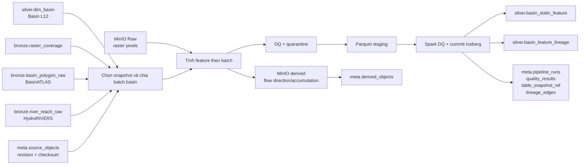

# ETL Silver basin static features

Tài liệu này mô tả cách DAG `silver_basin_static_features` sẽ tạo một bộ đặc trưng tĩnh cho mỗi lưu vực HydroBASINS level 12. Đây là **contract triển khai** của pipeline Bronze → Silver. Spark/Sedona là engine lập kế hoạch, spatial/tabular transform, DQ và Iceberg publish; Python/Rasterio xử lý hydrology raster qua Parquet staging. Tại thời điểm 2026-10-10, repository mới có các kernel tính toán trong `src/flashflood_data/pipelines/silver_static_features/`; DAG, service, Spark job, bảng Iceberg vật lý và cơ chế publish vẫn chưa được triển khai.

Quyết định runtime chung nằm tại [`spark_bronze_to_silver_architecture.md`](spark_bronze_to_silver_architecture.md).

Schema đích đầy đủ nằm trong [`docs/schema_contract/data.md`](schema_contract/data.md), mục `silver.basin_static_feature` và `silver.basin_feature_lineage`.

## 1. Mục tiêu và ranh giới

Pipeline nhận basin L12 đã chuẩn hóa, inventory raster ở Bronze và các object nguồn trong MinIO. Pipeline đọc đúng window raster giao từng basin, tính feature, kiểm tra chất lượng, rồi ghi kết quả có version vào Silver.

Pipeline tạo ba loại đầu ra:

1. `silver.basin_static_feature`: một dòng cho mỗi `(basin_id, basin_version, feature_build_version)`.
2. `silver.basin_feature_lineage`: ghi từng object nguồn hoặc object dẫn xuất đã đóng góp cho dòng feature.
3. Raster thủy văn dẫn xuất như flow direction và flow accumulation: lưu trong MinIO ở vùng `derived`, sau đó đăng ký vào `meta.derived_objects`.

WorldPop không được ghép vào `silver.basin_static_feature`. Population thuộc pipeline exposure riêng, vì có reference year và có thể thay đổi theo thời gian. Kernel `population.py` hiện có sẽ được tái sử dụng ở pipeline exposure.

## 2. Điều kiện đầu vào

DAG chỉ được chạy khi các điều kiện sau đã thỏa mãn:

- `silver.dim_basin` đã có basin L12 và `basin_version` cần xử lý.
- DAG `static_source_landing` và `static_source_to_bronze` đã thành công cho các source cần dùng.
- `bronze.raster_coverage` đã có metadata và `object_uri` cho DEM, SoilGrids và WorldCover. Bảng này chỉ chứa inventory; pixel vẫn nằm trong object Raw trên MinIO.
- `bronze.basin_polygon_raw` đã có các field BasinATLAS được cho phép.
- `bronze.river_reach_raw` đã có HydroRIVERS dùng để tính tổng chiều dài dòng chảy và drainage density.
- `meta.source_objects` chứa checksum và revision của mọi object đầu vào.
- Mỗi bảng đầu vào đã được cố định bằng Iceberg snapshot ID. Pipeline không đọc lẫn dữ liệu vừa thay đổi giữa một run.

## 3. Luồng dữ liệu



Đường đi của một raster là:

```text
bronze.raster_coverage.object_uri
  -> xác nhận object_id/checksum với meta.source_objects
  -> tải hoặc stream object từ MinIO vào staging cục bộ
  -> mở đúng band/layer
  -> chuyển geometry basin sang CRS của raster
  -> chỉ đọc window giao basin và mask NoData
  -> tính thống kê
  -> ghi Parquet staging
  -> writer commit vào Iceberg Silver
```

Không truyền mảng raster qua Airflow XCom. XCom chỉ mang ID, danh sách batch và URI của file staging.

## 4. Task graph của DAG

DAG chạy thủ công ở giai đoạn đầu, `schedule=None`, với task graph dự kiến:

```text
register_run
  -> discover_inputs
  -> select_revisions_and_pin_snapshots
  -> validate_input_matrix
  -> plan_basin_batches
  -> submit_spark_plan_and_tabular_transform
  -> compute_hydrology_batch.expand
  -> submit_spark_assemble_quality_publish
  -> register_derived_objects
  -> audit_and_finalize
  -> cleanup_staging
```

### `register_run`

Tạo `pipeline_run_id`, đọc config và tính `feature_build_version`. Run được ghi trạng thái `running` vào `meta.pipeline_runs`.

### `discover_inputs`

Đọc danh sách basin/version cần xử lý, inventory raster, BasinATLAS, HydroRIVERS và source object liên quan. Task này chỉ tạo manifest nhỏ; không đọc toàn bộ pixel.

### `select_revisions_and_pin_snapshots`

Chọn một revision hợp lệ cho mỗi business asset. Revision được chọn phải có trạng thái usable, checksum hợp lệ và phù hợp với AOI/bbox của basin. Snapshot ID của mọi bảng đầu vào được ghi lại để toàn bộ run có cùng một ảnh chụp dữ liệu.

Nếu hai revision cùng tồn tại, pipeline không dựa vào tên file để chọn. Nó dùng policy version/revision trong Meta. Các revision cũ vẫn được giữ để truy vết nhưng không tham gia build mới.

### `validate_input_matrix`

Kiểm tra đủ source bắt buộc trước khi fan-out:

- Có geometry cho mọi basin.
- Có DEM che phủ basin.
- Có đủ các lớp SoilGrids cần cho khoảng 0–30 cm.
- Có WorldCover che phủ basin.
- Có BasinATLAS và HydroRIVERS nếu các feature tương ứng được bật.
- `object_uri`, checksum, CRS, bbox và band/layer khớp giữa Bronze và Meta.

Thiếu hoặc hỏng object bắt buộc là lỗi fatal và chặn build. Source tùy chọn có thể tạo warning theo config.

### `plan_basin_batches`

Chia danh sách basin thành các batch có kích thước cố định. Mỗi batch chỉ chứa khóa basin, version và danh sách object liên quan. Cách này giới hạn RAM và cho phép Airflow chạy song song nhiều batch.

### `submit_spark_plan_and_tabular_transform`

Spark/Sedona chọn tile giao basin, join BasinATLAS/HydroRIVERS, chạy các zonal statistics đã được
kiểm chứng và lập manifest cho các basin cần hydrology chuyên dụng.

### `compute_hydrology_batch.expand`

Mỗi mapped Python task xử lý một batch nhưng không commit Iceberg. Task gọi kernel hydrology/raster
chuyên dụng rồi ghi hai file Parquet staging:

- feature rows;
- lineage rows.

Nếu tạo raster thủy văn, task upload vào key staging trên MinIO, xác nhận checksum rồi atomic copy sang key `derived` cuối cùng.

### `submit_spark_assemble_quality_publish`

Spark đọc các batch có manifest hoàn tất, ghép với tabular/zonal output, kiểm tra schema, khóa trùng,
số basin, DQ status và lineage. Fatal failure dừng publish; row lỗi vào quarantine; warning vẫn được
publish. Spark commit mỗi bảng Iceberg đúng một lần theo khóa:

```text
silver.basin_static_feature:
  (basin_id, basin_version, feature_build_version)

silver.basin_feature_lineage:
  (basin_id, basin_version, feature_build_version, object_id, role)
```

Compute được chạy song song nhưng commit được gom vào Spark publish application để tránh nhiều writer
sửa cùng snapshot Iceberg.

### `register_derived_objects`

Chỉ đăng ký `meta.derived_objects` sau khi object cuối đã tồn tại trong MinIO và checksum đã khớp. Nếu register thất bại, object staging/final có thể được repair ở lần chạy sau; không được tạo lineage trỏ tới object chưa xác nhận.

### `audit_and_finalize`

Ghi output snapshot, quality result và lineage cấp dataset vào Meta, sau đó chuyển run thành `success`, `warning` hoặc `failed`. Một run chỉ được đánh dấu success khi cả feature, lineage và derived registry đã nhất quán.

## 5. Phép biến đổi theo từng nguồn

### 5.1 DEM

DEM là nguồn chính cho các feature địa hình. Với mỗi basin:

1. Chuyển polygon basin sang CRS raster để chọn window.
2. Tạo working grid metric 30 m ở `EPSG:32648` theo config.
3. Loại NoData và pixel ngoài polygon.
4. Tính `elevation_min_m`, `elevation_mean_m`, `elevation_max_m`, `relief_m`, `slope_mean_deg` và `slope_p90_deg`.
5. Condition DEM cho phép tính thủy văn.
6. Tính flow direction, flow accumulation, stream mask và outlet đã snap.
7. Truy vết longest flow path, lấy cao độ đầu nguồn/cửa ra và tính:

```text
main_channel_slope_m_m =
  (source_elevation_m - outlet_elevation_m) / longest_flow_path_m
```

8. Tính `tc_hours`, sau đó tạo ba kịch bản `kb_fast_hours`, `kb_central_hours`, `kb_slow_hours` theo beta `0.5`, `1.0`, `2.0`.

Mean terrain slope không được dùng thay cho channel slope. Flow direction và flow accumulation là raster dẫn xuất, không nhét thành scalar hoặc array trong dòng feature.

### 5.2 SoilGrids

Đối với khoảng 0–30 cm, pipeline đọc ba depth layer `0-5cm`, `5-15cm`, `15-30cm`, chuyển scale/unit trước rồi tổng hợp theo độ dày `5/10/15 cm`:

```text
value_0_30 = (value_0_5 * 5 + value_5_15 * 10 + value_15_30 * 15) / 30
```

Mapping đích gồm `clay`, `sand`, `silt`, `bdod`, `cfvo`, `soc`, `wv0033` và `wv1500`. Sau khi đổi unit:

```text
awc_m3m3_0_30 = field_capacity_m3m3_0_30 - wilting_point_m3m3_0_30
soil_uncertainty_ratio = (Q95 - Q05) / Q50
```

Không tính AWC trên raw integer. Mỗi property phải ghi coverage fraction và object lineage để giải thích trường hợp null hoặc warning.

### 5.3 WorldCover

WorldCover là raster phân loại nên giữ native grid và dùng nearest/no resampling cho category. Pipeline đếm pixel hợp lệ theo class trong polygon basin rồi chia cho tổng pixel được nhận diện. Các class được map thành nhóm như forest/tree cover, cropland, built-up, water và wetland theo build config.

Tổng tỷ lệ phải nằm trong sai số cho phép quanh 100%. Pixel NoData và mã lạ được ghi làm bằng chứng DQ, không tự gán vào class khác.

### 5.4 HydroRIVERS

River geometry được chuyển sang CRS metric, cắt theo từng basin rồi tính:

- tổng `stream_length_km`;
- số reach đóng góp;
- `drainage_density_km_km2 = stream_length_km / basin_area_km2`;
- stream gradient tham khảo khi hai đầu reach có DEM hợp lệ.

### 5.5 BasinATLAS

Pipeline chỉ map allowlist field cần cho model hoặc QA. Terrain từ BasinATLAS mang tiền tố `atlas_` và chỉ dùng đối chiếu với DEM. Runoff/discharge dài hạn chỉ là reference, không thay ERA5-Land, IFS hoặc GSMaP theo thời gian.

Các field soil của BasinATLAS không được đưa vào model song song với SoilGrids để tránh trùng nguồn và nghĩa.

## 6. CRS và AOI trong ETL

- Geometry chuẩn của `silver.dim_basin` dùng `EPSG:4326`.
- Khi đọc raster, polygon basin được transform sang CRS của raster; raster không bị reproject toàn cục chỉ để cắt basin.
- Các phép tính khoảng cách, diện tích, slope và chiều dài chạy trong CRS metric được cấu hình, hiện là `EPSG:32648`.
- DAG chỉ tính các basin có trong snapshot `silver.dim_basin` được chọn. Vì vậy phạm vi Silver đi theo bộ basin L12 hiện hành, không tự động tính toàn Việt Nam chỉ vì Raw có object rộng hơn.
- Khi AOI mở rộng, pipeline xác định basin mới hoặc basin bị đổi geometry và chỉ lập kế hoạch cho các khóa đó nếu input revision cũ vẫn dùng được.

## 7. Idempotency, revision và incremental load

`feature_build_version` phải được tạo ổn định từ:

- `basin_version`;
- snapshot ID của các bảng đầu vào;
- object/revision ID thực sự được chọn;
- hash config và mapping field;
- version thuật toán terrain, soil, landcover và hydrology.

Chạy lại cùng tập input và cùng config tạo cùng build identity. Service kiểm tra đủ feature row, lineage row và derived object:

- đủ tất cả: skip compute và trả `reused`;
- thiếu một output: repair phần thiếu;
- input revision hoặc config đổi: tạo `feature_build_version` mới, không ghi đè lịch sử cũ.

Incremental load xác định dirty basin như sau:

- raster object mới/đổi: giao `bbox_wgs84` của object với basin;
- BasinATLAS/HydroRIVERS đổi: dùng feature ID hoặc spatial intersection;
- `basin_version` đổi: tính lại basin đó;
- chỉ thay source ngoài AOI: không lập batch.

## 8. Data quality và quarantine

### Fatal object-level

Chặn object và không publish các row phụ thuộc khi checksum sai, file corrupt, thiếu CRS, CRS không đọc được, schema/band sai hoàn toàn hoặc thiếu matrix SoilGrids bắt buộc.

### Row-level rejectable

Các basin row lỗi được đưa vào quarantine; row hợp lệ cùng batch vẫn có thể vào Silver. Ví dụ: khóa basin không tồn tại, flow path không dương, outlet nằm ngoài tolerance, AWC âm, elevation min/mean/max sai thứ tự hoặc lineage bắt buộc bị thiếu.

### Warning

Row vẫn vào Silver với `quality_status = warning` khi coverage thấp nhưng còn dùng được, chênh lệch lớn với BasinATLAS, có pixel land-cover không nhận diện hoặc một feature tùy chọn bị thiếu.

Các rule tối thiểu:

- unique theo khóa đích;
- mọi basin tồn tại trong `silver.dim_basin` cùng version;
- `elevation_min_m <= elevation_mean_m <= elevation_max_m`;
- `relief_m >= 0`, channel slope và AWC không âm;
- percentage nằm trong `[0, 100]`;
- coverage nằm trong `[0, 1]`;
- feature bắt buộc có source lineage;
- mọi object lineage tồn tại ở `meta.source_objects` hoặc `meta.derived_objects`.

## 9. Cấu trúc code và thứ tự đọc

| Thứ tự | File | Trạng thái | Trách nhiệm |
| --- | --- | --- | --- |
| 1 | `docs/schema_contract/data.md` | Có | Contract bảng và ý nghĩa field đích. |
| 2 | `config/pipelines/silver/basin_static_features.yaml` | Chưa có | Batch size, source policy, unit/scale, DQ threshold, hydrology/Tc version. |
| 3 | `airflow/dags/silver_basin_static_features.py` | Chưa có | DAG mỏng; khai báo dependency và submit Spark/Python job. |
| 4 | `silver_static_features/config.py` | Có một phần | Parse và validate cấu hình feature. |
| 5 | `silver_static_features/models.py` | Chưa có | Request, input manifest, partial row, feature row và lineage row. |
| 6 | `silver_static_features/reader.py` | Chưa có | Đọc snapshot Bronze/Meta và stage object từ MinIO. |
| 7 | `silver_static_features/spark_job.py` | Chưa có | Chọn revision/tile, chạy Sedona/tabular transform, DQ và publish. |
| 8 | `silver_static_features/raster_job.py` | Chưa có | Python worker đọc raster/hydrology batch và ghi Parquet staging. |
| 9 | `silver_static_features/terrain.py` | Có kernel | Tính elevation và terrain slope. |
| 10 | `silver_static_features/soil.py` | Có kernel | Scale SoilGrids và tổng hợp theo depth. |
| 11 | `silver_static_features/landcover.py` | Có kernel | Tính fraction lớp phủ đất trên native grid. |
| 12 | `silver_static_features/hydrology.py` | Có một phần | Hiện tính river length/gradient; chưa có flow direction, accumulation, outlet, longest path và Tc. |
| 13 | `silver_static_features/atlas.py` | Chưa có | Map allowlist BasinATLAS sang tên field Silver. |
| 14 | `silver_static_features/assemble.py` | Chưa có | Spark transform ghép partial theo basin và từ chối field xung đột. |
| 15 | `silver_static_features/quality.py` | Chưa có | Spark DQ, warning và row quarantine. |
| 16 | `silver_static_features/lineage.py` | Chưa có | Tạo lineage source/derived và derived identity. |
| 17 | `silver_static_features/pipeline.py` | Chưa có | Service lập plan và submit/monitor Spark/Python jobs. |
| 18 | `silver_static_features/runtime.py` | Chưa có | Nối Airflow submitter, Spark profile, MinIO, Meta và service. |

Đường gọi code dự kiến:

```text
airflow/dags/silver_basin_static_features.py
  -> runtime.build_static_feature_service()
  -> pipeline.StaticFeatureSilverService
  -> spark_job (revision, spatial/tabular transform, assemble, DQ, Iceberg publish)
  -> raster_job -> terrain + soil + landcover + hydrology (khi cần Python)
  -> Parquet staging -> spark_job
  -> shared/spark publish + audit
```

## 10. Các điểm phải chốt trước khi code DAG

Code hiện có chưa khớp hoàn toàn với schema đích, nên không nên chỉ bọc các kernel hiện tại vào DAG:

1. `config/features.yaml` hiện yêu cầu 8 property × 6 depth × 2 statistic = 96 asset, có `wv0010` nhưng thiếu `soc`; schema 0–30 cm cần `soc` và uncertainty từ `Q05/Q50/Q95`.
2. Landing hiện có thể mới lấy nhóm depth 0–30 cm, trong khi kernel `soil.py` bắt buộc đủ cả sáu depth đến 200 cm và cả band 30–100 cm.
3. Kernel terrain trả một số tên trung gian như `elevation_relief_m`, `slope_deg_mean`; cần mapper rõ ràng sang `relief_m`, `slope_mean_deg` của contract.
4. Kernel terrain hiện còn ghi DEM metric vào `dataset/derived`; DAG lakehouse phải publish derived object qua MinIO và Meta, không ghi file-first.
5. Kernel hydrology hiện mới tổng hợp HydroRIVERS và gradient. Các feature outlet, longest flow path, flow direction/accumulation, `tc_hours` và Kb chưa có.
6. Schema Iceberg vật lý cho `meta.derived_objects`, `silver.basin_static_feature` và `silver.basin_feature_lineage` chưa được đăng ký.
7. DAG phụ thuộc `silver.dim_basin`; cần hoàn thành pipeline basin topology trước hoặc cung cấp snapshot `dim_basin` hợp lệ.

Các điểm trên phải được giải quyết trong config/contract trước, sau đó mới triển khai orchestration. Làm như vậy giữ một nghĩa duy nhất cho từng field và tránh chạy ETL dài rồi mới phát hiện output không thể publish.

## 11. Tiêu chí hoàn thành một run

Một run chỉ đạt khi:

- số feature row bằng số basin hợp lệ được lập kế hoạch, trừ các row đã quarantine có audit rõ ràng;
- không có khóa trùng;
- mỗi feature bắt buộc có lineage tới object nguồn;
- mọi derived raster đã có checksum và registry;
- writer đã commit feature và lineage đúng một snapshot cho mỗi bảng;
- `meta.table_snapshot_ref`, `meta.quality_results` và `meta.lineage_edges` đã ghi đủ;
- chạy lại cùng input không tạo thêm dòng hoặc object trùng;
- thay một source revision chỉ tạo build mới cho basin bị ảnh hưởng.
