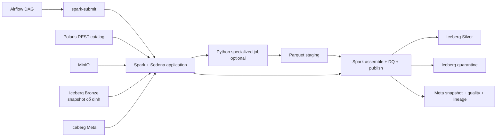

# Kiến trúc Spark cho toàn bộ Bronze → Silver

**Ngày chốt:** 10/10/2026

**Trạng thái:** Quyết định kiến trúc hiện hành

**Phạm vi:** Mọi pipeline đọc Bronze và publish Silver

Tài liệu này thay thế mô hình thực thi Bronze → Silver thuần Python/PyIceberg trong các plan ngày
30/09/2026. Schema nghiệp vụ, business key, revision, DQ và lineage trong các plan cũ vẫn giữ
nguyên nếu không xung đột với tài liệu này.

## 1. Quyết định

- Airflow là orchestrator: lập dependency, retry, schedule và theo dõi run.
- Apache Spark là compute engine mặc định của Bronze → Silver.
- Apache Sedona cung cấp spatial SQL, vector overlay và các phép raster phù hợp.
- Apache Iceberg là table format; Polaris là REST catalog; MinIO là object storage.
- Trino/DBeaver chỉ đọc và kiểm tra kết quả, không chạy ETL production.
- Python chuyên dụng vẫn xử lý thuật toán không phù hợp với Spark SQL: hydrology raster, một số
  network algorithm và NLP. Output của job Python phải đi qua Parquet staging; Spark tiếp tục DQ,
  assemble và commit Iceberg.
- Airflow worker không giữ `SparkSession`, DataFrame hay raster trong XCom. DAG gọi một Spark
  application độc lập bằng `spark-submit`.

## 2. Vì sao dùng Spark ở toàn bộ Silver

Các pipeline Silver cùng cần snapshot pinning, revision selection, spatial join, aggregate, DQ,
quarantine, incremental recompute và commit Iceberg. Dùng Spark làm engine chung đem lại một đường
đọc/ghi nhất quán, đặc biệt cho weather, OSM/exposure và event consolidation có lượng row lớn.

Spark không thay thế mọi thư viện Python. Các phép flow direction, flow accumulation, longest flow
path, HAND/TWI và NLP model vẫn được giữ trong job chuyên dụng vì thuật toán và thư viện phù hợp hơn.

## 3. Kiến trúc runtime



Các service Spark chạy trong Docker network của lakehouse và dùng endpoint nội bộ:

```text
Polaris: http://polaris:8181/api/catalog
MinIO:   http://minio:9000
```

Endpoint và secret vẫn đến từ environment/runtime settings, không ghi vào YAML pipeline.

## 4. Contract thực thi chung của một DAG Silver

```text
register_run
  -> resolve_and_pin_input_snapshots
  -> plan_incremental_scope
  -> submit_spark_transform
  -> submit_specialized_python_batches      # chỉ pipeline cần raster/hydrology/NLP
  -> submit_spark_assemble_quality_publish
  -> audit_output_snapshots_and_lineage
  -> cleanup_staging
```

Task Airflow chỉ trao đổi các giá trị nhỏ:

- `pipeline_run_id` và `build_signature`;
- input/output snapshot ID;
- URI của plan/manifest và Parquet staging;
- row count, DQ status và Spark application ID.

Task không trao đổi DataFrame, GeoDataFrame, byte raster hoặc full row list qua XCom.

## 5. Trách nhiệm giữa Airflow, Spark và Python

| Việc | Airflow | Spark/Sedona | Python chuyên dụng |
| --- | --- | --- | --- |
| Schedule, retry, dependency | Chính | Không | Không |
| Snapshot pinning/build plan | Gọi job | Chính | Không |
| Revision selection | Điều phối | Chính | Không |
| Tabular join/aggregate | Không | Chính | Chỉ unit kernel |
| Spatial join/vector overlay | Không | Chính | Fixture/reference nhỏ |
| Raster zonal statistics | Điều phối | Ưu tiên Sedona khi đã kiểm chứng | Rasterio fallback/kernel |
| Hydrology DEM | Điều phối | Assemble kết quả | Chính |
| NLP extraction | Điều phối | Normalize/consolidate | Chính |
| DQ row/warning/quarantine | Điều phối | Chính | Phát evidence lỗi thuật toán |
| Iceberg commit/MERGE | Theo dõi | Chính | Không |
| Meta audit/lineage | Finalize | Ghi batch/snapshot | Trả provenance manifest |

## 6. Cách áp dụng theo pipeline

### 6.1 Basin topology

Spark/Sedona đọc snapshot `bronze.basin_polygon_raw`, chọn revision HydroBASINS/BasinATLAS, chuẩn
hóa geometry EPSG:4326, join allowlist theo `HYBAS_ID`, tạo `silver.dim_basin` và
`silver.basin_edge`. Cycle/topological QA có thể dùng Python/NetworkX nếu tập graph nhỏ, sau đó trả
Parquet evidence để Spark publish.

### 6.2 Basin static features

Spark lập dirty basin, chọn tile bằng `bbox_wgs84`, join BasinATLAS/HydroRIVERS và assemble feature.
Sedona được ưu tiên cho zonal statistics sau khi kết quả khớp fixture Rasterio. Hydrology DEM chạy
Python theo batch basin, ghi feature/lineage Parquet và derived raster vào MinIO staging. Spark chạy
DQ cuối và publish `basin_static_feature`, `basin_feature_lineage`, quarantine và Meta.

Chi tiết ETL: [silver_basin_static_features_etl.md](silver_basin_static_features_etl.md).

### 6.3 Weather aggregation

Đây là pipeline Spark thuần chính:

```text
bronze.weather_raster_slice
  JOIN silver.source_grid
  JOIN silver.grid_basin_weight
  GROUP BY basin/version/source/product/variable/window/revision
  -> silver.basin_weather_value
```

Weight được tạo bằng Sedona trong CRS bảo toàn diện tích và cache theo grid version, basin version,
geometry processing version. Late/revised slice chỉ làm dirty business window liên quan.

### 6.4 River network

Spark/Sedona chuẩn hóa reach, spatial join river–basin và tính metric length. Graph QA hoặc snap
topology phức tạp có thể chạy Python theo snapshot. Spark publish dimension, edge và bridge table.

### 6.5 Exposure network

Spark/Sedona xử lý OSM lớn, tạo facility/road, road–basin, facility–basin, river crossing và tổng
hợp WorldPop. Thuật toán graph routing chưa thuộc Silver; chỉ xây graph/version ở đây.

### 6.6 Flood events

Spark chọn document revision, normalize structured records, deduplicate/consolidate mention/event và
spatial join event–basin. Rule/NLP extractor chạy Python, bắt buộc trả mention có evidence offset/hash
qua Parquet staging; không ghi thẳng `observed_flood_event`.

## 7. Shared Spark foundation

Cấu trúc mục tiêu:

```text
infra/docker/spark/
  Dockerfile

config/spark/
  local.yaml

src/flashflood_data/shared/spark/
  __init__.py
  models.py           # DTO qua biên Airflow/Spark và build signature
  session.py          # Spark/Sedona session + Polaris/MinIO catalog
  submit.py           # DTO/command builder cho spark-submit
  snapshots.py        # pin/read snapshot và build identity
  staging.py          # manifest + Parquet staging contract
  quality.py          # valid/reject/warning split
  publish.py          # append/MERGE/overwrite-by-filter Iceberg
  audit.py            # output snapshot, DQ, lineage payload
  runtime.py          # ghép dependency dùng chung cho domain job
  cli.py              # entrypoint spark-submit dùng chung
```

Mỗi domain sở hữu `spark_job.py`, transform và rule riêng:

```text
src/flashflood_data/pipelines/<silver_domain>/
  README.md
  airflow.py
  runtime.py
  config.py
  models.py
  planner.py
  spark_job.py
  transforms.py
  quality.py
```

Chỉ pipeline cần thuật toán chuyên dụng mới thêm `raster_job.py`, `hydrology.py`, `graph_job.py` hoặc
`extractors/`. Domain không import `spark_job.py` hay service nội bộ của domain khác.

## 8. Snapshot, revision và incremental load

Mọi Spark application nhận input snapshot ID rõ ràng. Không đọc `current` lại giữa run.

```text
build_signature = hash(
  sorted input table snapshot IDs,
  revision policy version,
  config content hash,
  transform/algorithm version,
  output contract version
)
```

- Build hoàn chỉnh cùng signature: `skip`.
- Build dở: repair output thiếu.
- Snapshot/config/algorithm đổi: build mới.
- Planner tính dirty logical group trước khi chạy transform; Spark không full scan/full rewrite mặc
  định chỉ vì DAG được trigger lại.

## 9. Staging và commit Iceberg

Mapped Python jobs chỉ ghi staging:

```text
s3://staging/silver/<pipeline>/<pipeline_run_id>/<batch_id>/
  data.parquet
  lineage.parquet
  quality.parquet
  manifest.json
  _SUCCESS
```

Spark chỉ đọc batch có manifest và `_SUCCESS`, kiểm tra schema/hash rồi publish. Mỗi bảng đích chỉ có
một Spark commit application tại một thời điểm. Bảng versioned ưu tiên append; bảng cần current-state
upsert dùng `MERGE INTO`; overwrite chỉ được dùng với filter/partition rõ ràng.

Iceberg không transaction xuyên nhiều bảng. `meta.pipeline_runs.status=success` chỉ được ghi sau khi
mọi output snapshot, quarantine, DQ và lineage đã đầy đủ. Retry kiểm tra output theo build signature.

## 10. DQ và quarantine

- Fatal object-level được phát hiện trước hoặc khi đọc input: chặn logical group phụ thuộc object.
- Row-level rejectable: Spark tách row lỗi vào `quarantine.*`, row hợp lệ vẫn publish.
- Warning: row vẫn publish; trạng thái warning được ghi ở `meta.quality_results`,
  `meta.table_snapshot_ref` và trạng thái run, không tự thêm cột ngoài schema Silver.
- Specialized Python job phải trả structured error/evidence; không chỉ throw một exception chung cho
  toàn batch nếu lỗi chỉ thuộc một basin/document.

## 11. Chạy local và quản lý tài nguyên

Spark không cần luôn chạy cùng base stack. `make spark-up` khởi động runtime khi chạy Silver và
`make spark-down` dừng runtime nhưng giữ Iceberg/MinIO. Giai đoạn đầu dùng một driver và một worker
hoặc local mode để giảm tài nguyên; không nhúng driver vào Airflow scheduler.

Mỗi Spark job phải đặt rõ executor memory, driver memory, shuffle partitions và max parallelism trong
profile local. Không dùng mặc định cluster lớn trên máy teammate. Smoke test phải chứng minh đọc một
snapshot Bronze và ghi/xóa một bảng Iceberg qua Polaris/MinIO trước khi chạy pipeline domain.
Image Spark hiện dùng Python 3.10 của image Apache chính thức; các module được import trong driver
phải giữ tương thích 3.10 dù runtime host/Airflow của repository dùng Python 3.11.

## 12. Lộ trình triển khai

1. Chốt compatibility matrix Spark, Scala, Iceberg runtime, Sedona, Hadoop AWS và Java.
2. Hoàn thiện Spark image/profile Compose và smoke read/write Iceberg.
3. Shared Spark foundation đã có session, submit contract, snapshot discovery/pinning,
   staging, DQ/quarantine projection, publisher, audit và dependency factory.
4. Chuyển basin topology thành vertical slice đầu tiên để kiểm chứng Sedona + Iceberg;
   normalize đã dùng Spark/Sedona, còn `spark_job.py`, topology, DAG và integration test.
5. Xây weather aggregation bằng Spark và benchmark backfill đại diện.
6. Xây static features theo mô hình Spark planner/publisher + Python hydrology.
7. Xây river network và exposure bằng Spark/Sedona, Python graph khi cần.
8. Xây flood event bằng Spark consolidation + Python extractor.
9. Bật dataset trigger/schedule sau khi manual run, reconciliation và resource profile ổn định.

Không triển khai đồng thời toàn bộ domain trước khi basin topology và weather chứng minh runtime,
idempotency, DQ, quarantine và Iceberg commit hoạt động đúng.

## 13. Tiêu chí nghiệm thu nền tảng Spark

- Spark đọc được Bronze theo snapshot ID qua Polaris và MinIO.
- Sedona spatial join cho kết quả khớp fixture GeoPandas/PostGIS tham chiếu.
- Spark ghi được Silver và quarantine với snapshot ID xác định.
- `MERGE INTO` chạy lại không nhân business key.
- Airflow nhận được application status nhưng không giữ dữ liệu lớn trong XCom.
- Driver/executor restart không làm run tốt trước đó mất dữ liệu.
- Một Spark job lỗi không làm scheduler Airflow hoặc base lakehouse dừng.
- Trino đọc được output ngay sau commit.
