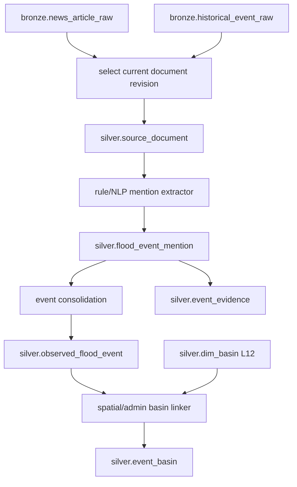

# Kế hoạch triển khai Flood Event Mention → Silver Event/Basin

> **Cập nhật runtime 10/10/2026:** Plan này giữ contract nghiệp vụ, schema, công thức và test domain.
> Phần thực thi phải theo [kiến trúc Spark Bronze → Silver](../../spark_bronze_to_silver_architecture.md):
> Airflow gọi `spark-submit`, Spark/Sedona transform + DQ + commit Iceberg, Python chỉ chạy job
> chuyên dụng và ghi Parquet staging. Mọi bước `PyIceberg`/Python writer hoặc mapped worker commit
> trong bản plan cũ đã bị thay thế bởi Spark publish application.
> Mỗi package domain phải bổ sung `spark_job.py`; `runtime.py` chỉ submit/monitor application.
> Chỉ job raster/hydrology/graph/NLP chuyên dụng mới fan-out bằng Python.


> **Dành cho người triển khai:** dùng các ô đánh dấu (`- [ ]`) theo thứ tự. Mỗi công việc phải có kiểm thử đỏ trước, code tối thiểu để qua kiểm thử, rồi chạy lại nhóm kiểm thử liên quan trước khi commit.

**Mục tiêu:** Chuẩn hóa bài báo Bronze và record lịch sử thành tài liệu có revision, trích xuất các `flood_event_mention` có evidence, hợp nhất nhiều mention thành event có revision, rồi liên kết event với BasinATLAS/HydroBASINS L12.

**Kiến trúc:** Silver có hai ranh giới chạy lại độc lập. DAG `flood_event_mentions` chọn revision đầu vào, tạo `source_document` và mention trung gian. DAG `silver_flood_events` hợp nhất mention thành `observed_flood_event`, ghi bridge `event_evidence`, sau đó gán một hoặc nhiều basin trong `event_basin`. Rule xác định được triển khai trước; NLP chỉ cắm qua protocol và luôn tạo mention có evidence, không ghi thẳng event chuẩn.

**Công nghệ:** Python 3.11, Airflow 3 TaskFlow, Pydantic 2, PyArrow, PySpark, Apache Spark/Sedona, Apache Iceberg, Shapely, GeoPandas, PyProj, pytest. NLP provider là adapter tùy chọn ở giai đoạn sau.

**Tài liệu thiết kế:** `docs/superpowers/specs/2026-10-09-flood-news-to-events-design.vi.md`

## Ràng buộc chung

- Phụ thuộc P1 DQ/quarantine, P3 Silver common, P4 `silver.dim_basin`, `bronze.news_article_raw` và/hoặc `bronze.historical_event_raw`.
- Không tạo `document_chunk`, embedding hoặc Qdrant.
- Một bài có thể sinh nhiều mention; nhiều bài có thể cùng mô tả một event.
- Mọi fact trích xuất phải truy về document version và đoạn evidence bằng offset + hash.
- NLP không được ghi trực tiếp `observed_flood_event`; output NLP phải qua cùng DQ và consolidation như rule extractor.
- Point/admin reference có thể gán basin nhưng không tạo `affected_area_km2`.
- Chỉ footprint đã xác minh mới được tính diện tích ảnh hưởng.
- Số lượng event/basin theo ngày hoặc kỳ thuộc Gold, không lưu trong `event_basin`.
- Mỗi bảng đích chỉ có một writer tại thời điểm commit.

## Luồng dữ liệu



## Cấu trúc file

```text
config/pipelines/flood_events/mentions.yaml
config/pipelines/flood_events/events.yaml
config/quality/silver_flood_events.yaml
airflow/dags/flood_event_mentions.py
airflow/dags/silver_flood_events.py
src/flashflood_data/pipelines/flood_events/
  __init__.py
  config.py
  models.py
  reader.py
  document_revision.py
  normalize.py
  quality.py
  gazetteer.py
  mentions.py
  consolidate.py
  evidence.py
  basin_link.py
  events.py
  runtime.py
  airflow.py
  extractors/
    __init__.py
    base.py
    rules.py
tests/unit/pipelines/flood_events/
  test_config.py
  test_document_revision.py
  test_normalize.py
  test_rule_extractor.py
  test_gazetteer.py
  test_mentions.py
  test_consolidate.py
  test_evidence.py
  test_basin_link.py
  test_events.py
tests/integration/silver/
  test_event_mention_pipeline.py
  test_event_pipeline.py
tests/contract/infra/test_silver_event_dags.py
```

`reader.py` chỉ đọc snapshot đã pin. `document_revision.py` chọn revision. `extractors/` tạo mention candidates. `consolidate.py` quyết định match/merge event. `basin_link.py` sở hữu quy tắc spatial/admin. `mentions.py` và `events.py` điều phối hai DAG; `runtime.py` ghép dependency dùng chung và `airflow.py` khai báo cả hai DAG.

---

## Công việc 1: Chốt schema, key và config Silver

**File:**

- Tạo: `config/pipelines/flood_events/mentions.yaml`
- Tạo: `config/pipelines/flood_events/events.yaml`
- Tạo: `config/quality/silver_flood_events.yaml`
- Tạo: `src/flashflood_data/pipelines/flood_events/{__init__,config,models}.py`
- Sửa: `src/flashflood_data/storage/iceberg_schemas.py`
- Sửa: `config/shared/metadata.yaml`
- Sửa: `tests/contract/storage/test_meta_bronze_schemas.py` hoặc contract schema Silver tương ứng.
- Tạo: `tests/unit/pipelines/flood_events/test_config.py`

**Bảng và grain:**

| Bảng | Grain/key |
| --- | --- |
| `silver.source_document` | `(document_id, document_version)` |
| `silver.flood_event_mention` | `mention_id` |
| `silver.observed_flood_event` | `(flood_event_id, event_revision)` |
| `silver.event_evidence` | `(flood_event_id, event_revision, mention_id, evidence_role)` |
| `silver.event_basin` | `(flood_event_id, event_revision, basin_id, basin_version, relation_type)` |

`source_document` giữ full text và source revision; `flood_event_mention` giữ:

- `mention_id`, `document_id`, `document_version`, `source_record_id` tùy chọn;
- `evidence_start`, `evidence_end`, `evidence_text_hash`, `evidence_text`;
- thời gian bắt đầu/kết thúc cùng precision;
- place text, resolved admin/coordinates/geometry nếu có;
- severity, casualties, affected population/damage và unit nếu có;
- extractor name/version, confidence, review status;
- quality status và provenance.

- [ ] Viết contract tests fail cho năm bảng/key.
- [ ] Bỏ contract `document_chunk` và đổi `event_evidence.chunk_id` thành `mention_id` trong schema/docs.
- [ ] Config tách mention extraction khỏi event consolidation/basin linking.
- [ ] Config hash không chứa run ID; hash bao gồm rule, gazetteer, quality và match policy liên quan.
- [ ] Chạy:

```bash
pytest tests/unit/pipelines/flood_events/test_config.py tests/contract/storage -q
```

- [ ] Commit:

```bash
git add config/silver config/quality/silver_flood_events.yaml config/shared/metadata.yaml src/flashflood_data/pipelines/flood_events src/flashflood_data/storage/iceberg_schemas.py tests/unit/pipelines/flood_events/test_config.py tests/contract/storage
git commit -m "feat(events): define Silver document and event contracts"
```

---

## Công việc 2: Chọn input revision và tạo `source_document`

**File:**

- Tạo: `src/flashflood_data/pipelines/flood_events/reader.py`
- Tạo: `src/flashflood_data/pipelines/flood_events/document_revision.py`
- Tạo: `src/flashflood_data/pipelines/flood_events/normalize.py`
- Tạo: `tests/unit/pipelines/flood_events/test_document_revision.py`
- Tạo: `tests/unit/pipelines/flood_events/test_normalize.py`

**Giao diện cần có:**

```python
def select_current_document_revisions(
    news_rows: Iterable[NewsArticleRawRow],
    historical_rows: Iterable[HistoricalEventRawRow],
    policy: DocumentRevisionPolicy,
) -> list[SelectedDocument]: ...

def normalize_source_document(selected: SelectedDocument) -> SourceDocumentRow: ...
```

News revision group theo `article_key`; historical group theo `(source_id, source_record_id)`. Chỉ row DQ eligible được rank. Thứ tự dùng provider/published/retrieved time theo policy và `object_id` làm tie-break xác định. `document_version` hash nội dung chuẩn hóa + source revision, không dùng Airflow run.

- [ ] Test hai Raw revision chỉ chọn một current document.
- [ ] Test revision policy mới có thể tạo build mới mà không thay stable `document_id`.
- [ ] Test historical structured record cũng được bọc thành source document/evidence đầu vào mà không giả tạo bài báo.
- [ ] Test rerun cùng snapshot/policy tạo cùng version.
- [ ] Test row failed/rejected không được chọn.
- [ ] Chạy:

```bash
pytest tests/unit/pipelines/flood_events/test_document_revision.py tests/unit/pipelines/flood_events/test_normalize.py -q
```

- [ ] Commit:

```bash
git add src/flashflood_data/pipelines/flood_events/reader.py src/flashflood_data/pipelines/flood_events/document_revision.py src/flashflood_data/pipelines/flood_events/normalize.py tests/unit/pipelines/flood_events/test_document_revision.py tests/unit/pipelines/flood_events/test_normalize.py
git commit -m "feat(events): normalize versioned source documents"
```

---

## Công việc 3: Protocol extractor và rule-based mention extraction

**File:**

- Tạo: `src/flashflood_data/pipelines/flood_events/extractors/{__init__,base,rules}.py`
- Tạo: `tests/unit/pipelines/flood_events/test_rule_extractor.py`

**Giao diện cần có:**

```python
class MentionExtractor(Protocol):
    name: str
    version: str
    def extract(self, document: SourceDocumentRow) -> Sequence[MentionCandidate]: ...

class RuleMentionExtractor:
    def extract(self, document: SourceDocumentRow) -> Sequence[MentionCandidate]: ...
```

Rule extractor dùng sentence/paragraph boundaries, từ khóa lũ, date/time expressions, địa danh, số liệu thiệt hại có đơn vị. Nó có thể tạo nhiều mention khi bài có các cặp thời gian/địa điểm khác nhau. Mọi field phải mang evidence span hợp lệ trong chính document version.

- [ ] Test một bài một event.
- [ ] Test một bài có hai tỉnh/hai thời điểm sinh hai candidates.
- [ ] Test số “20” không được hiểu là casualties nếu thiếu context/unit.
- [ ] Test offset cắt lại đúng evidence text và hash.
- [ ] Test structured historical row sinh mention qua extractor/adapter xác định.
- [ ] Test bài chỉ nhắc “nguy cơ lũ” không bị coi là observed event nếu policy yêu cầu sự kiện đã xảy ra.
- [ ] Chạy:

```bash
pytest tests/unit/pipelines/flood_events/test_rule_extractor.py -q
```

- [ ] Commit:

```bash
git add src/flashflood_data/pipelines/flood_events/extractors tests/unit/pipelines/flood_events/test_rule_extractor.py
git commit -m "feat(events): extract evidence-backed flood mentions"
```

---

## Công việc 4: Resolve địa danh, normalize fact và DQ mention

**File:**

- Tạo: `src/flashflood_data/pipelines/flood_events/gazetteer.py`
- Tạo: `src/flashflood_data/pipelines/flood_events/quality.py`
- Sửa: `src/flashflood_data/pipelines/flood_events/normalize.py`
- Tạo: `tests/unit/pipelines/flood_events/test_gazetteer.py`
- Mở rộng: `tests/unit/pipelines/flood_events/test_normalize.py`

Gazetteer đọc admin snapshot đã pin, alias tiếng Việt và hierarchy. Resolution mơ hồ phải giữ candidate/review state, không chọn bừa. Chuẩn hóa ngày luôn giữ precision (`exact`, `day`, `month`, `range`, `unknown`) và timezone/source.

**DQ:**

| Mức | Ví dụ | Xử lý |
| --- | --- | --- |
| Fatal document | document checksum/text không khớp | chặn document build |
| Reject mention | evidence offset ngoài text; không có bằng chứng lũ quan sát | quarantine mention |
| Warning | địa danh mơ hồ; thiếu ngày; chỉ có admin cấp cao | vẫn lưu mention, `needs_review` |
| Passed | evidence, time/place và type đạt policy | đủ điều kiện consolidation |

- [ ] Test alias tỉnh/huyện/xã có dấu và không dấu.
- [ ] Test hai địa danh trùng tên trả ambiguous result.
- [ ] Test không điền ngày xuất bản thành ngày xảy ra nếu bài không nói rõ.
- [ ] Test unit/currency không rõ được giữ raw value và warning.
- [ ] Test DQ theo bảng trên.
- [ ] Chạy:

```bash
pytest tests/unit/pipelines/flood_events/test_gazetteer.py tests/unit/pipelines/flood_events/test_normalize.py -q
```

- [ ] Commit:

```bash
git add src/flashflood_data/pipelines/flood_events/gazetteer.py src/flashflood_data/pipelines/flood_events/quality.py src/flashflood_data/pipelines/flood_events/normalize.py tests/unit/pipelines/flood_events/test_gazetteer.py tests/unit/pipelines/flood_events/test_normalize.py
git commit -m "feat(events): normalize and quality-check mentions"
```

---

## Công việc 5: Service và DAG `flood_event_mentions`

**File:**

- Tạo: `src/flashflood_data/pipelines/flood_events/mentions.py`
- Tạo/Sửa: `src/flashflood_data/pipelines/flood_events/runtime.py`
- Tạo: `airflow/dags/flood_event_mentions.py`
- Tạo: `tests/unit/pipelines/flood_events/test_mentions.py`
- Tạo: `tests/integration/silver/test_event_mention_pipeline.py`
- Tạo: `tests/contract/infra/test_silver_event_dags.py`

**Task graph:**

```text
pin_input_snapshots
  -> plan_dirty_documents
  -> extract_mention_batches.expand(...)
  -> publish_source_documents
  -> publish_event_mentions
  -> publish_run_summary
```

Dirty identity tối thiểu gồm input snapshots + document selection policy + extractor version + gazetteer version + quality policy. Document version mới hoặc extractor version mới chỉ làm dirty document liên quan.

- [ ] Test no-op cùng input/build identity.
- [ ] Test một article revision mới chỉ rebuild document/article đó.
- [ ] Test staged workers không ghi Iceberg.
- [ ] Test mỗi bảng có một writer và retry không nhân mention.
- [ ] Test lineage Bronze row → document → mention.
- [ ] DAG contract test dependency và import.
- [ ] Chạy:

```bash
pytest tests/unit/pipelines/flood_events/test_mentions.py tests/integration/silver/test_event_mention_pipeline.py tests/contract/infra/test_silver_event_dags.py -q
```

- [ ] Commit:

```bash
git add src/flashflood_data/pipelines/flood_events/mentions.py src/flashflood_data/pipelines/flood_events/runtime.py airflow/dags/flood_event_mentions.py tests/unit/pipelines/flood_events/test_mentions.py tests/integration/silver/test_event_mention_pipeline.py tests/contract/infra/test_silver_event_dags.py
git commit -m "feat(events): add flood event mention DAG"
```

---

## Công việc 6: Hợp nhất mention thành event có revision

**File:**

- Tạo: `src/flashflood_data/pipelines/flood_events/consolidate.py`
- Tạo: `src/flashflood_data/pipelines/flood_events/evidence.py`
- Tạo: `tests/unit/pipelines/flood_events/test_consolidate.py`
- Tạo: `tests/unit/pipelines/flood_events/test_evidence.py`

**Giao diện cần có:**

```python
def match_event(
    mention: FloodEventMentionRow,
    current_events: Sequence[ObservedFloodEventRow],
    policy: EventMatchPolicy,
) -> EventMatchDecision: ...

def consolidate_event(
    mentions: Sequence[FloodEventMentionRow],
    previous: ObservedFloodEventRow | None,
    policy: EventMergePolicy,
) -> ConsolidatedEvent: ...
```

Match dùng time overlap/precision, resolved place/admin/geometry và event type. Threshold phải tạo ba nhánh: auto-match, auto-new, needs-review. Không merge chỉ vì title hoặc keyword giống nhau. Stable `flood_event_id` không chứa document ID; `event_revision` chỉ tăng khi canonical payload đổi.

- [ ] Test hai bài cùng time/place hợp nhất một event và giữ hai evidence rows.
- [ ] Test cùng tỉnh nhưng khác ngày xa nhau tạo hai event.
- [ ] Test ambiguity rơi vào review, không auto-merge.
- [ ] Test evidence mới không thay canonical payload thì không tăng revision, nhưng bridge evidence được bổ sung idempotently.
- [ ] Test fact conflict giữ provenance và resolution status thay vì overwrite im lặng.
- [ ] Test revision tăng đúng một khi canonical payload đổi.
- [ ] Chạy:

```bash
pytest tests/unit/pipelines/flood_events/test_consolidate.py tests/unit/pipelines/flood_events/test_evidence.py -q
```

- [ ] Commit:

```bash
git add src/flashflood_data/pipelines/flood_events/consolidate.py src/flashflood_data/pipelines/flood_events/evidence.py tests/unit/pipelines/flood_events/test_consolidate.py tests/unit/pipelines/flood_events/test_evidence.py
git commit -m "feat(events): consolidate mentions into versioned events"
```

---

## Công việc 7: Liên kết event với basin L12

**File:**

- Tạo: `src/flashflood_data/pipelines/flood_events/basin_link.py`
- Tạo: `tests/unit/pipelines/flood_events/test_basin_link.py`

**Ưu tiên bằng chứng:** verified footprint intersection → resolved point → resolved administrative area. Mỗi row giữ `relation_type`, method/version, confidence và basin version. Footprint tính intersection/affected area trong CRS bảo toàn diện tích; point/admin chỉ để area null.

- [ ] Test footprint cắt nhiều basin và tổng area không vượt footprint do overlap/sai geometry.
- [ ] Test point trong boundary edge theo policy `covers`, không dùng `contains` cứng.
- [ ] Test admin area có thể gán nhiều basin với relation rõ ràng.
- [ ] Test point/admin giữ `affected_area_km2 = null`.
- [ ] Test basin snapshot/version đổi làm dirty links liên quan.
- [ ] Test duplicate relation bị loại theo composite key.
- [ ] Chạy:

```bash
pytest tests/unit/pipelines/flood_events/test_basin_link.py -q
```

- [ ] Commit:

```bash
git add src/flashflood_data/pipelines/flood_events/basin_link.py tests/unit/pipelines/flood_events/test_basin_link.py
git commit -m "feat(events): link flood events to L12 basins"
```

---

## Công việc 8: Service và DAG `silver_flood_events`

**File:**

- Tạo: `src/flashflood_data/pipelines/flood_events/events.py`
- Sửa: `src/flashflood_data/pipelines/flood_events/runtime.py`
- Tạo: `airflow/dags/silver_flood_events.py`
- Tạo: `tests/unit/pipelines/flood_events/test_events.py`
- Tạo: `tests/integration/silver/test_event_pipeline.py`
- Sửa: `tests/contract/infra/test_silver_event_dags.py`

**Task graph:**

```text
pin_mention_and_basin_snapshots
  -> plan_dirty_event_groups
  -> consolidate_batches.expand(...)
  -> stage_basin_links.expand(...)
  -> publish_observed_events
  -> publish_event_evidence
  -> publish_event_basins
  -> publish_run_summary
```

- [ ] Dirty plan xét mention snapshot, match/merge policy và basin snapshot/version.
- [ ] Writer event, evidence và basin chạy theo dependency rõ ràng; không để mapped task cùng commit một bảng.
- [ ] Retry sau partial audit repair được run/lineage mà không tăng revision.
- [ ] Integration test từ hai Bronze news rows → hai mentions → một event → một/nhiều basin.
- [ ] Integration test historical row và news mention cùng bổ sung evidence cho event khi match policy cho phép.
- [ ] Chạy:

```bash
pytest tests/unit/pipelines/flood_events tests/integration/silver/test_event_pipeline.py tests/contract/infra/test_silver_event_dags.py -q
```

- [ ] Commit:

```bash
git add src/flashflood_data/pipelines/flood_events/events.py src/flashflood_data/pipelines/flood_events/runtime.py airflow/dags/silver_flood_events.py tests/unit/pipelines/flood_events/test_events.py tests/integration/silver/test_event_pipeline.py tests/contract/infra/test_silver_event_dags.py
git commit -m "feat(events): add Silver flood event DAG"
```

---

## Công việc 9: Migration, pilot và tài liệu

**File:**

- Tạo: `tools/migrations/plan_flood_event_adoption.py`
- Tạo: `tests/integration/silver/test_event_adoption.py`
- Sửa: `docs/schema_contract/data.md`
- Sửa: `docs/raw_to_bronze_workflow.md`
- Sửa: `docs/pipeline_architecture_and_roadmap.md`
- Sửa: `README.md`

Migration mặc định dry-run. Nó nhận 32 record lịch sử hiện có qua Bronze/current snapshot, không đọc thẳng file bypass pipeline và không tạo event trùng. Báo cáo phải liệt kê source record → document → mention → event → basin.

- [ ] Test adoption lần đầu và chạy lại không tăng số event/revision.
- [ ] Chạy pilot rule extractor trên tập bài đã review; báo precision/recall theo field và danh sách ambiguity.
- [ ] Không bật NLP production nếu chưa có labeled set và ngưỡng nghiệm thu.
- [ ] Cập nhật sơ đồ/table schema: thêm mention, bỏ document chunk khỏi phạm vi hiện tại, đổi evidence FK.
- [ ] Chạy toàn bộ nhóm test:

```bash
pytest tests/unit/pipelines/flood_events tests/integration/silver/test_event_mention_pipeline.py tests/integration/silver/test_event_pipeline.py tests/integration/silver/test_event_adoption.py tests/contract/infra/test_silver_event_dags.py -q
```

- [ ] Commit:

```bash
git add tools/migrations/plan_flood_event_adoption.py tests/integration/silver/test_event_adoption.py docs/schema_contract/data.md docs/raw_to_bronze_workflow.md docs/pipeline_architecture_and_roadmap.md README.md
git commit -m "docs(events): document flood event Silver workflow"
```

## Giai đoạn NLP tùy chọn sau pilot

Chỉ thực hiện sau khi rule baseline và labeled set đã có:

- triển khai adapter riêng dưới `extractors/`, tuân `MentionExtractor`;
- version model, prompt/schema và decoding policy trong extractor version;
- lưu confidence + evidence span, không lưu reasoning ẩn;
- so sánh với rule baseline trên cùng labeled set;
- canary một nhóm document rồi mới backfill;
- nếu đổi model/version, chỉ chạy lại DAG mention từ `source_document`, không crawl hoặc parse Bronze lại.

## Tiêu chí nghiệm thu toàn pipeline

- Một bài có thể tạo nhiều mention mà không nhân document.
- Nhiều bài cùng sự kiện tạo một stable event và nhiều evidence rows.
- Revision đầu vào, extractor hoặc match policy thay đổi chỉ rebuild nhóm bị ảnh hưởng.
- Rerun cùng input không tăng event revision hoặc tạo bridge/basin row trùng.
- Mỗi event/basin có provenance đến mention, document và Bronze/Raw object.
- Affected area chỉ có khi evidence là verified footprint.
- Không có code/runtime dependency Qdrant, embedding hay document chunk.
