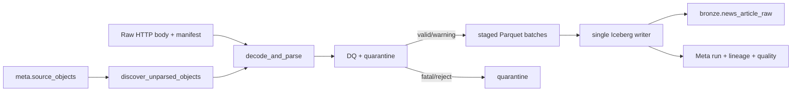

# Kế hoạch triển khai Flood News Raw → Bronze

> **Dành cho người triển khai:** dùng các ô đánh dấu (`- [ ]`) theo thứ tự. Mỗi công việc phải có kiểm thử đỏ trước, code tối thiểu để qua kiểm thử, rồi chạy lại nhóm kiểm thử liên quan trước khi commit.

**Mục tiêu:** Đọc payload bài báo bất biến ở Raw, giải mã và trích xuất nội dung nguồn đầy đủ vào `bronze.news_article_raw`, kèm metadata, DQ, lineage và phiên bản parser để có thể parse lại mà không crawl lại.

**Kiến trúc:** Pipeline discover Raw object từ `meta.source_objects`, chọn các object chưa có output cho đúng `parser_version`, parse HTML theo cấu hình từng domain với fallback chung, rồi ghi một dòng Bronze cho mỗi `(object_id, article_key)`. Bronze giữ nội dung bài báo trung thành với nguồn và kết quả keyword triage; việc suy luận sự kiện, hợp nhất nhiều bài và gán basin thuộc Silver.

**Công nghệ:** Python 3.11, Airflow 3 TaskFlow, Pydantic 2, BeautifulSoup/lxml, PyArrow, PyIceberg, pytest.

**Tài liệu thiết kế:** `docs/superpowers/specs/2026-10-09-flood-news-to-events-design.vi.md`

## Ràng buộc chung

- Phụ thuộc P1 DQ/quarantine và DAG `flood_news_landing` đã publish Raw body + manifest.
- Không gọi lại website trong DAG này; mọi input phải đọc từ Raw/Meta.
- Không NLP, không tạo flood event, không gán basin, không chunk và không Qdrant ở Bronze.
- HTML selector theo domain nằm trong config; code chỉ triển khai cơ chế áp dụng selector và fallback.
- Một Raw revision tạo một Bronze revision. Revision cũ vẫn truy vấn được qua Iceberg snapshot/lineage.
- `parser_version` phải thay đổi khi logic extractor, selector hoặc keyword policy thay đổi.
- Một writer task duy nhất commit `bronze.news_article_raw`; các task parse chỉ tạo staged batch.

## Luồng dữ liệu



## Cấu trúc file

```text
config/pipelines/flood_news/bronze.yaml
config/news_crawl/domains.yaml
config/quality/bronze_news.yaml
airflow/dags/flood_news_to_bronze.py
src/flashflood_data/news/extractor.py
src/flashflood_data/news/keywords.py
src/flashflood_data/pipelines/flood_news/
  README.md
  config.py
  models.py
  bronze_discovery.py
  bronze_parse.py
  bronze_quality.py
  bronze.py
  runtime.py
  airflow.py
src/flashflood_data/storage/iceberg_schemas.py
tests/unit/news_crawl/
  test_extractor.py
  test_keywords.py
tests/unit/pipelines/flood_news/
  test_config.py
  test_bronze_discovery.py
  test_bronze_parse.py
  test_bronze_quality.py
  test_bronze.py
tests/integration/news/test_news_bronze.py
tests/contract/infra/test_flood_news_dags.py
```

`news/extractor.py` chỉ biết biến HTML thành nội dung nguồn. `pipelines/flood_news/bronze_parse.py` đọc manifest/bytes, gọi extractor và tạo row lakehouse. `bronze.py` điều phối discovery, staging, commit và audit. `runtime.py` ghép dependency; DAG wrapper chỉ import object từ `airflow.py`.

---

## Công việc 1: Chốt schema vật lý, config và parser identity

**File:**

- Tạo: `config/pipelines/flood_news/bronze.yaml`
- Tạo: `config/quality/bronze_news.yaml`
- Tạo/Sửa: `src/flashflood_data/pipelines/flood_news/{__init__,config,models}.py`
- Sửa: `src/flashflood_data/storage/iceberg_schemas.py`
- Sửa: `config/shared/metadata.yaml`
- Sửa: `tests/contract/storage/test_meta_bronze_schemas.py`
- Tạo: `tests/unit/pipelines/flood_news/test_config.py`

**Giao diện cần có:**

```python
class NewsBronzeConfig(BaseModel):
    table: str
    source_id: str
    extractor_version: str
    domain_config_path: Path
    keyword_policy_path: Path
    quality_policy_path: Path
    parse_batch_size: int

def compute_news_parser_version(config: NewsBronzeConfig) -> str: ...
```

`bronze.news_article_raw` có grain `(object_id, article_key)` và tối thiểu các field:

- identity/provenance: `object_id`, `article_key`, `source_id`, `publisher_id`, `ingest_run_id`, `parser_version`;
- URL: `requested_url`, `final_url`, `canonical_url`;
- nội dung: `title`, `content_text`, `content_text_checksum`, `language`;
- metadata nguồn: `author`, `published_at_raw`, `published_at`, `retrieved_at`;
- extraction: `extraction_scope`, `extractor_name`, `extractor_version`;
- triage: `keyword_hits`, `triage_status`, `triage_reason`, `triage_policy_version`;
- DQ: `quality_status`, `quality_rule_ids`.

- [ ] Viết contract test fail vì bảng/key/schema chưa có.
- [ ] Thêm schema và `BRONZE_KEYS["news_article_raw"] = ("article_key",)`.
- [ ] Loader từ chối path thiếu và batch size không dương.
- [ ] `compute_news_parser_version()` hash canonical config của extractor, domain selectors, keyword policy và DQ policy; không dùng `run_id`.
- [ ] Chạy:

```bash
pytest tests/contract/storage/test_meta_bronze_schemas.py tests/unit/pipelines/flood_news/test_config.py -q
```

- [ ] Commit:

```bash
git add config/pipelines/flood_news/bronze.yaml config/quality/bronze_news.yaml config/shared/metadata.yaml src/flashflood_data/pipelines/flood_news src/flashflood_data/storage/iceberg_schemas.py tests/contract/storage/test_meta_bronze_schemas.py tests/unit/pipelines/flood_news/test_config.py
git commit -m "feat(news): define Bronze article contract"
```

---

## Công việc 2: Trích xuất nội dung và metadata theo domain

**File:**

- Sửa: `config/news_crawl/domains.yaml`
- Sửa: `src/flashflood_data/news/extractor.py`
- Sửa: `tests/unit/news_crawl/test_extractor.py`
- Thêm fixture HTML nhỏ dưới `tests/fixtures/news/`.

**Giao diện cần có:**

```python
@dataclass(frozen=True)
class ExtractedArticle:
    title: str | None
    content_text: str
    canonical_url: str | None
    author: str | None
    published_at_raw: str | None
    extraction_scope: str
    extractor_name: str

def extract_article(html: str, *, final_url: str, domain_rules: DomainRules) -> ExtractedArticle: ...
```

Thứ tự metadata: selector domain → JSON-LD → OpenGraph/meta → fallback HTML. Nội dung phải loại script/style/menu/footer, giữ thứ tự đoạn, chuẩn hóa whitespace nhưng không tóm tắt hoặc diễn giải.

- [ ] Viết test cho selector domain, JSON-LD, canonical URL và fallback chung.
- [ ] Viết test bảo đảm text có Unicode tiếng Việt và không chứa menu/script.
- [ ] Cấu hình selector cho từng publisher pilot; selector sai không được làm crash object nếu fallback còn lấy được text.
- [ ] Nếu cả selector và fallback không có nội dung, trả kết quả để DQ quyết định, không tự bịa title/text.
- [ ] Kiểm tra thủ công tối thiểu hai bài thật cho mỗi domain pilot và lưu URL cùng selector trong `docs/news-crawl-pilot.md` khi triển khai.
- [ ] Chạy:

```bash
pytest tests/unit/news_crawl/test_extractor.py -q
```

- [ ] Commit:

```bash
git add config/news_crawl/domains.yaml src/flashflood_data/news/extractor.py tests/unit/news_crawl/test_extractor.py tests/fixtures/news
git commit -m "feat(news): extract source-faithful article text"
```

---

## Công việc 3: Decode Raw payload và tạo Bronze row

**File:**

- Tạo: `src/flashflood_data/pipelines/flood_news/bronze_parse.py`
- Tạo: `tests/unit/pipelines/flood_news/test_bronze_parse.py`

**Giao diện cần có:**

```python
def parse_news_object(
    payload: bytes,
    manifest: RawNewsManifest,
    config: NewsBronzeConfig,
) -> NewsArticleRawRow: ...
```

Quy tắc decode: charset hợp lệ trong `Content-Type` → BOM → detector/fallback UTF-8 có kiểm soát. `published_at_raw` giữ chuỗi gốc; `published_at` chỉ ghi khi parse có timezone hoặc policy timezone rõ ràng. `content_text_checksum = sha256(UTF-8 text chuẩn hóa)`.

- [ ] Test UTF-8, BOM và charset header.
- [ ] Test `object_id/article_key/URLs/retrieved_at` được lấy từ manifest, không suy lại từ HTML.
- [ ] Test cùng payload/config sinh row xác định và checksum giống nhau.
- [ ] Test HTML malformed vẫn parse nếu thư viện có thể phục hồi.
- [ ] Test một article Raw revision mới giữ cùng `article_key` nhưng có `object_id` và text checksum mới.
- [ ] Chạy:

```bash
pytest tests/unit/pipelines/flood_news/test_bronze_parse.py -q
```

- [ ] Commit:

```bash
git add src/flashflood_data/pipelines/flood_news/bronze_parse.py tests/unit/pipelines/flood_news/test_bronze_parse.py
git commit -m "feat(news): parse Raw article payloads"
```

---

## Công việc 4: Keyword triage và DQ/quarantine

**File:**

- Sửa: `src/flashflood_data/news/keywords.py`
- Tạo: `src/flashflood_data/pipelines/flood_news/bronze_quality.py`
- Sửa/Tạo: `tests/unit/news_crawl/test_keywords.py`
- Tạo: `tests/unit/pipelines/flood_news/test_bronze_quality.py`

Triage chỉ cho biết bài có khả năng liên quan lũ. Nó không phải nhãn event. Policy version được hash từ `keywords_v2.yaml`.

**Phân loại DQ:**

| Mức | Ví dụ | Xử lý |
| --- | --- | --- |
| Fatal object | checksum Raw sai, manifest thiếu, body không đọc được | không ghi Bronze; ghi object rejection |
| Row reject | final URL/article identity không hợp lệ, text rỗng dưới ngưỡng bắt buộc | ghi row rejection; không publish row |
| Warning | thiếu author/time, fallback extractor, text ngắn nhưng trên ngưỡng | publish với `quality_status=warning` |
| Passed | identity và nội dung đạt policy | publish bình thường |

- [ ] Test keyword trên title + full text và giữ danh sách hit xác định.
- [ ] Test từng nhánh fatal/reject/warning/passed.
- [ ] Test rule ID và policy version được lưu trong result.
- [ ] Test warning không bị biến thành row reject.
- [ ] Chạy:

```bash
pytest tests/unit/news_crawl/test_keywords.py tests/unit/pipelines/flood_news/test_bronze_quality.py -q
```

- [ ] Commit:

```bash
git add src/flashflood_data/news/keywords.py src/flashflood_data/pipelines/flood_news/bronze_quality.py tests/unit/news_crawl/test_keywords.py tests/unit/pipelines/flood_news/test_bronze_quality.py
git commit -m "feat(news): add article triage and quality rules"
```

---

## Công việc 5: Discovery incremental, staging và single-writer commit

**File:**

- Tạo: `src/flashflood_data/pipelines/flood_news/bronze_discovery.py`
- Tạo: `src/flashflood_data/pipelines/flood_news/bronze.py`
- Tạo: `src/flashflood_data/pipelines/flood_news/runtime.py`
- Tạo: `tests/unit/pipelines/flood_news/test_bronze_discovery.py`
- Tạo: `tests/unit/pipelines/flood_news/test_bronze.py`
- Tạo: `tests/integration/news/test_news_bronze.py`

**Giao diện cần có:**

```python
def discover_news_objects(
    source_objects: Iterable[SourceObject],
    bronze_evidence: Iterable[BronzeEvidence],
    parser_version: str,
) -> list[NewsObjectWorkItem]: ...

class NewsBronzeService:
    def plan(self, run_id: str) -> NewsBronzePlan: ...
    def parse_batch(self, run_id: str, items: Sequence[NewsObjectWorkItem]) -> StagedNewsBatch: ...
    def publish(self, run_id: str, batches: Sequence[StagedNewsBatch]) -> NewsBronzeResult: ...
```

Discovery bỏ qua object chỉ khi output cho chính `(object_id, parser_version)` tồn tại, run thành công và snapshot/output còn đọc được. Tăng parser version phải parse lại Raw, không fetch website. Publish dùng replace key đúng object trong batch, không overwrite toàn bảng.

- [ ] Test no-op khi evidence hợp lệ.
- [ ] Test output bị mất hoặc run failed thì object được lập kế hoạch lại.
- [ ] Test parser version mới lập kế hoạch lại đúng object.
- [ ] Test parse batch không ghi Iceberg.
- [ ] Test writer deduplicate cùng key trong staged batches, commit một snapshot, rồi mới ghi lineage/quality/run success.
- [ ] Test crash sau commit trước audit được repair khi retry, không nhân row.
- [ ] Integration test với object store/catalog giả hoặc smoke namespace.
- [ ] Chạy:

```bash
pytest tests/unit/pipelines/flood_news tests/integration/news/test_news_bronze.py -q
```

- [ ] Commit:

```bash
git add src/flashflood_data/pipelines/flood_news tests/unit/pipelines/flood_news tests/integration/news/test_news_bronze.py
git commit -m "feat(news): add incremental Raw to Bronze service"
```

---

## Công việc 6: DAG, vận hành thử và cập nhật tài liệu

**File:**

- Tạo: `airflow/dags/flood_news_to_bronze.py`
- Sửa: `tests/contract/infra/test_flood_news_dags.py`
- Sửa: `docs/news-crawl-pilot.md`
- Sửa: `docs/raw_to_bronze_workflow.md`
- Sửa: `docs/schema_contract/data.md`
- Sửa: `docs/pipeline_architecture_and_roadmap.md`
- Sửa: `README.md`

**Task graph:**

```text
plan_unparsed_objects
  -> parse_object_batches.expand(...)
  -> publish_bronze_articles
  -> publish_run_summary
```

- [ ] DAG dùng batch mapping; không map một task cho mỗi URL nếu có thể gom batch.
- [ ] Pool parse và giới hạn batch cấu hình được; writer chỉ có một instance.
- [ ] Summary đọc trạng thái cuối cùng của upstream sau retry, không giữ failure tạm thời từ attempt cũ.
- [ ] Contract test DAG import và dependency.
- [ ] Trigger pilot; kiểm tra text, URLs, timestamp, DQ và lineage bằng Trino.
- [ ] Trigger lại: `0` object khi parser version không đổi.
- [ ] Đổi extractor version trong môi trường test: parse lại từ Raw nhưng không có HTTP request.
- [ ] Chạy:

```bash
pytest tests/unit/news_crawl tests/unit/pipelines/flood_news tests/integration/news/test_news_bronze.py tests/contract/infra/test_flood_news_dags.py -q
```

- [ ] Commit:

```bash
git add airflow/dags/flood_news_to_bronze.py tests/contract/infra/test_flood_news_dags.py docs/news-crawl-pilot.md docs/raw_to_bronze_workflow.md docs/schema_contract/data.md docs/pipeline_architecture_and_roadmap.md README.md
git commit -m "feat(news): add flood news Bronze DAG"
```

## Điểm kiểm tra trước Silver

- Mỗi Raw object hợp lệ có đúng một Bronze row cho parser version hiện hành.
- Full text có thể đọc trực tiếp bằng Trino; không cần đọc HTML để chạy Silver.
- Parser/selector/keyword thay đổi có thể reprocess mà không crawl lại.
- Bài không liên quan được giữ provenance và triage status nhưng Silver mặc định không chọn.
- Fatal/reject/warning đã đi qua DQ/quarantine chung.
- Bronze chưa chứa event, basin assignment hoặc model inference.
