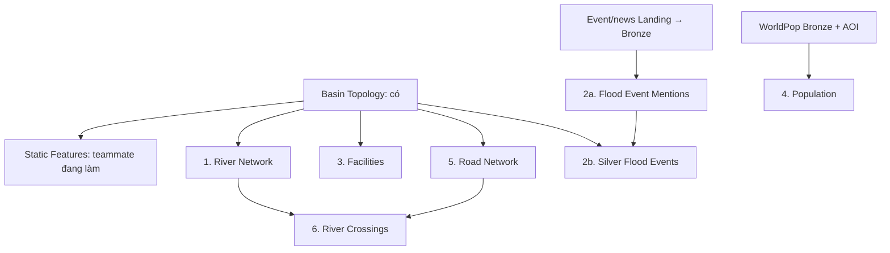

# Kế hoạch hoàn thiện các pipeline Silver còn lại

> **Dành cho người triển khai:** dùng `executing-plans` khi bắt đầu code từng domain.
> Các checkbox là việc chưa nghiệm thu; tài liệu này không tạo DAG hay bảng.

**Mục tiêu:** hoàn thiện Silver với pipeline nhỏ theo domain, dễ đọc từng file và
có thể chạy lại độc lập. **Cập nhật:** 08/11/2026.

**Kiến trúc:** Airflow → domain runtime → Spark job → transform/DQ → Iceberg →
manifest → Meta. Dùng foundation hiện có, mỗi bảng một writer, dependency qua
snapshot output của run hoàn tất. Không xây một DAG `silver_exposure_network` chung.

**Công nghệ:** Spark/Sedona, Iceberg/Polaris, MinIO, Airflow, Python/Rasterio cho
raster block, framework DQ/quarantine và audit hiện có.

**Thiết kế:** [Tách Exposure Silver](../specs/2026-11-08-silver-exposure-split-design.vi.md).

## 1. Baseline

| Domain | Trạng thái cho lần lập plan này |
| --- | --- |
| Shared Spark + Basin Topology | Đã triển khai, không giao lại |
| Weather Aggregation | Người dùng xác nhận đã xong; không giao lại phần implementation |
| Static Basin Features | Teammate đang triển khai; giữ plan/package hiện tại |
| River Network | Cần triển khai theo plan riêng |
| Flood Events | Cần triển khai hai DAG Silver; upstream event/news Bronze là prerequisite riêng |
| Facilities, Population, Road Network, River Crossings | Bốn pipeline mới thay Exposure gom chung |

Ngoài Static Feature đang làm, còn **6 nhóm domain / 7 DAG**:
River Network (1), Flood Events (2), Facilities (1), Population (1), Road Network (1),
River Crossings (1). Tính cả Static Feature thì còn **7 nhóm / 8 DAG** cần hoàn thiện.
Không tính Landing/Bronze event, Gold, Serving, KG, Qdrant hoặc dashboard vào số này.

## 2. Dependency và thứ tự

Số thứ tự là thứ tự bàn giao khuyến nghị, không phải dependency ép tuần tự.
Facilities/Population/Road có thể phát triển bằng fixture trong lúc River đang làm.
Population không cần chờ Static Feature hoặc River. Flood Events chờ Bronze
evidence trước khi production, nhưng có thể test extractor bằng fixture.

| Đợt | Người 1 | Người 2 |
| --- | --- | --- |
| Hiện tại | River Network | Hoàn thiện Static Feature |
| Tiếp theo | Road Network | Flood Events (mention → event/basin) |
| Sau đó — đề xuất bổ sung | River Crossings khi Road + River đủ evidence | Facilities → Population |

Hai hàng đầu giữ phân công đã thống nhất. Hàng cuối là đề xuất cho bốn domain mới,
có thể đổi owner theo tiến độ; không cùng sửa writer/schema của một bảng trên hai branch.

## 3. Plan và output

| Pipeline / DAG | Plan hiện hành | Output |
| --- | --- | --- |
| `silver_river_network` | [River](2026-09-30-silver-river-network.vi.md) | `dim_river_reach`, `river_reach_edge`, `river_basin` |
| `flood_event_mentions` → `silver_flood_events` | [Events](2026-10-09-flood-event-silver.vi.md) | `source_document`, `flood_event_mention`, `observed_flood_event`, `event_evidence`, `event_basin` |
| `silver_facilities` | [Facilities](2026-11-08-silver-facilities.vi.md) | `dim_facility`, `facility_basin` |
| `silver_population` | [Population](2026-11-08-silver-population.vi.md) | `population_grid`, bổ sung `source_grid` |
| `silver_road_network` | [Road](2026-11-08-silver-road-network.vi.md) | `dim_road_node`, `dim_road_edge`, `road_basin` |
| `silver_river_crossings` | [Crossings](2026-11-08-silver-river-crossings.vi.md) | `river_crossing` |

Plan Exposure ngày 30/09 chỉ còn tham khảo lịch sử; không thực hiện DAG/package
`silver_exposure_network`/`silver_exposure` trong plan đó. `document_chunk` không
thuộc đợt này; Events dùng mention/evidence span như plan 09/10.

## 4. Gate chung trước khi coi Silver hoàn tất

- [ ] Mỗi domain có config, schema/registry, transform, DQ, Spark job, runtime,
  DAG manual, README và test fixture; bàn giao theo thứ tự file trong plan riêng.
- [ ] Mỗi output có version ổn định, geometry/unit đúng và truy được input snapshot.
- [ ] Fatal block, row reject vào quarantine, warning giữ được evidence.
- [ ] Chạy cùng snapshot/config trả skip; ngắt giữa hai commit rồi retry repair
  không sinh row trùng hoặc đánh dấu bundle nửa vời là hoàn tất.
- [ ] Upstream version mới được downstream phát hiện và pin đúng; không dùng snapshot
  mới nhất của các bảng độc lập để tự ghép thành một bộ version.
- [ ] Smoke dữ liệu thật trong AOI, xem bằng Trino; ghi thời gian theo phase và
  ngưỡng tài nguyên. Không tạo hàng nghìn task/commit theo từng feature.
- [ ] Contract `population_version`, road `ford`/`osm_layer` và Events mention
  được đồng bộ trong schema, registry, `data.md` và test trước publish.
- [ ] Phân biệt xong implementation với xong backfill/production nghiệm thu;
  checklist Weather nâng cao như dirty-window vẫn theo backlog riêng.

Gold triển khai sau khi các input cần thiết ổn định; không đưa risk, passability,
route, tổng số event theo kỳ hay exposure snapshot vào Silver để lấp thiếu Gold.
