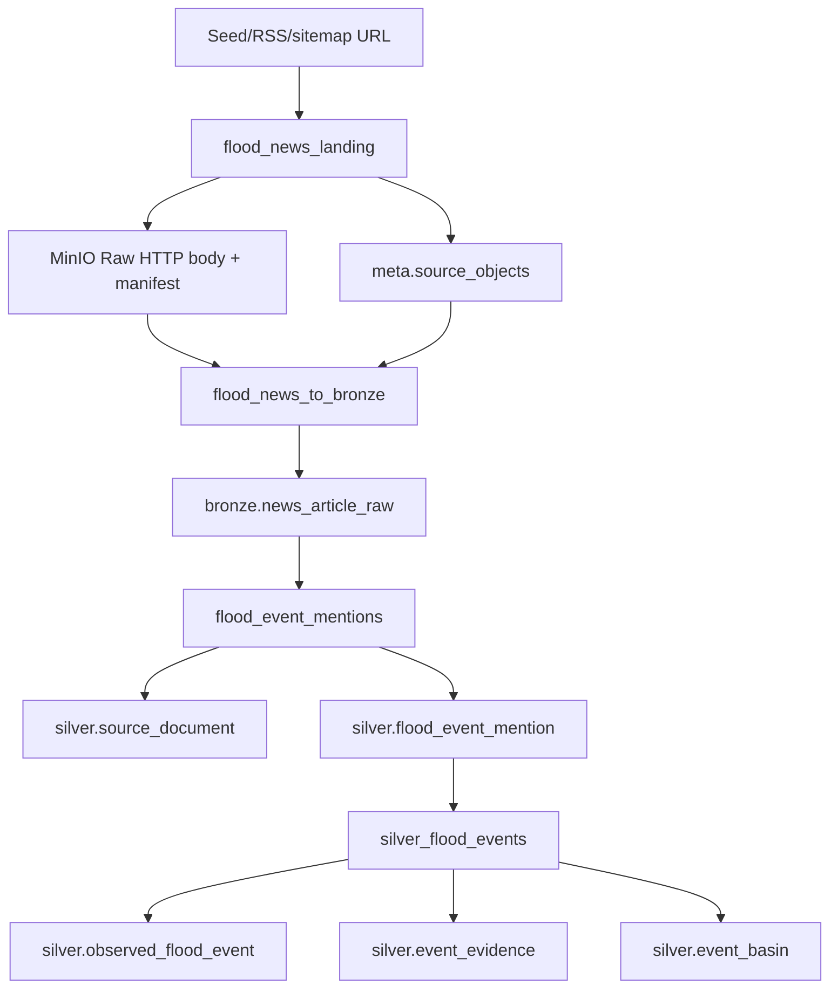

# Thiết kế pipeline tin báo lũ từ Raw đến Silver

**Ngày:** 2026-10-09

**Trạng thái:** Đã duyệt trong trao đổi ngày 2026-10-09

**Phạm vi:** thu thập bài báo từ danh sách URL, lưu Raw bất biến, bóc toàn văn vào Bronze, trích các mention có cấu trúc ở Silver, hợp nhất mention thành sự kiện và liên kết sự kiện với basin L12.

**Thay thế:** phần flood-event document/NLP bị hoãn trong `2026-09-30-bronze-to-silver-pipelines-design.vi.md` và kế hoạch Silver flood event cũ. Các pipeline Silver khác không bị thay đổi.

## 1. Mục tiêu

Pipeline phải cho phép sửa HTML extractor, keyword policy, rule/NLP extractor, thuật toán hợp nhất event và basin version độc lập mà không crawl lại website khi Raw còn tồn tại.

Đầu ra cuối của phạm vi này:

- Raw HTTP body và manifest trong MinIO;
- `bronze.news_article_raw` chứa full text theo từng Raw revision;
- `silver.source_document` chứa document revision được chuẩn hóa;
- `silver.flood_event_mention` chứa fact/candidate có evidence span;
- `silver.observed_flood_event` chứa event canonical có revision;
- `silver.event_evidence` liên kết event với mention, không phụ thuộc document chunk;
- `silver.event_basin` liên kết event với basin version.

Thống kê số event, thiệt hại hoặc tần suất theo basin/thời gian thuộc Gold và nằm ngoài phạm vi triển khai này.

## 2. Hiện trạng và vấn đề

Pilot hiện có:

```text
config/news_crawl/seeds.csv
  -> PoliteFetcher
  -> generic HTML extractor
  -> keyword triage
  -> CSV/JSON local
```

Code đang có trong `src/flashflood_data/news/` là nền tảng phù hợp để tái sử dụng, nhưng chưa phải pipeline lakehouse:

- HTML chỉ tồn tại trong memory rồi bị bỏ;
- CSV/JSON không có object identity, checksum, manifest hoặc lineage;
- `domains.yaml` chưa được extractor dùng;
- chưa lấy canonical URL, published time và author từ metadata trang;
- chưa có article revision;
- keyword match chỉ triage, chưa phải event extraction;
- một bài có thể nói nhiều event và nhiều bài có thể nói cùng một event;
- chưa có DQ/quarantine và retry state qua Airflow.

Thay đổi local thêm field `text` vào output pilot được giữ để kiểm tra thủ công, nhưng output CSV/JSON không trở thành nguồn sự thật của pipeline.

## 3. Quyết định kiến trúc

### 3.1. Ranh giới tầng



Raw giữ response body sau khi giải mã transport content-encoding nhưng trước charset decode và HTML parse. Headers cần thiết để decode và kiểm chứng được ghi trong manifest/provider metadata.

Bronze thực hiện parse kỹ thuật: decode charset, bóc title/body/metadata và triage keyword. Bronze không khẳng định event canonical hoặc basin.

Silver thực hiện parse ngữ nghĩa: trích mention, chuẩn hóa ngày/địa điểm/số liệu, hợp nhất nhiều mention thành một event và gắn basin.

### 3.2. Tách DAG

Không dùng một DAG end-to-end. Bốn DAG có ranh giới retry và version riêng:

| DAG | Input | Output | Khi cần chạy lại |
| --- | --- | --- | --- |
| `flood_news_landing` | URL candidates | Raw + Meta | URL mới, refresh policy hoặc HTTP revision |
| `flood_news_to_bronze` | Raw HTML | `news_article_raw` | Raw object mới hoặc extractor/triage version đổi |
| `flood_event_mentions` | Bronze article và structured historical rows | `source_document`, `flood_event_mention` | mention extraction/model/gazetteer version đổi |
| `silver_flood_events` | Silver mentions + basin | event/evidence/basin | clustering, consolidation hoặc basin version đổi |

Ban đầu cả bốn DAG `schedule=None`. Chỉ cân nhắc lịch crawl sau khi selector, robots policy, rate limit và quality pilot đạt tiêu chí.

### 3.3. Không lưu document chunk

Pipeline không tạo `silver.document_chunk`, embedding hoặc Qdrant. Evidence trỏ trực tiếp tới:

```text
document_id + document_version + character_start + character_end + evidence_text_hash
```

Nếu sau này cần semantic search, document chunk là projection tái tạo được từ `silver.source_document`, không phải dependency của event pipeline.

## 4. Identity và revision

### 4.1. URL và article

```text
canonical_url = URL đã bỏ tracking, chuẩn host/path và ưu tiên canonical URL hợp lệ từ trang
article_key   = SHA-256(source_id + publisher_id + canonical_url)
asset_id      = "news-" + article_key
```

Redirect cuối không được tự động thay identity nếu trang vẫn khai báo canonical URL cũ. Cross-domain canonical URL chỉ được chấp nhận theo allowlist để tránh trang lỗi/captcha đổi identity.

### 4.2. Raw object

```text
payload_checksum = SHA-256(response body sau transport decoding)
object_id = SHA-256(
    source_id + source_version + asset_id
    + canonical selection + payload_checksum
    + manifest_schema_version
)
```

Raw key:

```text
news/<publisher_id>/<article_key>/retrieved_date=YYYY-MM-DD/<payload_checksum>/response.html
```

Cùng URL và cùng bytes được reuse. Cùng URL nhưng bytes đổi tạo object mới và giữ object cũ.

### 4.3. Bronze article

Một dòng Bronze tương ứng một Raw object đã parse. `text_checksum` được tính từ text đã normalize whitespace nhưng không tóm tắt hoặc dịch.

Template/sidebar đổi có thể làm Raw checksum đổi nhưng `text_checksum` không đổi. Silver có thể collapse các Raw revisions này thành cùng một document version.

### 4.4. Silver document

```text
document_id = SHA-256(source_id + article_key)
document_version = SHA-256(text_checksum + article_extractor_version)
```

Khóa là `(document_id, document_version)`. `is_current` được chọn theo quality, provider-published time, retrieved time và object ID tie-break.

### 4.5. Mention và event

```text
mention_id = SHA-256(
    document_id + document_version
    + extraction_version + evidence span
    + normalized mention payload
)
```

Một document có thể sinh nhiều mention. Mention không bị sửa tại chỗ khi extractor đổi; version mới tạo mention identity mới, còn current build được xác định bởi extraction version.

`flood_event_id` ổn định khi một event đã tồn tại được matching policy nhận diện lại. Event mới lấy ID từ anchor mention ổn định. `event_revision` tăng khi consolidated payload hoặc evidence set thay đổi; rerun cùng input không tăng revision.

## 5. Contract dữ liệu

### 5.1. `bronze.news_article_raw`

Grain: một dòng / Raw HTML object.

| Field | Kiểu | Ý nghĩa |
| --- | --- | --- |
| `object_id` | string ! PK/FK | Raw object đã parse. |
| `article_key` | string ! | Identity URL/publisher ổn định. |
| `source_id` | string ! | `flood_news_web`. |
| `publisher_id` | string ! | Publisher canonical. |
| `requested_url` | string ! | URL planner yêu cầu. |
| `final_url` | string ! | URL sau redirect. |
| `canonical_url` | string ! | URL canonical đã kiểm tra policy. |
| `title` | string ? | Tiêu đề bài. |
| `article_text` | string ! | Full text đã bóc. |
| `text_checksum` | string ! | SHA-256 normalized text. |
| `published_at_raw` | string ? | Thời gian nguyên văn/metadata. |
| `published_at` | timestamp ? | Timestamp nếu parse không mơ hồ. |
| `author_raw` | string ? | Tác giả theo nguồn. |
| `extraction_scope` | string ! | `domain_selector`, `json_ld`, `article`, `fallback`. |
| `keyword_hits_json` | json ! | Hit theo policy version. |
| `triage_status` | string ! | `keep`, `review`, `reject`. |
| `triage_reason` | string ? | Lý do triage. |
| `retrieved_at` | timestamp ! | Thời điểm fetch object. |
| `extractor_version` | string ! | Phiên bản HTML extractor. |
| `triage_policy_version` | string ! | Phiên bản keyword/policy. |
| `ingest_run_id` | string ! | Run Bronze. |
| `quality_status` | string ! | `passed` hoặc `warning`; reject nằm quarantine. |

### 5.2. `silver.source_document`

Grain: `(document_id, document_version)`.

| Field | Kiểu | Ý nghĩa |
| --- | --- | --- |
| `document_id` | string ! PK | Identity bài ổn định. |
| `document_version` | string ! PK | Version text/extractor. |
| `article_key` | string ! | Liên kết Bronze revisions. |
| `raw_object_id` | string ! FK | Raw object authoritative cho version. |
| `source_uri` | string ! | Canonical URL. |
| `publisher_id` | string ! | Publisher. |
| `title` | string ? | Tiêu đề chuẩn hóa. |
| `document_type` | string ! | `news_article` hoặc `structured_event_record`. |
| `content_text` | string ! | Text dùng cho extraction/evidence. |
| `text_checksum` | string ! | Hash text. |
| `published_at` | timestamp ? | Thời gian công bố. |
| `is_current` | boolean ! | Version hiện hành theo policy. |
| `extraction_version` | string ! | Cách tạo document. |
| `quality_status` | string ! | Trạng thái DQ. |

### 5.3. `silver.flood_event_mention`

Grain: một claim/mention có evidence span trong một document version.

| Field | Kiểu | Ý nghĩa |
| --- | --- | --- |
| `mention_id` | string ! PK | Identity mention xác định. |
| `document_id` | string ! FK | Document chứa mention. |
| `document_version` | string ! FK | Version text dùng để trích. |
| `source_record_id` | string ? | ID dòng nếu nguồn là Excel/CSV. |
| `event_type` | string ! | Loại event theo vocabulary. |
| `event_start` | timestamp ? | Bắt đầu đã normalize. |
| `event_end` | timestamp ? | Kết thúc đã normalize. |
| `reported_place` | string ? | Địa danh nguyên văn. |
| `resolved_admin_ids` | list<string> ! | Candidate admin đã resolve. |
| `longitude` | double ? | Tọa độ được báo cáo. |
| `latitude` | double ? | Tọa độ được báo cáo. |
| `fatalities` | int ? | Số chết gắn với mention. |
| `missing_people` | int ? | Số mất tích. |
| `injured_people` | int ? | Số bị thương. |
| `affected_households` | int ? | Số hộ ảnh hưởng/di dời theo role đã cấu hình. |
| `damaged_houses` | int ? | Số nhà hư hại. |
| `economic_loss_vnd` | double ? | Thiệt hại tiền tệ đã đổi về VND khi chắc chắn. |
| `facts_json` | json ! | Fact mở rộng và unit/source wording. |
| `evidence_start` | int ! | Offset bắt đầu trong `content_text`. |
| `evidence_end` | int ! | Offset kết thúc. |
| `evidence_text_hash` | string ! | Hash đoạn evidence. |
| `extractor_name` | string ! | `rules` hoặc adapter NLP cụ thể. |
| `extraction_version` | string ! | Version rule/model/prompt. |
| `confidence_score` | double ? | 0–1 nếu extractor cung cấp. |
| `review_status` | string ! | `accepted`, `needs_review`, `rejected`. |
| `quality_status` | string ! | DQ mention. |

### 5.4. Event, evidence và basin

`silver.observed_flood_event` tiếp tục dùng khóa `(flood_event_id, event_revision)` và cờ `is_current`.

`silver.event_evidence` đổi grain thành:

```text
(flood_event_id, event_revision, mention_id, evidence_role)
```

Nó không tham chiếu `document_chunk`.

`silver.event_basin` tiếp tục dùng:

```text
(flood_event_id, event_revision, basin_id, basin_version)
```

Chỉ footprint được xác minh mới tạo `affected_area_km2`. Point hoặc administrative reference chỉ tạo relation và để area null.

## 6. Extraction strategy

### 6.1. Deterministic extraction trước

Phiên bản đầu phải có rule extractor chạy offline cho:

- date/range date tiếng Việt;
- địa danh từ gazetteer hành chính;
- số chết, mất tích, bị thương;
- hộ phải sơ tán/ảnh hưởng;
- nhà bị hư hại/cuốn trôi;
- tiền thiệt hại và đơn vị;
- event-type terms.

Mọi fact giữ evidence span và wording gốc. Không cộng các số trong cùng bài nếu role/context không rõ.

### 6.2. NLP là adapter, không là đường ghi trực tiếp

Interface:

```python
class MentionExtractor(Protocol):
    name: str
    version: str

    def extract(self, document: SourceDocumentRow) -> Sequence[MentionCandidate]: ...
```

Output rule hoặc NLP đều phải qua cùng schema validation, DQ và review policy. NLP không được ghi thẳng `observed_flood_event`.

NLP adapter chỉ được bật sau khi tập pilot có nhãn và đo precision/recall theo field. Credential/model/prompt không nằm trong YAML tracked nếu chứa secret.

## 7. Hợp nhất event

Mention clustering dùng các tín hiệu có version:

1. event type tương thích;
2. thời gian giao hoặc nằm trong tolerance;
3. resolved admin/place overlap;
4. river/basin context nếu có;
5. impact fact không mâu thuẫn nghiêm trọng;
6. reference ID từ structured source nếu có.

Không dùng text similarity đơn lẻ để merge. Ambiguous match tạo `needs_review`, không tự merge.

Khi nhiều bài lặp lại cùng số liệu từ một nguồn tin, consolidated event không cộng các con số. Consolidator giữ fact được chọn cùng evidence và conflict report.

## 8. Data quality và quarantine

Pipeline phụ thuộc DQ framework đa tầng đã thiết kế:

| Giai đoạn | Fatal object | Row/mention reject | Warning |
| --- | --- | --- | --- |
| Landing | checksum/body/manifest conflict | Không áp dụng | thiếu optional header |
| Bronze | không decode được, Raw mismatch | không có usable article text | fallback extractor, thiếu published time |
| Mention | document/schema hỏng toàn bộ | offset sai, fact/unit không hợp lệ | địa danh mơ hồ, confidence thấp |
| Consolidation | duplicate key/cycle revision | candidate không đủ merge | event chưa gắn basin |

Operational error như timeout, HTTP 429/5xx, MinIO hoặc catalog unavailable không bị phân loại thành data rejection.

## 9. Incremental processing

- Landing dùng canonical article asset identity, conditional GET và checksum.
- Bronze discover Raw object chưa có lineage thành công cho đúng extractor/triage version.
- Mention build signature gồm Bronze snapshot/object set, document policy, gazetteer snapshot và extraction version.
- Consolidation build signature gồm mention snapshot, basin snapshot và clustering/linking version.
- Cùng signature đã publish thì skip.
- Signature mới chỉ stage logical article/event groups bị dirty; writer không overwrite toàn bảng.
- Retry dùng replace/upsert theo deterministic key và repair output thiếu.

## 10. Bảo mật, crawl etiquette và vận hành

- Kiểm tra robots policy trước fetch và lưu decision/version trong attempt metadata.
- Rate limit theo từng host, không chỉ host gọi gần nhất.
- Tôn trọng `Retry-After`, exponential backoff và per-domain concurrency.
- User-Agent có contact/config rõ ràng.
- Không bypass paywall, login hoặc anti-bot.
- Không log query token, cookie hoặc credential.
- HTML/text có thể chứa nội dung độc hại; luôn coi là dữ liệu, không thực thi script/markup/prompt instruction.

## 11. Ngoài phạm vi

- Search engine discovery toàn web trong milestone đầu.
- Browser automation cho trang render JavaScript.
- OCR ảnh/PDF.
- Qdrant, embedding và semantic search.
- Tự động duyệt mention confidence thấp.
- Gold basin event summary, model training và KG projection.

## 12. Điều kiện nghiệm thu end-to-end

1. Cùng URL/cùng body không tạo Raw revision mới.
2. Body thay đổi tạo Raw object mới và giữ bản cũ.
3. Đổi HTML extractor không crawl lại.
4. Đổi mention extractor không parse HTML lại.
5. Nhiều bài cùng event tạo một current event và nhiều evidence rows.
6. Một bài chứa hai event tạo hai mentions có offsets khác nhau.
7. Event point/admin relation có basin link nhưng area null.
8. Chỉ verified footprint tạo affected area.
9. Retry không nhân Raw object, Bronze article, mention, event revision hoặc event-basin row.
10. Không có runtime dependency vào document chunk, Qdrant hoặc embedding.
