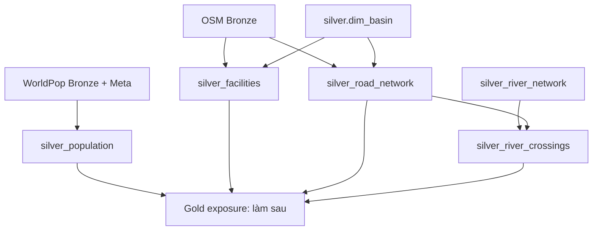

# Thiết kế tách các pipeline Exposure ở Silver

**Ngày:** 08/11/2026. **Trạng thái:** thiết kế cho đợt triển khai tiếp theo, chưa có bốn DAG trong code.
Thiết kế này thay phần Exposure gom chung trong các tài liệu ngày 30/09/2026.

## 1. Phạm vi và quyết định

Tách thành bốn DAG manual độc lập: `silver_facilities`, `silver_population`,
`silver_road_network`, `silver_river_crossings`. Mỗi DAG có config, package domain,
entrypoint Spark, DQ và Meta audit riêng. Các pipeline trao đổi qua bảng Iceberg và
snapshot đã được nghiệm thu; không import transform nội bộ của nhau.

Chỉ lập kế hoạch trong đợt cập nhật này. Không tạo DAG giả, đổi schema vật lý,
rebuild container, chạy migration hay sửa code Static Feature của teammate.

## 2. Dependency và quyền sở hữu bảng

| DAG | Input bắt buộc | Output sở hữu |
| --- | --- | --- |
| `silver_facilities` | OSM Bronze, `silver.dim_basin`, exposure AOI | `silver.dim_facility`, `silver.facility_basin` |
| `silver_population` | WorldPop qua `bronze.raster_coverage` và Meta, exposure AOI | `silver.population_grid`; bổ sung cell WorldPop vào `silver.source_grid` |
| `silver_road_network` | OSM Bronze, `silver.dim_basin`, exposure AOI | `silver.dim_road_node`, `silver.dim_road_edge`, `silver.road_basin` |
| `silver_river_crossings` | Bộ output Road Network hoàn tất và River Network hoàn tất | `silver.river_crossing` |

Population tạo cell theo AOI, không gán basin trong DAG này nên không bắt buộc
`dim_basin`. Nếu AOI được xây từ basin, hash artifact AOI đã được dựng trước là
dependency của build. Tổng hợp dân số theo basin cho exposure thuộc Gold. Kernel
population cũ của Static Feature không được dùng để ghi `population_grid` từ DAG khác.

Facilities chưa cần River Network: `distance_to_stream_m` và `distance_to_outlet_m`
để null nếu input tương ứng không được pin và phương pháp chưa được cấu hình.
Không điền 0 hoặc tự lấy snapshot river mới nhất trong lúc đang transform.

## 3. Contract dùng chung và phạm vi không gian

- Dùng Spark/Sedona, Iceberg/Polaris/MinIO và `shared/spark/` đang có. Airflow chỉ
  plan, submit/monitor và audit; không mang raster/DataFrame/row list qua XCom.
- Geometry chuẩn lưu EPSG:4326; diện tích overlay dùng EPSG:6933, chiều dài và
  khoảng cách Sơn La dùng CRS mét cấu hình rõ ràng (mặc định EPSG:32648).
- Mặc định facilities/road/population chọn `exposure_aoi.geoparquet`; hash AOI,
  scope, config, policy, algorithm và các input snapshot thuộc build signature.
- Đọc subset từ Bronze quốc gia; không yêu cầu tải lại Raw. Chọn toàn feature có
  giao AOI, giữ geometry nguồn của road/facility; quan hệ basin mới tính phần giao.
- Một pipeline chỉ chọn revision authoritative theo metadata thứ tự công bố/ingest
  đã chốt; không sort checksum, object ID hoặc snapshot ID để suy revision mới nhất.
  Nếu không phân giải được hai revision ngang quyền thì block build.
- Khi input/config không đổi: skip. Khi đổi: phiên bản đầu rebuild domain trong
  AOI đã chọn. Chưa tuyên bố có dirty-cell/dirty-road incremental chi tiết.
- Trạng thái `succeeded` chỉ ghi sau đủ output, DQ và lineage. Bảng Iceberg commit
  riêng lẻ; downstream phải pin snapshot từ bundle Meta hoàn tất, tránh trộn version.
- Mỗi bảng một writer. Riêng `silver.source_grid` là bảng dùng chung với weather:
  serialize population và weather qua cùng cơ chế writer; không tạo grid registry mới.

## 4. Code dùng chung được bổ sung có giới hạn

| File | Phạm vi | Caller |
| --- | --- | --- |
| `shared/spatial_grid.py` (mới) | Chỉ tách các primitive thuần `GridDefinition`, cell index/ID và geometry hiện có; hỗ trợ affine của WorldPop | Population; weather re-export primitive để giữ import cũ |
| `shared/spark/` (đã có) | Snapshot, staging, publish, quality, audit, submit | Cả bốn pipeline |
| `storage/iceberg_schemas.py` và `config/shared/metadata.yaml` | Contract/registry vật lý của từng bảng, chỉ domain owner bổ sung bảng mình sở hữu | Factory runtime |

Không chuyển Python writer/`ensure_grid` của weather vào common để dùng ghi Silver
population. Spark là writer của cell population. Mọi điều chỉnh writer weather
để serialize `source_grid` phải có regression test và rollout khi không có run
đang ghi bảng đó. Việc tách primitive không được đổi ID, alignment hay checksum weather.

## 5. Các điểm contract cần giải quyết khi triển khai

### Population có revision dữ liệu riêng

`source_grid_version` mô tả hình học/alignment, không phải checksum raster giá trị.
Hai bản WorldPop cùng năm có thể cùng grid nhưng khác population. Thêm
`population_version` vào khóa `population_grid`, hash từ tập object/checksum,
semantics, scope và processing policy. Sửa schema + registry + contract test trước
publish đầu tiên. Đây là thay đổi contract dự kiến, chưa áp dụng vào Iceberg.
Nếu bảng đã có dữ liệu ở branch khác, phải migration có kiểm soát và đối chiếu
snapshot; không tự drop bảng. Nhóm tuổi không có nguồn giữ null.
Grid alignment và global index phải lấy từ định nghĩa provider hoặc metadata
parent raster/offset còn lưu trong manifest. Nếu Raw đã crop mà không còn đủ
thông tin khôi phục alignment toàn cục, block registration để bổ sung metadata;
không gán cell ID theo origin của từng crop.

### Road topology không suy ra từ mọi giao hình học

Bronze hiện có geometry và tags, chưa có sequence OSM node reference cho từng way.
Bản đầu xây graph suy từ endpoint/shared vertex với tolerance và version rõ ràng;
không tạo junction chỉ vì hai line cắt nhau. Không gán `osm_node_id` suy đoán.
Bridge/tunnel/layer khác nhau không tự nối. T-junction không đủ bằng chứng hoặc
layer mâu thuẫn được ghi DQ, không tự snap xa để tạo đường đi.

Graph này không được quảng bá là đồ thị OSM đầy đủ hoặc đủ điều kiện sơ tán.
OSM Bronze đang lọc nhóm giao thông quan trọng, nên đường local có thể thiếu.
Trước Gold routing phải có gate riêng về coverage/connectivity và, nếu cần,
bổ sung node references/road classes ở Bronze bằng plan riêng.

Road edge cần giữ `ford` (boolean nullable) và `osm_layer` (string nullable) cùng
`bridge`/`tunnel` để Crossing đọc được evidence mà không import Road service.
Đây cũng là thay đổi contract dự kiến, không sửa schema vật lý trong đợt lập plan.

### Crossing là quan hệ hình học có evidence, chưa phải hazard

Crossing được tạo từ cặp road edge–river reach và vị trí giao được chuẩn hóa.
`crossing_id` bao gồm hai version, algorithm version và dấu vân tay vị trí;
hai giao điểm trên cùng cặp phải ra hai ID, không phụ thuộc thứ tự iterator.
Bridge/ford có tag tương ứng mới phân loại; chỉ giao geometry thì `unknown`.
Tunnel hoặc giao line chồng dài không tự trở thành bridge. Không suy deck height,
ngập, khả năng đi qua hay travel disruption từ geometry. Height chỉ giữ khi có
nguồn và datum rõ ràng.

## 6. DQ, recovery và hiệu năng

- Fatal: CRS không xác định, bundle input không nhất quán, conflict business key,
  schema sai → không công bố bundle output hoàn tất.
- Reject: geometry rỗng/sai không sửa được, giá trị population âm/không hữu hạn,
  edge mất endpoint → quarantine theo source key, các dòng hợp lệ vẫn được ghi.
- Warning: thiếu capacity/speed/nhóm tuổi, graph không đủ coverage, crossing unknown.
  Không bịa giá trị để vượt DQ. Run không có row hợp lệ phải có kết quả no-data
  rõ ràng; không đánh dấu thành công bằng cách dùng snapshot output cũ.
- Batch theo raster window hoặc spatial bucket khi cần; không task/cell, task/road
  hay commit/feature. Dùng spatial index/bbox pruning trước exact intersection.
- Phân biệt staging manifest và manifest publish hoàn tất. Chỉ manifest publish
  sau commit mới là bằng chứng bỏ qua output. Retry sau partial commit repair theo
  build/version, không append lại; artifact kiểm chứng giữ tới khi Meta finalize.
- Target reads giới hạn version/scope hoặc business-key batch khi an toàn; không
  đọc toàn bảng rồi lọc Python. Ghi timing read/transform/DQ/publish/audit trong log.
- Test bằng bảng tạm; không restart job weather đang chạy để thử plan này.

## 7. Plan triển khai

- [Facilities](../plans/2026-11-08-silver-facilities.vi.md)
- [Population](../plans/2026-11-08-silver-population.vi.md)
- [Road Network](../plans/2026-11-08-silver-road-network.vi.md)
- [River Crossings](../plans/2026-11-08-silver-river-crossings.vi.md)
- [Thứ tự hoàn thiện Silver](../plans/2026-11-08-silver-remaining-pipelines.vi.md)
