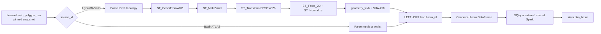

# Silver basin topology

Package này sở hữu pipeline chuẩn hóa lưu vực HydroBASINS level 12 từ Bronze sang
`silver.dim_basin`, sau đó sẽ dựng quan hệ downstream trong `silver.basin_edge`.

## Trạng thái hiện tại

Đã hoàn thiện:

- config và field allowlist của HydroBASINS/BasinATLAS;
- model của basin, edge và topology report;
- normalization bằng Spark/Sedona;
- unit test cho normalization;
- smoke test normalization với Spark/Sedona thật.

Chưa triển khai:

- revision selection hoàn chỉnh;
- thuật toán dựng `basin_edge` và kiểm tra cycle;
- domain `spark_job.py` ghép snapshot, DQ, publish và audit;
- DAG Airflow `silver_basin_topology`;
- lần publish production đầu tiên vào hai bảng Silver.

Vì vậy `normalize.py` hiện đã dùng được như một transform Spark, nhưng package chưa phải
một pipeline Airflow Bronze → Silver hoàn chỉnh.

## Nguồn và quyền sở hữu thuộc tính

Cả hai nguồn nằm trong cùng bảng `bronze.basin_polygon_raw` và phải được đọc từ cùng
một pinned Iceberg snapshot.

| Nguồn | Vai trò |
| --- | --- |
| HydroBASINS `hydrobasins_v1c` | Nguồn chính của polygon, CRS, basin ID và topology. |
| BasinATLAS `basinatlas_v10` | Chỉ bổ sung các metric allowlist theo `HYBAS_ID`. |

HydroBASINS quyết định `geometry_wkb`, `NEXT_DOWN`, `MAIN_BAS`, `PFAF_ID`, `SORT` và
`NEXT_SINK`. BasinATLAS cung cấp `SUB_AREA`, `UP_AREA`, `DIST_MAIN` và `DIST_SINK`.
Geometry hoặc topology từ BasinATLAS không được dùng để thay HydroBASINS.

Mapping chính thức nằm tại `config/pipelines/silver/basin_topology.yaml`:

| Field Silver | Field nguồn |
| --- | --- |
| `basin_id` | `HYBAS_ID` |
| `next_down_id` | `NEXT_DOWN` |
| `main_basin_id` | `MAIN_BAS` |
| `pfaf_id` | `PFAF_ID` |
| `topology_sort_hint` | `SORT` |
| `basin_area_km2` | `SUB_AREA` |
| `upstream_area_km2` | `UP_AREA` |
| `distance_to_main_sink_km` | `DIST_MAIN` |
| `next_sink_id` | `NEXT_SINK` |
| `distance_to_sink_km` | `DIST_SINK` |

Config chỉ chấp nhận đúng allowlist này để việc thêm một field BasinATLAS vào Bronze
không tự động làm schema Silver thay đổi.

## Luồng normalize hiện tại



Các bước hình học trong `normalize.py`:

1. Đọc WKB bằng `ST_GeomFromWKB`.
2. Sửa geometry bằng `ST_MakeValid`.
3. Nếu CRS nguồn khác đích, chuyển sang `EPSG:4326` bằng `ST_Transform`.
4. Bỏ chiều Z/M bằng `ST_Force_2D`.
5. Chuẩn hóa thứ tự biểu diễn bằng `ST_Normalize`.
6. Chuyển lại WKB và tính `geometry_hash = SHA-256(geometry_wkb)`.

Toàn bộ chuỗi trên là lazy DataFrame plan. Hàm không lặp row bằng Python, không gọi
Shapely/PyProj cho từng basin và không `collect()` dữ liệu về driver.

## Vì sao dùng LEFT JOIN BasinATLAS

HydroBASINS là tập basin có thẩm quyền, nên normalize giữ mọi basin HydroBASINS bằng
`LEFT JOIN`. Basin thiếu record tương ứng trong BasinATLAS sẽ có metric null. DQ rule
`basin_atlas_joinable` chịu trách nhiệm reject row đó vào quarantine. Nếu dùng inner join,
basin lỗi sẽ biến mất trước khi framework có thể ghi nhận nguyên nhân.

## Output của normalize

`normalize_basins()` trả một Spark DataFrame với các cột của `silver.dim_basin`:

| Cột | Ý nghĩa |
| --- | --- |
| `basin_id` | ID HydroBASINS, giữ dạng chuỗi. |
| `basin_version` | Version bất biến của lần xây basin dimension. |
| `hydrobasins_level` | Luôn bằng `12`. |
| `geometry_wkb` | Polygon canonical trong `EPSG:4326`. |
| `crs` | CRS chuẩn, hiện là `EPSG:4326`. |
| `geometry_hash` | SHA-256 của canonical WKB. |
| `next_down_id`, `main_basin_id`, `pfaf_id` | Định danh topology từ HydroBASINS. |
| `topology_sort_hint` | Giá trị `SORT` dùng để QA, không thay topological sort tự tính. |
| `basin_area_km2`, `upstream_area_km2` | Diện tích local và tổng upstream từ BasinATLAS. |
| `distance_to_main_sink_km`, `distance_to_sink_km` | Khoảng cách đến outlet/sink. |
| `next_sink_id` | Sink tiếp theo từ HydroBASINS. |
| `valid_from`, `valid_to` | Khoảng hiệu lực của basin version. |
| `source_object_id` | Object HydroBASINS tạo ra row và dùng cho lineage. |

Các ID tùy chọn có source sentinel `0` hoặc chuỗi rỗng được đổi thành null. Giá trị số
không hợp lệ hoặc metric Atlas thiếu được giữ ở dạng null để DQ quyết định disposition.

## Vai trò từng file

| File | Trách nhiệm |
| --- | --- |
| `config.py` | Validate contract L12, source authority, output table, version và field allowlist. |
| `models.py` | Model bất biến cho `BasinRow`, `BasinEdgeRow` và `TopologyReport`. |
| `normalize.py` | Compile biểu thức Spark SQL và tạo lazy canonical basin DataFrame. |
| `reader.py` | Reader PyIceberg pinned-snapshot đã có từ giai đoạn trước; phù hợp cho decode/debug nhỏ, không phải đường đọc distributed chính của Spark job sắp tới. |

Spark job production sẽ dùng `shared.spark.SparkSnapshotManager.read()` để đọc
`bronze.basin_polygon_raw` trực tiếp thành Spark DataFrame, rồi truyền DataFrame đó vào
`normalize_basins()`.

## Cách gọi normalize

```python
from datetime import datetime, timezone
from pathlib import Path

from flashflood_data.pipelines.silver_basin.config import load_basin_topology_config
from flashflood_data.pipelines.silver_basin.normalize import normalize_basins

config = load_basin_topology_config(
    Path("config/pipelines/silver/basin_topology.yaml")
)
canonical = normalize_basins(
    bronze_frame,
    config,
    basin_version="basin-v1-<build-signature>",
    valid_from=datetime.now(timezone.utc),
)
```

Hàm này không publish. Domain `spark_job.py` phải tiếp tục áp dụng DQ, publish bằng
`SparkTablePublisher` và finalize bằng `SparkAudit`.

## DQ dự kiến

Policy nằm tại `config/quality/silver_basin_topology.yaml`:

- fatal: business key trùng, geometry không hợp lệ, diện tích không dương, graph có cycle
  hoặc thiếu internal downstream target;
- reject: thiếu source ID hoặc không join được BasinATLAS;
- warning: geometry phải sửa, diện tích lệch, `SORT` không nhất quán hoặc thiếu sink metadata.

Rule YAML hiện là contract. Phần compile predicate cụ thể của domain sẽ được bổ sung cùng
`spark_job.py` và topology builder.

## Kiểm tra

```bash
.venv/bin/pytest -q tests/unit/pipelines/silver_basin/test_normalize.py
.venv/bin/ruff check \
  src/flashflood_data/pipelines/silver_basin \
  tests/unit/pipelines/silver_basin

make spark-up
make spark-smoke
make spark-down
```

`make spark-smoke` chạy `normalize_basins()` và DQ thật trên Spark/Sedona, sau đó dùng
shared publisher ghi và đọc bảng Iceberg tạm qua Polaris/MinIO.
