# Silver basin topology

Package này sở hữu pipeline chuẩn hóa lưu vực HydroBASINS level 12 từ Bronze sang
`silver.dim_basin` và dựng quan hệ downstream cho `silver.basin_edge`.

## Trạng thái hiện tại

Pipeline Bronze → Silver đã hoàn thiện ở mức code và smoke integration:

- chọn revision HydroBASINS/BasinATLAS mới nhất đã có trong cùng pinned Bronze snapshot;
- chọn các basin có phần trong nằm trong `hydrological_aoi.geoparquet` của Sơn La;
- tạo build signature ổn định và quyết định `build`, `repair` hoặc `skip`;
- normalize bằng Spark/Sedona, dựng edge và chạy Kahn cycle diagnostics;
- áp dụng fatal/reject/warning DQ, ghi row reject vào `quarantine.rejected_rows`;
- MERGE idempotent vào `silver.dim_basin` và `silver.basin_edge`;
- ghi pipeline run, quality result, input/output snapshot và lineage từ cả Bronze snapshot lẫn
  hai Raw object nguồn;
- Airflow submit application qua service `spark-submit-gateway`; Spark driver không chạy trong
  scheduler và log process được giới hạn bộ nhớ;
- smoke thật đã chạy normalize → DQ → topology → MERGE Iceberg qua Polaris/MinIO thành công.

DAG được tạo ở trạng thái pause; các lần chạy mới chỉ bắt đầu khi người vận hành
trigger. Sau khi sửa AOI, cần build lại image Airflow trước lần trigger kế tiếp
vì image cài package Python tại thời điểm build.

## Nguồn và quyền sở hữu thuộc tính

Cả hai nguồn nằm trong cùng bảng `bronze.basin_polygon_raw` và phải được đọc từ cùng
một pinned Iceberg snapshot. Bronze chứa subset Việt Nam rộng hơn; Silver chỉ nhận
các basin thuộc AOI thủy văn Sơn La L12 và một bước thượng nguồn. Runtime đọc AOI
và HydroBASINS L12 local để lập danh sách ID, đưa checksum AOI và danh sách ID vào
build identity, rồi truyền danh sách ID cho Spark. Spark kiểm tra mọi ID đó có trong
revision Bronze đã pin trước khi publish. Một polygon chỉ chạm ranh AOI không được chọn.

| Nguồn | Vai trò |
| --- | --- |
| HydroBASINS `hydrobasins_v1c` | Nguồn chính của polygon, CRS, basin ID và topology. |
| BasinATLAS `basinatlas_v10` | Chỉ bổ sung các metric allowlist theo `HYBAS_ID`. |

HydroBASINS quyết định `geometry_wkb`, `NEXT_DOWN`, `MAIN_BAS`, `PFAF_ID`, `SORT`,
`ORDER`, `COAST`, `ENDO` và `NEXT_SINK`. BasinATLAS cung cấp `SUB_AREA`, `UP_AREA`,
`DIST_MAIN` và `DIST_SINK`.
Geometry hoặc topology từ BasinATLAS không được dùng để thay HydroBASINS.

Mapping chính thức nằm tại `config/pipelines/silver/basin_topology.yaml`:

| Field Silver | Field nguồn |
| --- | --- |
| `basin_id` | `HYBAS_ID` |
| `next_down_id` | `NEXT_DOWN` |
| `main_basin_id` | `MAIN_BAS` |
| `pfaf_id` | `PFAF_ID` |
| `topology_sort_hint` | `SORT` |
| `hydro_order` | `ORDER` |
| `is_coastal` | `COAST` |
| `is_endorheic` | `ENDO` |
| `basin_area_km2` | `SUB_AREA` |
| `upstream_area_km2` | `UP_AREA` |
| `distance_to_main_sink_km` | `DIST_MAIN` |
| `next_sink_id` | `NEXT_SINK` |
| `distance_to_sink_km` | `DIST_SINK` |

Config chỉ chấp nhận đúng allowlist này để việc thêm một field BasinATLAS vào Bronze
không tự động làm schema Silver thay đổi.

## Luồng normalize hiện tại

```mermaid
flowchart LR
    A[bronze.basin_polygon_raw\npinned snapshot] --> B{source_id}
    B -->|HydroBASINS| C[Parse ID và topology]
    B -->|BasinATLAS| D[Parse metric allowlist]
    C --> E[ST_GeomFromWKB]
    E --> F[ST_MakeValid]
    F --> G[ST_Transform EPSG:4326]
    G --> H[ST_Force_2D + ST_Normalize]
    H --> I[geometry_wkb + SHA-256]
    I --> J[LEFT JOIN theo basin_id]
    D --> J
    J --> K[Canonical basin DataFrame]
    K --> L[Phân loại downstream edge]
    L --> M[Kahn sort + cycle diagnostics]
    M --> N[DQ/quarantine ở shared Spark]
    N --> O[silver.dim_basin + silver.basin_edge]
```



Các bước hình học trong `normalize.py`:

1. Đọc WKB bằng `ST_GeomFromWKB`.
2. Sửa geometry bằng `ST_MakeValid`.
3. Nếu CRS nguồn khác đích, chuyển sang `EPSG:4326` bằng `ST_Transform`.
4. Bỏ chiều Z/M bằng `ST_Force_2D`.
5. Chuẩn hóa thứ tự biểu diễn bằng `ST_Normalize`.
6. Chuyển lại WKB và tính `geometry_hash = SHA-256(geometry_wkb)`.

Toàn bộ chuỗi trên là lazy DataFrame plan. Hàm không lặp row bằng Python, không gọi
Shapely/PyProj cho từng basin và không `collect()` dữ liệu về driver.

`topology.py` tạo edge bằng lazy Spark plan. Nó đọc từng partition của hai cột
`basin_id` và `next_down_id` để chạy Kahn sort trên driver; rank được đưa về Spark dưới
dạng DataFrame hai cột rồi join
theo basin ID. Cách này giữ câu SQL có kích thước cố định khi số basin tăng, thay cho
biểu thức `CASE` một nhánh cho mỗi basin. Task lập plan đọc Bronze theo Arrow batch và
chỉ giữ cặp `(source_id, object_id)` duy nhất trong bộ nhớ Python.

Kahn vẫn giữ ID và quan hệ downstream của các basin được chọn trên driver. Ngoài ra,
DQ và Iceberg publisher thực hiện nhiều Spark action trên các DataFrame lazy; nếu lần
chạy thực tế cho thấy normalize hoặc edge join bị tính lại quá tốn thời gian, bước tối ưu
tiếp theo là materialize có kiểm soát rồi giải phóng cache sau publish. Smoke test hiện
chỉ kiểm tra tính đúng trên mẫu nhỏ, chưa đo thời gian cho toàn bộ Bronze.

## Vì sao dùng LEFT JOIN BasinATLAS

HydroBASINS là tập basin có thẩm quyền, nên normalize giữ mọi basin HydroBASINS bằng
`LEFT JOIN`. Basin thiếu record tương ứng trong BasinATLAS sẽ có metric null. DQ rule
`basin_atlas_joinable` chịu trách nhiệm reject row đó vào quarantine. Nếu dùng inner join,
basin lỗi sẽ biến mất trước khi framework có thể ghi nhận nguyên nhân.

## Output của normalize

`normalize_basins()` trả một Spark DataFrame với các cột của `silver.dim_basin`:

| Cột | Ý nghĩa |
| --- | --- |
| `basin_id` | ID HydroBASINS, giữ dạng chuỗi. |
| `basin_version` | Version bất biến của lần xây basin dimension. |
| `hydrobasins_level` | Luôn bằng `12`. |
| `geometry_wkb` | Polygon canonical trong `EPSG:4326`. |
| `bbox_wgs84` | Bounding box `[min_lon, min_lat, max_lon, max_lat]` tính lại từ geometry canonical. |
| `crs` | CRS chuẩn, hiện là `EPSG:4326`. |
| `geometry_hash` | SHA-256 của canonical WKB. |
| `next_down_id`, `main_basin_id`, `pfaf_id` | Định danh topology từ HydroBASINS. |
| `topology_sort_hint` | Giá trị `SORT` dùng để QA, không thay topological sort tự tính. |
| `hydro_order` | `ORDER` gốc của HydroBASINS, dùng đối chiếu cấu trúc mạng. |
| `is_coastal`, `is_endorheic` | Cờ `COAST`/`ENDO` để phân loại basin terminal. |
| `basin_area_km2`, `upstream_area_km2` | Diện tích local và tổng upstream từ BasinATLAS. |
| `distance_to_main_sink_km`, `distance_to_sink_km` | Khoảng cách đến outlet/sink. |
| `next_sink_id` | Sink tiếp theo từ HydroBASINS. |
| `valid_from`, `valid_to` | Khoảng hiệu lực của basin version. |
| `hydrobasins_object_id`, `basinatlas_object_id` | Hai object nguồn góp vào row, dùng cho lineage. |
| `quality_status` | `pending` trong transform; DQ phải đổi thành `passed` hoặc `warning` trước publish. |

Các ID tùy chọn có source sentinel `0` hoặc chuỗi rỗng được đổi thành null. Giá trị số
không hợp lệ hoặc metric Atlas thiếu được giữ ở dạng null để DQ quyết định disposition.

`build_basin_topology()` tạo thêm `basin_edge_id` ổn định, giữ `source_downstream_id`
ngay cả khi downstream nằm ngoài AOI, gán `topological_rank_upstream_first` cho routing và
phân loại `terminal_type`. Ba metric chiều dài/chênh cao/slope không nằm ở edge vì hiện chưa
có producer tính đúng theo cặp basin; các metric thủy văn tương ứng được xây ở static feature
hoặc river network theo đúng grain của chúng.

## Vai trò từng file

| File | Trách nhiệm |
| --- | --- |
| `config.py` | Validate contract L12, source authority, output table, version và field allowlist. |
| `models.py` | Model bất biến cho `BasinRow`, `BasinEdgeRow` và `TopologyReport`. |
| `normalize.py` | Compile biểu thức Spark SQL và tạo lazy canonical basin DataFrame. |
| `topology.py` | Tạo lazy edge DataFrame, phân loại `internal/exits_AOI/terminal` và chạy Kahn diagnostics. |
| `quality.py` | Compile toàn bộ rule YAML thành predicate Spark và tạo frame đúng schema publish. |
| `planner.py` | Chọn revision nằm trong Bronze, tạo build signature và quyết định build/repair/skip. |
| `scope.py` | Chọn ID basin Sơn La từ AOI thủy văn và tính checksum AOI. |
| `spark_job.py` | Đọc snapshot cố định, transform, DQ/quarantine, MERGE Iceberg và ghi result manifest. |
| `runtime.py` | Chạy ở Airflow: đăng ký dataset, pin snapshot, submit gateway và finalize Meta audit. |
| `airflow.py` | Khai báo hai task nhỏ `plan_basin_build` → `execute_basin_plan`. |
| `reader.py` | Reader PyIceberg cho decode/debug nhỏ; đường production đọc phân tán bằng Spark. |

Spark job production đọc trực tiếp `bronze.basin_polygon_raw` với `versionAsOf` (snapshot ID đã được
planner pin), sau đó lọc đúng hai `object_id` revision và các ID thuộc AOI Sơn La
trước khi gọi `normalize_basins()`.

## Cách gọi normalize

```python
from datetime import datetime, timezone
from pathlib import Path

from flashflood_data.pipelines.silver_basin.config import load_basin_topology_config
from flashflood_data.pipelines.silver_basin.normalize import normalize_basins

config = load_basin_topology_config(
    Path("config/pipelines/silver/basin_topology.yaml")
)
canonical = normalize_basins(
    bronze_frame,
    config,
    basin_version="basin-v1-<build-signature>",
    valid_from=datetime.now(timezone.utc),
)
```

Hàm normalize không tự publish. `spark_job.py` gọi DQ và `SparkTablePublisher`; `runtime.py` chỉ
đánh dấu Meta success sau khi kiểm tra result manifest và đủ output snapshot.

## DQ hiện dùng

Policy nằm tại `config/quality/silver_basin_topology.yaml`:

- fatal: business key trùng, geometry không hợp lệ, diện tích không dương, graph có cycle
  hoặc thiếu internal downstream target;
- reject: thiếu source ID hoặc không join được BasinATLAS;
- warning: geometry phải sửa, diện tích lệch, `SORT` không nhất quán hoặc thiếu sink metadata.

`quality.py` bắt buộc policy chứa đúng toàn bộ rule đã duyệt. Fatal chặn cả build; reject chỉ loại
row lỗi và ghi quarantine; warning vẫn publish với `quality_status=warning`.

## Chạy DAG

Base lakehouse và Spark gateway phải cùng hoạt động:

```bash
make lakehouse-up
make spark-up
docker compose exec -T airflow-api-server airflow dags unpause silver_basin_topology
docker compose exec -T airflow-api-server airflow dags trigger silver_basin_topology
```

Run đầu tạo hai bảng Silver. Trigger lại với cùng Bronze snapshot/config/policy sẽ trả `skip`.
Nếu run trước chỉ publish một bảng, planner trả `repair` và Spark chỉ ghi output còn thiếu.

## Kiểm tra

```bash
.venv/bin/pytest -q tests/unit/pipelines/silver_basin
.venv/bin/ruff check \
  src/flashflood_data/pipelines/silver_basin \
  tests/unit/pipelines/silver_basin

make spark-up
make spark-smoke
make spark-down
```

`make spark-smoke` chạy normalize, policy DQ, topology và shared publisher trên Spark/Sedona thật,
ghi cả `dim_basin` và `basin_edge` vào namespace Iceberg tạm rồi dọn namespace.
