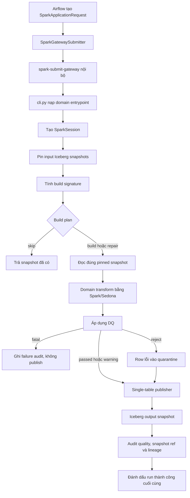

# Shared Spark foundation

Package này cung cấp lifecycle dùng chung cho các pipeline Bronze → Silver chạy bằng
Spark, Sedona và Iceberg. Code ở đây không chứa quy tắc riêng của basin, thời tiết,
sông hay sự kiện lũ. Mỗi domain chỉ bổ sung cách transform dữ liệu và bộ quy tắc DQ
của chính nó.

## Trạng thái hiện tại

Đã có:

- contract giữa Airflow và Spark;
- cấu hình Spark/Sedona/Iceberg dùng Polaris và MinIO;
- pin snapshot Bronze và đọc đúng snapshot đã chọn;
- build signature, quyết định `build`, `repair` hoặc `skip`;
- staging bất biến theo run/batch;
- DQ dạng `fatal`, `reject`, `warning` và `info`;
- publish Iceberg theo `append`, `merge` hoặc overwrite có giới hạn;
- chống tạo snapshot thừa khi `MERGE` lại cùng dữ liệu;
- audit Meta cho run, quality, snapshot reference và lineage;
- dependency factory dùng chung cho Spark domain job;
- gateway nội bộ chạy `spark-submit` ngoài Airflow scheduler, có timeout và log tail giới hạn;
- domain đầu tiên `silver_basin_topology` đã dùng foundation này và pass integration smoke.

Chưa có ở phạm vi dùng chung:

- revision policy tổng quát cho weather, raster, river và flood event;
- các domain Silver còn lại ngoài basin topology.

## Luồng xử lý



Success chỉ được ghi sau khi output snapshot, quality result và lineage đều đã được
ghi bền vững. Nếu run dừng sau khi một số bảng đã publish, lần chạy sau nhận action
`repair` và chỉ hoàn thiện output còn thiếu.

## Vai trò từng file

| File | Trách nhiệm |
| --- | --- |
| `models.py` | DTO tuần tự hóa qua ranh giới Airflow/Spark: runtime config, pinned snapshot, request, result, staging và published snapshot. |
| `session.py` | Tạo một `SparkSession` thống nhất với Iceberg REST catalog, Polaris, MinIO, Sedona, UTC, ANSI và AQE. |
| `submit.py` | Tạo lệnh `spark-submit`, gọi gateway, giới hạn timeout và rút kết quả nhỏ từ marker stdout. Không truyền DataFrame qua Airflow. |
| `cli.py` | Entry point chung của `spark-submit`; validate request, import module domain và gọi hàm `run(request)`. |
| `snapshots.py` | Pin snapshot đầu vào, đọc snapshot cố định, tính build signature và lập plan `build/repair/skip`. |
| `staging.py` | Quản lý Parquet/manifest/_SUCCESS bất biến theo run và batch cho các job Python chuyên biệt. |
| `quality.py` | Compile rule Spark SQL, đếm finding trong một aggregate action, tách accepted/rejected và dựng row quarantine. |
| `publish.py` | Validate schema/business key và sở hữu tối đa một commit cho một bảng Iceberg. |
| `audit.py` | Ghi trạng thái run, quality, input/output snapshot reference và lineage từ snapshot/Raw object vào Meta. |
| `runtime.py` | Ghép snapshot manager, staging, audit và publisher thành dependency graph dùng chung. |
| `__init__.py` | Public API lazy-import để import model không buộc môi trường Airflow phải khởi tạo PySpark. |
| `spark/jobs/submit_gateway.py` | HTTP service nội bộ tuần tự hóa `spark-submit`, giữ log dài trên file tạm và trả result DTO. |

## Identity và incremental build

`BuildSignature` là SHA-256 của JSON canonical gồm:

- danh sách input table và snapshot ID đã sắp xếp;
- `config_hash`;
- `policy_id`;
- `algorithm_version`;
- `contract_version`.

Cùng các giá trị trên sẽ tạo cùng signature:

| Trạng thái Meta | Action |
| --- | --- |
| Chưa có output cho signature | `build` |
| Đã có một phần output | `repair` |
| Đã đủ mọi output bắt buộc | `skip` |

Snapshot được pin trước khi transform. Dữ liệu Bronze được commit trong lúc job đang
chạy không tự lọt vào build hiện tại; nó chỉ xuất hiện trong build kế tiếp.

## Staging

Staging dành cho kết quả trung gian do Python/Rasterio hoặc NLP tạo ra để Spark đọc
và publish. Mapped worker chỉ ghi file; nó không được commit bảng Silver.

```text
s3://staging/silver/<pipeline>/<pipeline_run_id>/<batch_id>/
├── data.parquet
├── lineage.parquet
├── quality.parquet
├── manifest.json
└── _SUCCESS
```

`manifest.json` giữ input snapshot, build signature, schema hash, row count và checksum.
Batch chỉ được xem là hoàn chỉnh khi có `_SUCCESS`. Retry với cùng batch và cùng manifest
được reuse; cùng identity nhưng nội dung khác sẽ phát sinh `StagingConflict`. Chỉ cleanup
staging sau khi Meta đã finalize run thành công.

## Data quality

`SparkQualityRule.predicate_sql` mô tả điều kiện một row **hợp lệ**. Framework đảo điều
kiện để đếm lỗi và xử lý theo severity:

| Severity | Hành vi |
| --- | --- |
| `fatal` | Chặn toàn bộ output của object/build. |
| `reject` | Tách row lỗi sang `quarantine.rejected_rows`; row hợp lệ vẫn tiếp tục. |
| `warning` | Vẫn publish và đánh dấu run/output là warning. |
| `info` | Ghi finding để quan sát, không chặn dữ liệu. |

`rejection_id` không chứa Airflow run ID. Nó được tạo xác định từ dataset, business key
và tập rule lỗi, nên retry không nhân bản cùng một rejection.

## Publish Iceberg

Mỗi instance `SparkTablePublisher` chỉ publish một lần và chỉ sở hữu một bảng vật lý.
Trước khi ghi, publisher kiểm tra:

- tên, kiểu dữ liệu và thứ tự cột khớp bảng đích; nullability được kiểm tra bằng dữ liệu thực;
- mọi cột bắt buộc của bảng đích không chứa null;
- DataFrame không rỗng;
- business key có mặt, không null và không trùng;
- identifier/filter không chứa SQL không an toàn.

Các mode:

- `append`: thêm key mới; từ chối nếu key cũ có nội dung khác;
- `merge`: insert row mới và update row thay đổi;
- `overwrite`: chỉ cho phép khi có bounded filter.

Với `merge`, publisher đếm row mới hoặc thay đổi trước. Nếu kết quả bằng `0`, nó không
gọi `MERGE INTO` và trả về snapshot hiện tại, tránh tạo snapshot Iceberg rỗng khi rerun.

## Cách một domain job sử dụng package

Domain entrypoint phải có hàm `run(request: SparkApplicationRequest)` và trả về
`SparkApplicationResult`. Skeleton dưới đây chỉ minh họa thứ tự gọi; tên bảng, rule và
transform thuộc package domain.

```python
config = load_spark_runtime_config(Path("config/spark/local.yaml"))
spark = build_spark_session(
    request.application_id,
    config=config,
    pipeline=request.pipeline,
    pipeline_run_id=request.pipeline_run_id,
    build_signature=request.build_signature,
)
dependencies = build_spark_dependencies(
    spark=spark,
    object_store=object_store,
    meta=meta_service,
    catalog_name=config.catalog_name,
)

source = dependencies.snapshots.read(spark, request.snapshots[0])
normalized = domain_transform(source)
quality = apply_quality_plan(normalized, quality_plan, ...)
published = dependencies.publisher("silver.output_table").publish(
    quality.accepted,
    key_fields=("business_id", "version"),
    mode="merge",
)
dependencies.audit.finalize_success(audit_request, (published,), quality_rows=...)
```

## Cấu hình và runtime

Compatibility matrix và resource local nằm ở `config/spark/local.yaml`. Runtime hiện tại:

| Thành phần | Phiên bản |
| --- | --- |
| Spark | 4.1.3 |
| Scala | 2.13 |
| Java | 17 |
| Iceberg | 1.11.0 |
| Sedona | 1.9.1 |
| GeoTools wrapper | 1.9.1-33.5 |

Session đọc endpoint và credential từ environment; secret không được ghi vào request,
manifest hoặc config YAML. Các biến bắt buộc là `POLARIS_URI`, `POLARIS_CATALOG`,
`POLARIS_CLIENT_ID`, `POLARIS_CLIENT_SECRET` và `MINIO_ENDPOINT`.

## Kiểm tra

```bash
.venv/bin/pytest -q tests/unit/shared/spark
.venv/bin/ruff check src/flashflood_data/shared/spark tests/unit/shared/spark

make spark-build
make spark-up
make spark-smoke
make spark-down
```

Smoke test thật kiểm tra Sedona, normalize basin, DQ, topology, publish hai frame Silver qua
Polaris/MinIO và MERGE idempotent. Nó dùng namespace tạm và tự xóa bảng sau khi hoàn tất.
